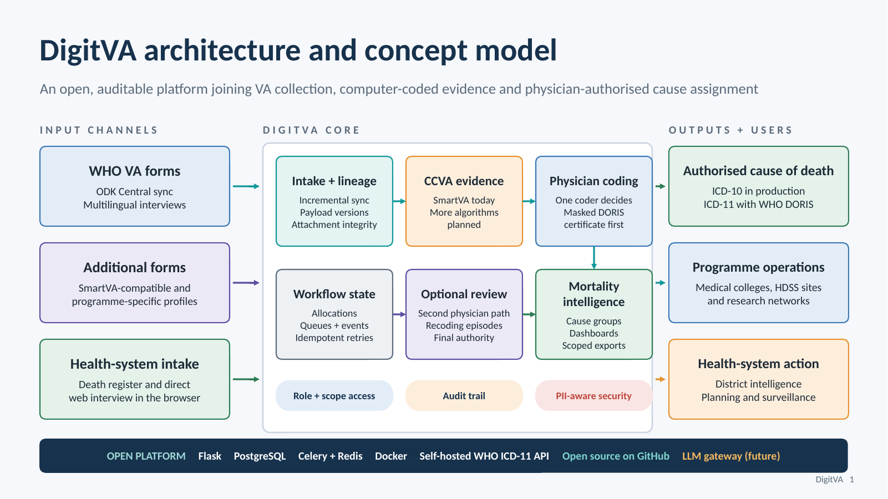
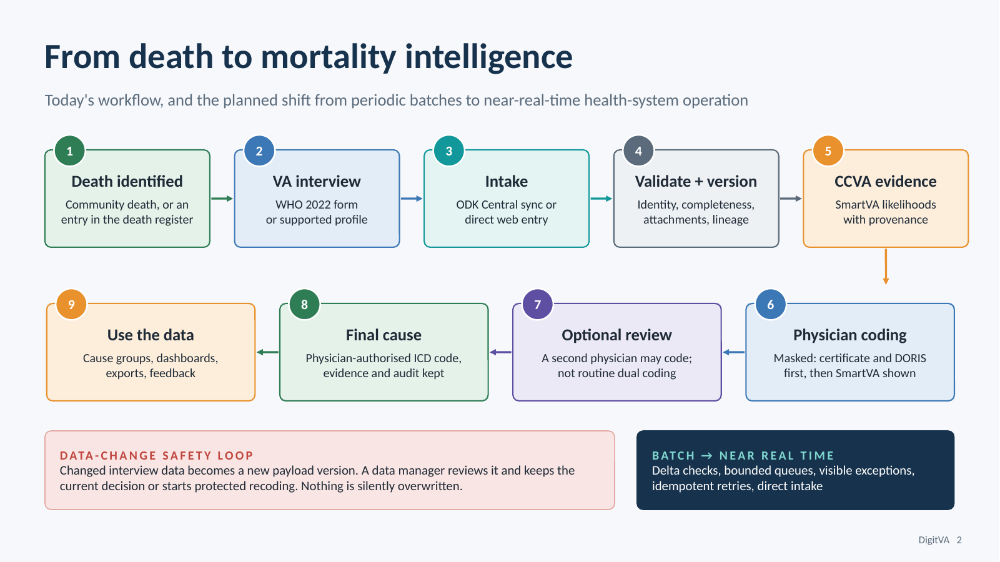
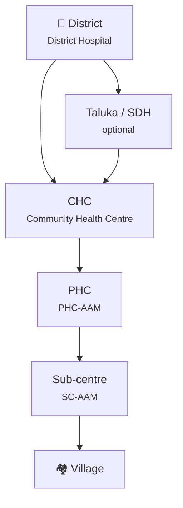

<div align="center">

# DigitVA

**Digital Verbal Autopsy: from a death in the community to a physician-authorised cause of death.**

An open, auditable platform that joins verbal autopsy (VA) collection, computer-coded evidence
and physician coding with ICD-10 and ICD-11.


[Features](#features) · [Components](#components) · [How it works](#how-it-works) · [Organisation](#organisation-units-and-workers) · [Getting started](#getting-started) · [Quick start](#quick-start) · [Documentation](#documentation) · [Changelog](CHANGELOG.md)

</div>

---



## Features

| | |
| --- | --- |
| 📥 **Intake from anywhere** | Incremental ODK Central sync, a death register, web interviews in the browser, and the offline **DigitVA Collect** Android app. |
| 🧾 **Lineage you can trust** | Every change to interview data becomes a new payload version. A data manager reviews it; nothing is silently overwritten. |
| 🤖 **Computer-coded evidence** | SmartVA (Tariff 2.0) runs in-process through a native Rust engine after sync; likelihoods are stored with their provenance. |
| 🩺 **Physician coding** | One coder decides. Masked mode shows the death certificate and DORIS first, SmartVA after. ICD-10 in production, ICD-11 with the self-hosted WHO ICD-11 API and DORIS. |
| 🔁 **Optional review** | A second physician may code a case, with recoding episodes and a single final authority. |
| 📊 **Mortality intelligence** | Cause groups, area and data-manager dashboards, and exports limited to each user's scope. |
| 🔐 **Secure by design** | Role- and scope-based grants, CSRF on every browser state change, encrypted PII, a full audit trail. |
| 🌐 **Multilingual** | English and Hindi UI, project-configured questionnaire languages, admin-reviewed machine translation drafts. |

## Components

DigitVA is a family of parts that ship together.

### 🖥️ DigitVA server · `app/`
The Flask web application: sync, workflow, coding and review screens, dashboards, admin and the
`/api/v1` JSON API. Server-rendered with HTMX; PostgreSQL holds workflow state, Celery runs sync and
SmartVA in the background.

### 📱 DigitVA Collect · [`mobile/digitva-collect/`](mobile/digitva-collect/README.md)
One Expo / React Native codebase, two builds:

- **Android app**: offline field collection. Enrolment, PIN sign-in, consent, death registration,
  WHO VA interviews, drafts, audio/photo/PDF attachments, stored encrypted on the device and synced when back online.
- **Web app**: served by the server at `/app/`. Role-based home, web interviews, coding and review
  workspaces, statistics and data-management screens.

English and Hindi UI; the interview language follows the questionnaire.

### 📝 WHO VA 2022 form engine · [`vendor/who-va-2022/`](vendor/who-va-2022/README.md)
An independent JavaScript implementation of the **2022 WHO VA instrument v1.1**, published as
`@drguptavivek/who-2022-va`. One checked-in JSON contract drives the Android app, the web app and
server-side submission validation, with no XLSForm parsing at runtime.

### ⚡ SmartVA in Rust · [`vendor/smartva-analyze/rust/`](https://github.com/drguptavivek/SmartVA-Analyze-rust)
`smartva-rs`, a **pure native Rust** implementation of IHME's
[SmartVA-Analyze](https://github.com/ihmeuw/SmartVA-Analyze) (Tariff 2.0), mirroring upstream
v3.0.1. It ships as a flag-compatible CLI, a Rust crate and a C-ABI shared library. DigitVA loads
`libsmartva_rust.so` in the Celery worker and calls it in-process, with no Python SmartVA
dependency. The Python engine remains available as a fallback (`SMARTVA_ENGINE`).
Prebuilt binaries: [SmartVA-Analyze-rust releases](https://github.com/drguptavivek/SmartVA-Analyze-rust/releases).

### 🩺 ICD-11 and DORIS · [`vendor/who-icd11-api/`](https://github.com/drguptavivek/who-icd11-api)
Cause of death is coded in **ICD-11** using the WHO ICD-11 API 2.6.0, the Embedded Coding Tool
and **DORIS** 1.2.0, the WHO rule engine that derives the underlying cause from a death
certificate. Everything is self-hosted. `who-icd11-api` is a Rust host that loads WHO's official
ICD-11 and DORIS assemblies in-process, with every artifact SHA-256 pinned. It rejects payloads
carrying personal identifiers before they reach WHO code. It runs as `icd_api_rust_service`; the
official `whoicd/icd-api` container is also supported.

In **masked DORIS** mode a coder writes the death certificate and sees the DORIS result before
SmartVA is revealed, so the computer-coded cause cannot anchor the physician.
See [DORIS COD workflow](docs/current-state/doris-cod-workflow.md).

### 🎓 Public DORIS training service · `public_doris_app.py`
A separate, database-free service for practising death-certificate coding with DORIS. It sits behind
the same ingress as the main app (compose profile `icd11`).

## How it works



## Organisation, units and workers

DigitVA supports two kinds of project:

- **Research networks**: the classic *Project → Site → Form* shape, with access granted per
  project or per site.
- **Public health systems**: the project opts into an **organisation tree** that follows the
  health system's own hierarchy, so that "the medical officer at this PHC codes this PHC's deaths"
  can be expressed directly.



- **Levels and units**: each project defines its levels (any level can be optional) and its units.
  A unit's path is a PostgreSQL `ltree`, so "everything under this CHC" is one indexed query.
  Units are deactivated, never deleted, and whole trees import from CSV or Excel.
- **Cadres**: workers carry their health-system cadre (CHO, ANM, MPW, ASHA, MO, SMO, BPM, DPM and
  others). A *level × cadre* grid decides which roles a cadre may hold at each level, for example
  an ANM at a sub-centre may report deaths.
- **Unit-scoped grants**: a grant covers a unit and its whole subtree. Submissions are routed to
  their unit, and a data manager sees any submission that could not be routed in a separate queue.

### Who does what

| Stage | Role | Typical worker | What they do |
| --- | --- | --- | --- |
| 📣 **Death reporting** | `death_reporter` | ANM, MPW, ASHA at a sub-centre or village | Registers a death in the app, without interviewing |
| 🎙️ **Interview** | `interviewer` | CHO, staff nurse | Registers deaths and conducts the WHO VA interview, on the web or offline on Android |
| 👀 **Supervision** | `interview_supervisor` | PHC MO, CHC SMO | Follows interviews across their units, picks the interview to keep, reopens one for revision |
| 🗂️ **Data management** | `data_manager` | BPM, DPM | Watches the pipeline, reviews changed upstream data, routes unrouted cases, exports |
| 🩺 **Coding** | `coder` | Medical officer | Assigns the cause of death in ICD-10, or ICD-11 with DORIS |
| ✅ **Review** | `reviewer` | Senior MO, faculty | Independently recodes a sample of cases as a second physician, blind to the first code |
| 🎓 **Mentoring** | institute roster + `coder` / `reviewer` | Medical-college faculty and residents | Code and review for the districts their institute supports, and mentor district coders |
| 📊 **Oversight** | `site_pi`, `project_pi` | In-charge, PI, district officers | Statistics, cause groups and dashboards for their scope |
| ⚙️ **Administration** | `admin` | Programme team | Projects, forms, ODK connections, the organisation tree, users |

### 🎓 Medical colleges and mentoring institutes

Cause of death is assigned by doctors, not field staff. Where a district lacks coding capacity,
DigitVA links it to a **medical college or mentoring institute** whose faculty and residents code,
review and teach.

- **Institute roster**: the college's nodal officer keeps its own roster of faculty and residents in
  the Mentoring screen (`/app/mentoring`). Mentors sit *alongside* district staff, not inside the
  district's headcount, so a college can support several districts and rotations end cleanly.
- **District assigns the role**: the DPM, CMO or project lead grants each mentor a role within the
  districts the institute supports: coder, reviewer, coding tester (protocol testing that never
  touches official statistics) or viewer with names.
- **Mentor view** *(planned, [policy](docs/policy/mentor-view.md))*: per-coder progress for one
  district, so institute staff, the district data manager and the In-charge can mentor a coder on
  specific cases. Coders are listed by name, never ranked against each other, and every look at a
  coder's cases is audited.

Roles and scopes are not interchangeable: every grant names one role and one scope (project, site
or unit), and the server checks both on every request. See
[Organisation model](docs/policy/organization-model.md),
[Access control model](docs/policy/access-control-model.md) and
[Workflow and permissions](docs/current-state/workflow-and-permissions.md).

## Repository layout

```text
app/                 Flask app: routes, models, services, templates (HTMX)
mobile/digitva-collect/  DigitVA Collect: Expo web app (/app/) and offline Android app
vendor/who-va-2022/      WHO VA 2022 form engine (JS, shared by web, Android and server)
vendor/smartva-analyze/  SmartVA-Analyze, with the pure-Rust engine in rust/
vendor/who-icd11-api/    Rust host for the WHO ICD-11 API and DORIS
desktop/             Rust workspace for an offline desktop station (paused)
migrations/          Alembic migrations (Flask-Migrate)
docs/                Current state, policy, planning and knowledge base
tests/               pytest suite
deploy/ docker/      Ingress, TLS and container configuration
```

## Getting started

| I want to | Start here |
| --- | --- |
| Collect interviews on a phone | Install **DigitVA Collect** from the [latest `android-v*` release](https://github.com/drguptavivek/DigitVA/releases) (`arm64-v8a` for most phones, `armeabi-v7a` for older 32-bit ones), or from your server's `/download/android` page. Scan the enrolment QR code your data manager gives you, set a PIN, then sign in. |
| Code causes of death offline on a phone | **DigitVA Collect Plus** (experimental prerelease, arm64 only) is on the [`collect-plus-v*` releases](https://github.com/drguptavivek/DigitVA/releases). It runs WHO's ICD-11 and DORIS engine on the phone; coding is off until you turn it on. See the [technical note](docs/manuscript/who-technical-note-offline-icd11-doris.md). |
| Code or review in the browser | Sign in to your DigitVA server and open `/app/`. Your role (coder, reviewer, data manager, ...) decides what the home screen offers. |
| Run DigitVA locally | The [Quick start](#quick-start) below: Docker, one seed command, then sign in. |
| Work on the code | Read [AGENTS.md](AGENTS.md) and [handoff.md](handoff.md), then the [current state index](docs/current-state/README.md). Every command runs inside the `minerva_app_service` container. |

### Quick start

Everything runs in Docker. You need Docker with Compose.

Copy the environment template and fill in the secrets it marks (each one says how to
generate it):

```bash
cp .env.example .env
```

```bash
docker compose up -d
```

```bash
docker compose exec minerva_app_service uv run flask seed run
```

That seeds an admin account (`testadmin@digitva.com`) and the WHO 2022 VA mapping, with no test
data. The app is served at <http://localhost:8051>; the development password for the seeded
accounts is in [AGENTS.md](AGENTS.md#dev-environment).

The mobile app lives in `mobile/digitva-collect`. After `npm install` there, `npm run web:hmr`
serves the web app with hot reload, and `npm run android:plus:dev` builds and runs a debug Collect
Plus on an Android emulator or a USB phone. Release APKs are built only on GitHub Actions; see
[Release process](docs/current-state/release-process.md).

Optional extras:

```bash
make test-projects
```

```bash
./scripts/restore-test-db.sh
```

The first seeds the test projects and accounts; the second restores the baseline test dataset.
Run `make help` for every target.

#### Running tests

```bash
make test-parallel
```

Set `TEST_DATABASE_URL` to a database of your own first; see the
[test harness policy](docs/policy/test-harness.md).

## Tech stack

**Backend:** Python 3.13 · Flask 3 · SQLAlchemy 2 · Flask-Migrate · PostgreSQL · Celery + Redis · Gunicorn · pyODK · uv
**Frontend:** server-rendered Jinja + HTMX · Expo / React Native (web and Android) · TypeScript
**Coding engines:** SmartVA in Rust (Tariff 2.0) · WHO ICD-11 API 2.6.0 + Embedded Coding Tool + DORIS 1.2.0, hosted in Rust

## Documentation

| Start here | |
| --- | --- |
| [Current state index](docs/current-state/README.md) | How the system works today, in reading order |
| [Architecture overview](docs/current-state/architecture-overview.md) | Runtime stack and app shape |
| [Data model](docs/current-state/data-model.md) | Tables and their relationships |
| [ODK sync and attachments](docs/current-state/odk-sync.md) | Sync, repair and attachment handling |
| [DORIS COD workflow](docs/current-state/doris-cod-workflow.md) | ICD-11 cause-of-death entry |
| [SmartVA analysis](docs/current-state/smartva-analysis.md) | How SmartVA runs, engines and outputs |
| [Expo client](docs/current-state/expo-client.md) | DigitVA Collect web app hosting and access |
| [Android release builds](docs/current-state/android-release-builds.md) | Building and hosting the APK |
| [API v1](docs/current-state/api-v1.md) | JSON API used by the Expo clients |
| [Runtime and operations](docs/current-state/runtime-and-operations.md) | Deployment, backups, operations |
| [Policy docs](docs/policy/README.md) | The rules behaviour is built against |
| [Docs index](docs/README.md) | Everything else: knowledge base, planning, audits |

## Contributing

Read [AGENTS.md](AGENTS.md) for engineering rules and [handoff.md](handoff.md) for what is next.
Schema changes ship with a migration; behaviour changes get a policy baseline in `docs/policy` first.
