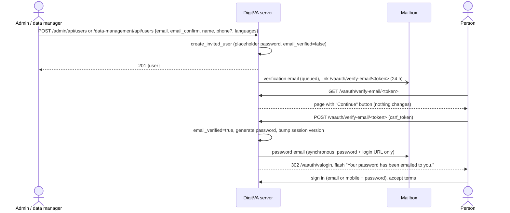
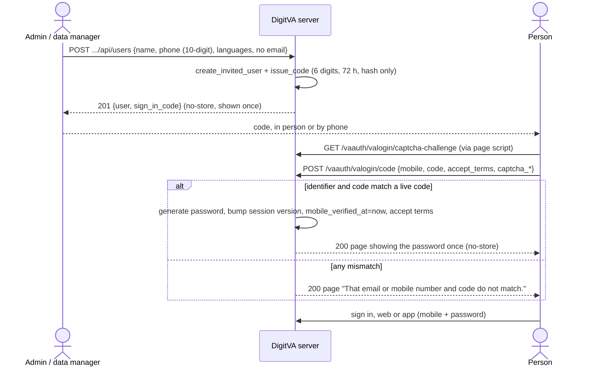
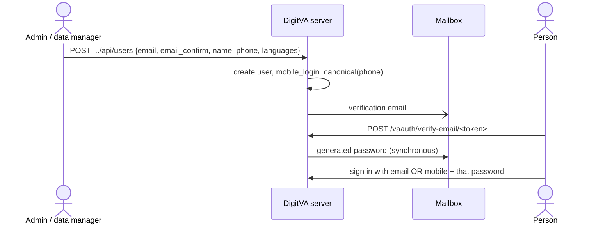
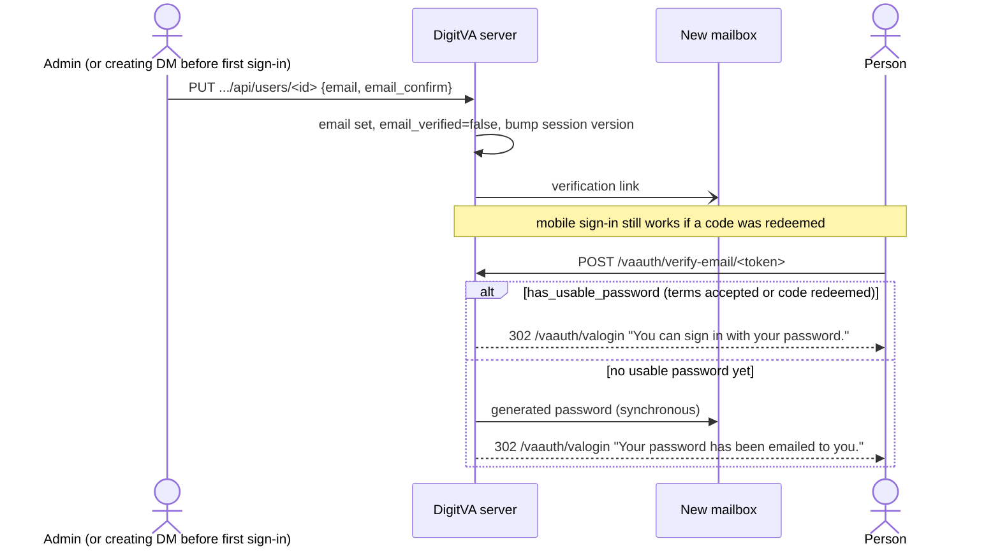

# Authentication, Login and Onboarding (shipped APIs)

What the server does today for account creation, onboarding, web login,
native-app device sign-in and the related recovery flows. It is written for
client builders (the Expo browser client and the native collection app;
bead `digitva-j13l`). The password/passkey policy and native deferment
described here are the current target contract.

Policies (intent): [account onboarding and passwords](../policy/account-onboarding-and-passwords.md),
[mobile sign-in](../policy/mobile-sign-in.md),
[authentication factors](../policy/authentication-factors.md),
[field data collection](../policy/field-data-collection.md),
[Expo client](../policy/expo-client.md). Related current state:
[device collection API](device-collection-api.md),
[Expo client hosting and access](expo-client.md).

Code:

| Area | File |
| --- | --- |
| Web login, code redemption, emailed links | `app/routes/va_auth.py` (blueprint `va_auth`, prefix `/vaauth`) |
| Terms page | `app/routes/profile.py` (`/profile/force-password-change`) |
| Profile JSON (password, reauth, passkeys and optional profile reminder) | `app/routes/api/profile.py` (`/api/v1/profile`) |
| Sign-in API (device) | `app/routes/api/auth.py` (`/api/v1/auth`), `app/services/device_auth_service.py`; route reference: [API v1](api-v1.md) |
| Device enrolment codes (admin) | `app/routes/admin_devices.py` |
| Account creation, phone rules | `app/services/user_account_service.py` |
| Sign-in codes, generated passwords | `app/services/mobile_sign_in_service.py` |
| Emailed-link tokens | `app/services/token_service.py` |
| Email sending | `app/services/email_service.py` |
| Passkeys | `app/services/webauthn_service.py` |
| CAPTCHA | `app/services/pow_captcha_service.py` |
| Session gates (terms and maintenance) | `app/__init__.py` (`force_password_update`) |
| Loaders, session version | `app/models/va_users.py` (`load_user`, `load_user_from_device_token`) |
| Forms | `app/forms/va_login_form.py`, `app/forms/password_reset_form.py`, `app/forms/va_pwresettnc_form.py` |
| Admin and data-manager user endpoints | `app/routes/admin.py`, `app/routes/data_management.py`, `app/routes/admin_mentor_institute.py`, `app/routes/admin_organization.py` |
| CLI | `app/commands/users.py`, `app/commands/auth.py`, `app/commands/devices.py` |

## 1. Overview

**Identifiers.** Every account (`va_users`) has an email, a sign-in mobile
number, or both (check constraint `email_or_mobile`).

- **Email**: stored lower-cased, unique. A typed value containing `@` is an
  email everywhere (login, code redemption, forgot password, device sign-in).
- **Mobile**: any typed value without `@` is read as a mobile number and
  canonicalised by `canonical_mobile`: keep digits only, drop a leading `0`
  (11 digits) or `91` (12 digits); the result must be exactly 10 digits, or
  it is not a number at all and matches no account. The canonical number is
  stored in `va_users.mobile_login` (unique). The free-text `phone` column
  keeps what was typed; `assign_phone` keeps `mobile_login` in step with it
  and refuses a number another account holds (in `mobile_login` or as the
  canonical form of its `phone`). Shared or malformed legacy numbers are
  never put in `mobile_login`, so they sign in by email only.
- `is_mobile_only` is `email IS NULL`. `sign_in_verified` is
  `email_verified OR mobile_verified_at IS NOT NULL` (a verified email, or a
  redeemed sign-in code). Login refuses an account that is not
  `sign_in_verified`.

**Nobody chooses a password.** There is no "set" or "change password"
endpoint, form or CLI prompt. `PUT /admin/api/users/<id>` refuses a
`password` key (400 "Passwords are generated, never set. ..."). Every
password comes from `mobile_sign_in_service.generate_password`:

- Three words from the bundled list (`mobile_password_words.txt`, 1823
  lowercase English words of 4 to 7 letters) and a 4-digit number joined by
  `-`, for example `maple-otter-candle-4821`. Always 19 to 26 characters,
  about 45.8 bits, drawn with `secrets`.
- Checked against the breach list; a hit is redrawn (up to 5 draws). If the
  breach check cannot be reached the flow raises
  `PasswordGenerationUnavailable`, changes nothing and shows the breach-check
  outage message (HTTP 503 on the profile JSON endpoint).
- Setting it always bumps the account's session version (section 3.6), so
  the old password and every session end.
- A password is delivered once: by a synchronous email
  (`send_password_email`, never through Celery; subject "Your DigitVA
  password", carrying the password and the login page address only), or on
  one `Cache-Control: no-store` response (code redemption, profile generate
  for an account without a verified email, CLI terminal). It is never logged.

**Who creates accounts** (nobody self-registers; every path calls
`validate_new_user_payload` + `create_invited_user`, or the import's
equivalent):

| Path | Who | Mobile-only allowed |
| --- | --- | --- |
| `POST /admin/api/users` | admin | yes |
| `POST /data-management/api/users` (with one initial grant the caller may write) | `role_required("data_manager", "admin")`; the data-manager gate is effective roles: a `data_manager` grant, a unit `site_pi` (In-charge) or a `project_pi` on a tree project | yes |
| `POST /admin/api/organization/<project_id>/project-users/import` (CSV/XLSX, `dry_run` default on) | admin, project_pi | new mobile-only rows: admin only |
| `POST /admin/api/mentor-institutes/<code>/staff` | admin, mentoring-institute admin (20 per day per caller; admin exempt) | platform admin only |
| `flask users create` | shell access | yes (password printed once) |

A new account is active, `email_verified = False`, `pw_reset_t_and_c =
False` (terms not accepted), and holds a random unknown placeholder password
(`secrets.token_urlsafe(32)`) until a generated one replaces it.

## 2. Onboarding per account type

Creator record: every `VaUsers` row is built with `other=creation_other(via,
actor_user_id, extra)` (`app/services/user_account_service.py`), which sets
`created_by_user_id` (text, or null with no human actor) and `created_via`.
`create_invited_user` applies it for the admin, data-manager and
mentor-institute paths; the project import, `flask users create` (`cli`),
`flask seed` (`seed`) and the synthetic demo seed (`system`) call it directly.

### 2.1 Email account

1. Creator saves the account. After commit `send_invitation` queues the
   verification email (`email_verify` token, 24 hours, bound to the current
   email). Failure is logged without the address and swallowed; the creator
   can resend.
2. The person opens `/vaauth/verify-email/<token>`. GET shows a button and
   changes nothing.
3. POST (button, CSRF) marks the email verified (`email_verified` audit
   event). Because the account has no usable password yet
   (`has_usable_password` is false: terms never accepted and no code ever
   redeemed), the server generates one, bumps the session version and
   emails it synchronously. If generation or the email fails, everything
   rolls back (the email stays unverified) and the page asks to retry.
4. Flash "Your email is verified. Your password has been emailed to you."
   and redirect to `/vaauth/valogin`. The page never shows the password.
5. The person signs in (section 3), accepts the terms on first sign-in, and
   privileged users enrol a factor if enforcement is on.



### 2.2 Mobile-only account

1. Creator saves the account with a name, a 10-digit mobile no other
   account holds, languages, and no email. The same transaction issues a
   6-digit sign-in code (`issue_code`); the create response carries it once
   as `sign_in_code` (`Cache-Control: no-store`). No email is sent.
2. The creator hands the code over in person or by phone. It is valid 72
   hours, works once, and five wrong attempts void it.
3. The person opens `/vaauth/valogin/code` ("I have a code"), enters the
   mobile number and code, ticks "I accept the terms of use above"
   (required), and solves the CAPTCHA.
4. On a match the server generates a password, bumps the session version,
   sets `mobile_verified_at`, records the terms acceptance
   (`terms_accepted`, `via: sign_in_code`), and shows the password once on that response
   ("Write this down. It will not be shown again.", `no-store`). A refresh
   re-posts a spent code and fails.
5. The person signs in, on the web or in the app, with the mobile number
   and password; the terms are already accepted (section 6.5).



### 2.3 Account with both email and mobile

Created like 2.1 with a `phone` that canonicalises: `mobile_login` is set
at creation. Nothing is mailed to or about the mobile. Verifying the email
(2.1 step 3) makes the account `sign_in_verified`, so from then the person
may type either the email or the mobile number at login; no code is needed.
Before verification neither works (the password is still the unknown
placeholder).



### 2.4 Email added to an existing account

- **Who.** An admin, any time (`PUT /admin/api/users/<id>`). A data manager
  only on an account it created (`other.created_by_user_id`) that has never
  signed in (no verified email and no redeemed code)
  (`PUT /data-management/api/users/<id>`); otherwise 403 "You may update
  email only for users created by you who have not signed in yet."
- **Effect of any email change** (both endpoints): `email_verified = False`,
  session version bumped (every web session, remember cookie and device
  session ends), a verification link to the new address after commit (send
  failures ignored).
- **Signing in meanwhile.** A mobile account that already redeemed a code
  stays `sign_in_verified` (via `mobile_verified_at`), so it keeps signing
  in by mobile. An email account whose address was changed and that never
  redeemed a code cannot sign in until the new address is verified ("Please
  verify your email address before logging in.").
- **Verifying it** keeps the existing password when `has_usable_password`
  is true (terms accepted, or a code redeemed): flash "Your email is
  verified. You can sign in with your password." From then "Forgot
  password" works by email.



### 2.5 Public-demo account (only with `PUBLIC_DEMO_ENABLED`)

Policy: [public-demo.md](../policy/public-demo.md). The only self sign-up.
With the flag off (every deployment but the demo one) the sign-up routes
answer 404 and a username never resolves at sign-in.

- `va_users.username` (lower-case, unique `uq_va_users_username`) and
  `va_users.is_public_demo` (partial index `ix_va_users_public_demo_status`);
  `ck_va_users_email_or_mobile` accepts an email, a sign-in mobile number or
  a username (migration `b4d6f8a2c9e1`).
- Username rule (`user_account_service.clean_username`): 3-30 characters,
  `^[a-z][a-z0-9._-]{2,29}$`, typed case ignored, and never one that
  canonicalises to a mobile number. Password: at least 12 characters, not the
  username, breach-checked (an unreachable check is a retryable refusal).
- `public_demo_service.create_account`, in one transaction under an advisory
  lock: active demo accounts below `PUBLIC_DEMO_MAX_ACCOUNTS` (default 500),
  `create_invited_user` with `username`, `is_public_demo`, languages english
  and hindi and `created_via = self_signup`, the chosen password, `accept_terms`,
  and project-scope `interviewer`, `coder` and `reviewer` grants on
  `PUBLIC_DEMO_PROJECT_ID` (default `PUB01`). Audits `account_created`
  (`self_signup`) and `terms_accepted` (`web` or `api`). The whole demo
  refuses (`PublicDemoError` `wrong_database`, 503, one logged error) when
  `va_project_master` holds a project other than `PUBLIC_DEMO_PROJECT_ID`, the
  sign of a demo pointed at the main database (`foreign_projects_exist`; the
  same guard stops setup, the beat allowlist, the purge and the eviction).
- **At the cap** (`PUBLIC_DEMO_MAX_ACCOUNTS`, 500), with
  `PUBLIC_DEMO_PURGE_ENABLED`, the same transaction first deletes the active
  account idle longest, if it has been idle `PUBLIC_DEMO_EVICT_IDLE_DAYS` (7)
  or more (`public_demo_purge_service.evict_one`: the account and everything
  it created, as the purge does, each try in a savepoint (up to 25 candidates,
  so refused accounts do not block it; a failed try never queues its stored
  files), audited as a
  `public_demo_evict` security event with row counts only). Its stored files
  go after the sign-up commits; a rolled-back sign-up deletes nothing. An
  account an admin marked kept (`va_users.public_demo_keep`, migration
  `d8e2a6c4f1b7`; admin toggle `POST /admin/api/users/<id>/public-demo-keep`,
  404 when the demo is off, audited as a `public_demo_keep` security event
  with the actor and `{keep}` only) is never evicted or purged
  (`public_demo_purge_service._eligible`, also the row-locked re-check) but
  still counts toward the cap. When
  nobody qualifies, or the purge is off, sign-up is refused: JSON 503
  `{"code": "cap_reached", "error": "The demo is full; try again later."}`,
  the same text flashed on the web form.
- `sign_in_verified` is true for a username account (nothing to verify);
  `is_mobile_only` now means no email **and** a sign-in number, so it is
  false for a username account and unchanged for every other one. A sign-in
  code cannot be issued for a username account (`issue_code` raises; the
  admin route answers 400). No password reset (no email).
- Confinement (policy section 3): a `before_flush` guard
  (`authz.grant_cache._guard_public_demo_grants`) raises
  `PublicDemoGrantRefused` for any new, reactivated or reshaped active grant
  of a demo account other than those three; routes answer 403 `forbidden`.
  Demo accounts get no demo-training virtual grants (`authz.grants._resolve`).
  Every submission predicate (`scope_filter`, `lens_filter`, `reaches`,
  `codes_as_tester`, so `can` too) is ANDed with the account's own submitted
  drafts (`ix_va_web_intake_drafts_user_submitted`); `get_death` and the
  worklist scope reach only deaths the account registered.
- Limits at the point of write (`public_demo_service`, 429 `demo_limit`):
  open drafts (`start_draft`), submissions per rolling day and in total
  (`submit_draft`, which web and device submits share); on the demo project
  `store_upload` uses `PUBLIC_DEMO_ATTACHMENT_MAX_BYTES` and
  `PUBLIC_DEMO_ATTACHMENTS_PER_DRAFT`. A demo draft or registration without a
  unit uses the project's one unit `PUBDEMO`. Death registrations
  (`register_death`) are limited by `PUBLIC_DEMO_REGISTRATIONS_PER_DAY` (5) and
  `PUBLIC_DEMO_REGISTRATIONS_TOTAL` (25). Every per-account check first takes
  `pg_advisory_xact_lock` on the account (`public_demo_service._lock_account`),
  held until the caller commits, so parallel requests cannot pass a count
  together. Drafts are limited to `PUBLIC_DEMO_OPEN_DRAFTS` (3) open and
  `PUBLIC_DEMO_DRAFTS_PER_DAY` (10) / `PUBLIC_DEMO_DRAFTS_TOTAL` (30) started
  whatever their status (`check_new_draft`, one query), and submissions to
  `PUBLIC_DEMO_SUBMISSIONS_PER_DAY` (5) / `PUBLIC_DEMO_SUBMISSIONS_TOTAL` (10).
  Sign-ups are limited per client address (`PUBLIC_DEMO_SIGNUP_RATE_LIMIT`,
  default 30/hour and 200/day, keyed per IPv4 address or per IPv6 /64 prefix by
  `signup_client_key`, also the key of the two sign-up routes' own 10/min
  limit) and across the whole demo (`PUBLIC_DEMO_SIGNUP_GLOBAL_RATE_LIMIT`,
  100/hour, one shared key). Both are spent by one atomic limiter hit each
  (`hit_signup_quota`, client windows first) after the account is flushed and
  before the commit, one set of buckets for the web and JSON paths; a spent
  quota rolls back and answers the app's 429. ICD-11 and DORIS calls
  (`icd11_api`, `doris_clinical_api`, including the WHO proxy) share one
  per-account bucket, `PUBLIC_DEMO_ICD_RATE_LIMIT` (300 per hour), and one
  bucket for all demo accounts, `PUBLIC_DEMO_ICD_GLOBAL_RATE_LIMIT` (2000 per
  hour), both for demo accounts only and both before any WHO call.
- Reserved usernames (`user_account_service.RESERVED_USERNAMES`, and any name
  starting `support`, `root`, `security`, `who`, `official`, `admin` or
  `digitva`) are refused by `clean_username`, compared after dropping `.`, `_`
  and `-` (so `a.d_min` is `admin`).
- A demo account's refusal for a case it did not submit is always `NOT_FOUND`
  (`predicates._can_submission`), so a guessed `va_sid` cannot be told apart
  from an unknown one; `my_organization` reports `people_count: 0` for the
  units below it.
- Redis and Celery namespace (policy section 8a): `create_app` applies
  `_namespace_public_demo` before any extension reads its configuration, with
  the flag on only: `CACHE_KEY_PREFIX` `digitva_demo:`, `RATELIMIT_KEY_PREFIX`
  `demo`, `AUTHZ_GRANT_CACHE_PREFIX` `digitva_demo_authz:`,
  `NOTIFICATION_CACHE_PREFIX` `digitva_demo_msg:last:`, `SWEEP_LOCK_KEY_PREFIX`
  `demo:` (the SmartVA, bundle and attachment sweep locks), Celery
  `task_default_queue` `demo` and `global_keyprefix` `demo:` in
  `broker_transport_options` and `result_backend_transport_options`. The
  worker, started without `-Q`, consumes the default queue; no task names a
  queue. The beat schedule is `app/tasks/beat_schedule.py` (see async-tasks.md).
- Nothing shows a demo account another demo user's identity or project-wide
  counts. Refused for a demo account: people and roles (JSON and CSV, 404),
  the area dashboard and Home KPIs (`resolve_area_scope` returns no scope),
  the organization roster (`unit_people`, `my_organization` people lists) and
  suggesting translations. Scoped to its own rows: the case list and its
  facets, coding and review queues, stats and history, the intake worklist,
  possible-duplicate hints and the register's identifier-in-use warning
  (`death_identifier_service._duplicate_warnings`).
- **Retention** (policy section 9): the daily beat task
  `app.tasks.public_demo_tasks.purge_public_demo_task` and
  `flask public-demo purge --dry-run|--apply` run
  `public_demo_purge_service.purge_run`. It takes demo accounts idle
  `PUBLIC_DEMO_PURGE_IDLE_DAYS` (30; at most `PUBLIC_DEMO_PURGE_BATCH`, 100,
  per run, oldest first; accounts the guards refuse stay idle and are
  reselected nightly, so the run looks past them, up to `PURGE_SCAN_LIMIT`
  1000 candidates, until it has deleted the batch) and deletes each in its own transaction, in the
  explicit order of `PLAN`: the account's notifications, payload versions and
  every table keyed by its `va_sid`, death registrations (sealed PII,
  identifiers, consent records, transitions, contact attempts), drafts and
  uploads, submissions, devices only it used, audit rows it wrote, grants, then
  the user; `auth_security_events` stay (user columns go NULL), and so do
  config and admin tables (`RETAINED_TABLES`; a test walks the foreign keys so
  a new table must be added to one list or the other). Last activity is the
  latest of `last_signed_in_at` (web and device sign-in), creation,
  the newest `auth_device_sessions` row and the newest `va_web_intake_drafts`
  `updated_at`/`created_at`. Per account, under a `FOR UPDATE SKIP LOCKED` row lock, it refuses
  (counted, nothing deleted) unless every draft, death registration,
  submission, grant and device is on the demo project, no other account
  shares a case and the account is still idle. Applying needs
  `PUBLIC_DEMO_ENABLED`, `PUBLIC_DEMO_PURGE_ENABLED` (default off until the
  nightly backup is verified) and the main-database guard; `--dry-run` runs the
  deletes and rolls them back. Stored files are removed after the commit
  (`session.info` queue, dropped by a rollback). One `public_demo_purge`
  security event per run carries counts only. The same run ages out the demo
  project's SmartVA run folders (`purge_smartva_runs`, up to 200 per run):
  every `va_smartva_form_runs` row of the demo project started more than the
  idle period ago loses its folder on disk (`disk_path`, only a folder named for
  the run id) and its objects under `smartva_runs/<project>/<form>/<run>/` in
  the S3 store; the row is deleted, or, when a `va_smartva_runs` row still
  references it (an account in use has older submissions), kept with
  `disk_path` and `archive_key_prefix` cleared and `archive_state` `absent`.
  A failure keeps the row for the next day. `va_sessions` rows (browser
  session blobs, no user column) lapse by their own expiry.
- `flask public-demo setup --by <admin email>` builds or resets the project
  (policy section 4), its site, web form, levels, the `PUBDEMO` unit and
  required consent with the seeded en and hi notice approved by that admin.
  `CODING_SWEEP_INTERVAL_MINUTES` (unset: the hourly beat row is left as it
  is) sets how often the reviewer-eligible sweep runs; the demo deployment
  sets a few minutes, which repoints and renames the existing beat row.

## 3. Web login

All pages are server-rendered Flask-WTF forms posting `csrf_token` (section
8.1). Clients use these pages; they do not reimplement them.

### 3.1 Identifier step: `GET|POST /vaauth/valogin`

- A signed-in visitor is redirected to `landing_url()` (`/app/` for every user while the Expo export is present; the stored `landing_page` only applies without it). Every visit clears
  any pre-auth state ("not you?" goes back here).
- The page fetches `GET /vaauth/valogin/captcha-challenge`, which returns
  `{"salt", "difficulty", "expires", "signature"}` (HMAC-SHA256 under
  `CAPTCHA_HMAC_KEY`; lifetime 300 seconds; difficulty `CAPTCHA_DIFFICULTY`,
  default 14). The browser (`app/static/js/pow_captcha.js`, Web Worker)
  finds a decimal integer `n` such that `SHA-256(salt + str(n))` has
  `difficulty` leading zero bits, and posts `email`, `captcha_salt`,
  `captcha_difficulty`, `captcha_expires`, `captcha_signature`,
  `captcha_solution`. The server checks signature, expiry, solution, then
  claims the challenge once (atomic cache add); a solved challenge works
  once.
- A failed CAPTCHA re-renders with "We couldn't verify that request. Please
  try again."
- On success the server stores the pre-auth state in the server-side
  session (`session["preauth"]`: the lower-cased email, or the canonical
  mobile, or with `PUBLIC_DEMO_ENABLED` a lower-cased username, or `""` for
  anything else; `issued_at`; safe `next`) **without looking the account
  up**. Web login and device sign-in read the identifier through one
  resolver, `user_account_service.sign_in_identifier` / `find_sign_in_user`, and redirects to `/vaauth/valogin/password`
  (keeping `?next=`). Pre-auth expires 5 minutes after this step.
- A value with `@` must be a valid email (form error); a value without `@`
  is never refused here.
- Maintenance after the cutoff shows "Site is under maintenance. Only admin
  login is allowed right now." on the page.
- `next` is accepted only if `_safe_next_url` passes: a path starting with a
  single `/`, or an absolute http(s) URL on this host; no backslashes,
  whitespace or control characters.

### 3.2 Second page: `GET|POST /vaauth/valogin/password`

The same page for every identifier, known or not: "Signing in as <typed
value>", a passkey button and a password form (`password`).
No pre-auth state, or expired: redirect to `/vaauth/valogin` with "Please
sign in again."

Password POST, in order:

1. Look up the account named by the pre-auth state (email, or
   `mobile_login`). Unknown: a dummy hash check is spent for equal timing.
2. Unknown account, wrong password or inactive account: flash
   `INVALID_LOGIN_MESSAGE` "Invalid email or password. Please, re-check and
   login again." and back to this page.
3. Not `sign_in_verified`: an email account gets "Please verify your email
   address before logging in." (flash category `email_unverified`); a
   mobile-only account gets the invalid-login message.
4. Non-admin after the maintenance cutoff: "Site is under maintenance. Only
   admin login is allowed right now."
5. Otherwise `_complete_login` (section 3.5) and redirect to `next` or the
   landing page.

Passkey path (JSON, `X-CSRFToken` header):

- `POST /vaauth/valogin/passkey/options` (empty body) returns WebAuthn
  request options: discoverable credentials, no `allowCredentials`,
  `userVerification: "required"`, RP ID `WEBAUTHN_RP_ID`. Identical for every
  identifier. No pre-auth: 400 `{"error": "Please sign in again."}`. The
  challenge lives in the session for 5 minutes. An atomic Redis claim prevents
  concurrent requests from consuming it twice; an unavailable claim store
  refuses verification.
- `POST /vaauth/valogin/passkey/verify` with `{"credential": <PublicKeyCredential JSON>}`.
  The credential must belong to the account the pre-auth state names; a
  credential of another account, or of none, a malformed body, a failed
  signature, a counter regression (non-zero stored counter not exceeded;
  `counter_regression` event) or a lost race on the counter update all
  answer 400 `{"error": INVALID_LOGIN_MESSAGE}`. Unverified: 400
  `{"error": "Please verify your email address before logging in."}`.
  Maintenance: 400 with the maintenance message. Success: 200
  `{"redirect": <next or landing URL>}`. A passkey sign-in is never
  "remembered" (`remember=False`).

### 3.3 Optional passkey reminder

After a password sign-in, the base template may show a dismissible reminder
linking to the browser Profile passkey section. It is informational only; no
role is blocked from continuing without a passkey.

### 3.4 No mandatory factor setup

There is no enrolment deadline or factor-setup redirect. Password sign-in is
available to every role, and passkey registration remains optional.

### 3.5 Terms acceptance: `GET|POST /profile/force-password-change`

`force_password_update` runs on every request for a signed-in session.
While `pw_reset_t_and_c` is false, every endpoint except `static`,
`profile.force_password_change`, `api_v1.profile_api.accept_terms`,
`va_auth.va_logout`, `va_auth.va_login`, `va_auth.forgot_password`,
`va_auth.reset_password`, `va_auth.verify_email` and
`va_auth.resend_verification` is held:

- a page answers **302 to `/profile/force-password-change`** (the name is
  historical; no password changes there);
- a JSON path (`/api/`, `/admin/api/`, `/data-management/api/`) answers **403**
  `{"error": "terms_required", "code": "terms_required", "redirect_url": "/profile/force-password-change"}`
  with `Cache-Control: no-store`, never a redirect;
- Expo web reads `GET /api/v1/me/access` (section 7); it gets the same
  `terms_required` as every other JSON path.

The page posts `accept_terms` (required checkbox) and `csrf_token`; success
records the acceptance (`accept_terms`: `pw_reset_t_and_c = True` and a
`terms_accepted` event, `via: web`), flashes "Terms accepted successfully."
and redirects to `current_user.landing_url()`, not to `next`. POST is
limited to 5 per minute. The JSON equivalents are `POST /api/v1/profile/terms`
(browser session, section 8.3) and `POST /api/v1/me/terms` (either
credential, section 6.5); they record acceptance the same way (`via: api`,
`via: device` for a bearer). Accepting when already accepted changes and records nothing.

`pw_reset_t_and_c` is false on every new account and is set false again by
the reset-link POST (section 5.2). Code redemption sets it (the code page
requires the terms box); Profile generate does not change it. This gate
runs before the remaining terms and maintenance gates.

### 3.6 Sessions, remember, logout, session version

- `_complete_login` (password or passkey)
  clears the pre-auth state and the WebAuthn challenge, clears the whole
  session (fixation), marks it permanent, calls `login_user(user)`,
  stamps `last_activity_at`, sets `auth_verified_at` (opens the 10-minute
  reauthentication window, section 5.6) and regenerates the session id.
- Server-side sessions (Flask-Session, table `va_sessions`), signed cookie,
  `PERMANENT_SESSION_LIFETIME` 30 minutes of user activity
  (`app/utils/idle_session.py`; `X-DigitVA-Background: 1` requests do not
  count). There is no "Remember me": no remember cookie is set, and one sent
  by an old browser is ignored and cleared. The session cookie is `HttpOnly`,
  `Secure` in production, `SameSite=Lax` by default.
- Flask-Login identifies a session as `<user_id>` or `<user_id>:<version>`.
  `load_user` rejects an inactive user or a version mismatch, so a bump ends
  every web session and remember cookie at the next request.
- **Session version bumps** (`bump_session_version`): every generated
  password (code redemption, first password at email verification,
  reset-link POST, Profile generate, CLI create of a mobile-only account,
  CLI `reset-password`), `reset_factors` (admin and CLI), and the recovery-link
  POST. Any email change by an admin or data manager also bumps it. Not bumped:
  logout, terms acceptance, deactivation (deactivation is caught instead by
  the `is_active` check in `load_user`, `role_required` and the device
  checks). A bump also ends device sessions (section 6.4).
- `POST /vaauth/valogout` (CSRF) calls `logout_user()` (also clears the
  remember cookie) and redirects to `/`. An anonymous POST just redirects.
- A non-admin signed in when the maintenance cutoff starts is logged out at
  the next request: HTML redirects to the login page, API paths get 401
  `{"error": "Site is under maintenance. Only admin login is allowed right now."}`.

## 4. Sign-in codes

### 4.1 Issuing

| Endpoint | Who | Rule |
| --- | --- | --- |
| `POST /data-management/api/users/<id>/sign-in-code` | data-manager gate | `may_issue_code`: the target holds at least one active grant, the caller may manage **every** active grant (`authz.grant_list_filter`), none of them is `admin`, `project_pi`, `site_pi` or `data_manager` or global-scoped, and the target has **no verified email**. Anyone failing this gets the same 404 "User not found." as an unknown id. 20 per hour per caller. |
| `POST /admin/api/users/<id>/sign-in-code` | admin | any account |
| account creation (admin, DM page, import, mentor staff) | as section 1 | automatically for a new mobile-only account |

`issue_code` locks the user row, voids any live code (`mobile_code_voided`,
reason `reissued`), stores only a keyed hash (bound to the user id), sets a
72-hour expiry, records `mobile_code_issued`, and returns the code once.
Responses: 200 `{"sign_in_code": "123456", "expires_in_hours": 72}`,
`Cache-Control: no-store`.

### 4.2 Redeeming: `GET|POST /vaauth/valogin/code`

Form fields: `mobile` (holds an email **or** a mobile number, max 128),
`code` (max 32), `accept_terms` (required checkbox; without it the form is
refused with "Please accept the terms of use." and nothing is read or
written), and the five `captcha_*` fields (same CAPTCHA as 3.1).
Limits: 10 per minute per IP and 10 per hour per identifier (canonical
mobile, or lower-cased email).

- The password is generated **before** the lookup, so a breach-check outage
  ("warning" flash, nothing read or written) cannot reveal whether the code
  was right.
- Every path runs the same statements. Unknown email, unknown, shared or
  malformed number, inactive account, no live code, wrong code: one answer,
  `INVALID_SIGN_IN_CODE_MESSAGE` "That email or mobile number and code do
  not match. Please check and try again." A wrong code increments the live
  code's counter under a row lock; the fifth voids it
  (`mobile_code_voided`, reason `too_many_attempts`).
- A match marks the code redeemed, sets the password, bumps the session
  version, sets `mobile_verified_at` if unset, accepts the terms, and
  records `mobile_code_redeemed`, `password_generated` (`path:
  sign_in_code`) and `terms_accepted` (`via: sign_in_code`).
- The response renders the password once with `Cache-Control: no-store` and
  `Pragma: no-cache`, plus a "Continue to sign in" link. The page offers no
  passkey (the person is not signed in); it points to Profile after sign-in.
- If the account has an email, a notice is queued to it ("Your DigitVA
  password was changed", no password, code or link). Its failure is logged
  and ignored.
- The person then signs in normally (section 3) with the generated password or
  an available web passkey.

## 5. Recovery and account links

Every emailed link has a GET that shows a button and changes nothing (mail
scanners prefetch links) and a POST (the button, `csrf_token`) that acts.
Tokens are `itsdangerous` timed tokens:

| Purpose | Lifetime | Single use because |
| --- | --- | --- |
| `password_reset` | 1 hour | it fingerprints the password hash, which the POST changes |
| `email_verify` | 24 hours | it fingerprints the current email; reopening after verification shows "already verified" |
| `factor_reset` | 1 hour | it fingerprints the password hash and session version, which the POST bumps |

### 5.1 Forgot password: `GET|POST /vaauth/forgot-password`

Field `email` (email or mobile). 3 per hour per IP. Signed-in visitors are
redirected. Typing an identifier never changes a password.

- Email typed: if it names an account with a verified email, a reset link
  is queued to it. Always the same flash: "If that email address is
  registered, we've sent a password reset link. Please check your inbox (and
  spam folder)."
- Mobile typed: if `mobile_login` names an account with a verified email,
  the link goes to that email. Always the same flash
  (`MOBILE_FORGOT_MESSAGE`): "If that number belongs to an account with a
  verified email, we've sent a password reset link to that email. Otherwise
  ask your data manager for a new sign-in code, then use "I have a code" on
  the sign-in page."

### 5.2 Reset link: `GET|POST /vaauth/reset-password/<token>`

5 per minute per IP on POST. Invalid, expired, used, inactive or no-email
account: 200 page with `token_valid = False` ("This link is invalid or has
expired." in the template). POST: generate a password, bump the session
version, email it synchronously (`email_new_password`, path
`password_reset`), set `pw_reset_t_and_c = False` (terms again at next
sign-in), commit, flash "Your password has been emailed to you. Please sign
in with it." and redirect to `/vaauth/valogin`. The page shows no password
and has no password box. Generation or email failure rolls everything back
(the old password keeps working) and redirects to the same link with a
retry message. A CSRF failure re-renders with 400.

### 5.3 Verify email: `GET|POST /vaauth/verify-email/<token>`

5 per minute per IP on POST. Works signed in or not. Invalid or expired
link, or inactive account: flash "This verification link is invalid or has
expired. Please request a new one." and redirect to login. Already verified:
"Your email is already verified. You can sign in." POST behaviour: section
2.1 (first password) or 2.4 (keeps the password).

### 5.4 Resend verification: `GET|POST /vaauth/resend-verification`

Field `email`. 3 per hour per IP. A value without `@` gets
`MOBILE_RESET_MESSAGE` ("If you sign in with a mobile number, ask your data
manager for a new sign-in code, then use "I have a code" on the sign-in
page."). An email of an unverified account gets a new link. Same flash
either way: "If that email address needs verification, we've sent a new
link. Please check your inbox (and spam folder)."

### 5.5 Passkey and account recovery

An administrator or the CLI may reset another user's passkey credentials for
an audited reason. The reset clears active passkeys and any inert legacy
factor records, bumps the account session version, ends active sessions, and
records `factor_reset`. For a verified email, the server sends a single-use
timed recovery link; opening it changes nothing, and pressing its button signs
the person in so they can use the normal password or register a new web
passkey. The link does not set a password. Nobody may reset their own
credentials. The native app has no administrator or data-manager reset UI.

### 5.6 Reauthentication: `POST /api/v1/profile/reauth` (password or passkey)

Password: JSON `{"password": "..."}`. Wrong or missing: 403 `{"error":
"Incorrect password."}`. Success sets `auth_verified_at` and returns
`{"message": "Reauthenticated."}`. 5 per minute per user.

Passkey: `POST /api/v1/profile/reauth/passkey/options` returns WebAuthn
request options (the same discoverable-credential options as sign-in,
user verification required); then `POST /api/v1/profile/reauth/passkey`
with `{"credential": {...}}`. The credential must be one of the signed-in
user's own passkeys; the signature-counter rule and atomic counter update
are those of passkey sign-in (a regression records `counter_regression`).
Success sets `auth_verified_at` and returns `{"message":
"Reauthenticated."}`; any failure is 403 `{"error": "That passkey could not
be verified."}`. Both 5 per minute per user, `X-CSRFToken`.

A sign-in also opens the window. The window is 10 minutes (`REAUTH_TTL`); endpoints that need it
answer 401 `{"error": "reauth_required"}` outside it.

### 5.7 Profile "Generate a new password": `POST /api/v1/profile/password/generate`

Signed in, `X-CSRFToken`, empty body, needs the reauthentication window,
5 per hour per user. `Cache-Control: no-store`.

- Account with a verified email: password emailed;
  200 `{"message": "Your new password has been emailed to you."}`.
- Mobile-only account (no email):
  200 `{"password": "...", "message": "Write this down. It will not be shown again."}`.
- Account with an email still awaiting verification: 409
  `{"error": "Verify your email address first; ...", "code": "email_unverified"}`;
  nothing changes, nothing is shown or mailed (a password never goes to an
  unverified address).
- Either way the old password and every session end, this one included:
  the client must send the person to sign in again.
- Breach-check outage or email failure: 503 `{"error": <message>}`, nothing
  changed.

## 6. Native app (device sign-in, `/api/v1/auth`)

Bearer only, CSRF-exempt, no cookies (`csrf.exempt(bp)`; a browser session
cookie never satisfies these endpoints). Errors are
`{"error": <message>, "code": <machine code>}`; the role gate's 401/403
bodies carry `error` only. Full data endpoints and tables:
[device collection API](device-collection-api.md).

### 6.1 Enrolment (QR)

An admin issues a code: `POST /admin/api/projects/<project_id>/device-enrolments`
`{"expires_in_minutes": 5..10080 (default 60), "max_uses": 1..200 (default 1)}`
returns 201 `{"code", "qr_payload", "qr_svg", "expires_at", "max_uses"}`
(`no-store`). `qr_payload` is compact JSON
`{"v":1,"server":<DEVICE_PUBLIC_URL>,"enroll":<code>,"project":<project_id>}`.
Refused 503 when `DEVICE_PUBLIC_URL` is plain http outside debug/testing
(except `localhost`, `127.0.0.1`, `10.0.2.2`); 404 for an inactive or
unknown project. CLI: `flask devices create-enrolment-code`.

The app posts `POST /api/v1/auth/enroll`
`{"code", "device_name" (required, <= 64), "platform": "android" or "ios", "app_version" (optional, <= 32)}`.
201 `{"device_id", "device_secret", "project": {"project_id", "name"}, "server_time"}`.
The code is consumed atomically; unknown, expired, revoked, used-up, or an
inactive project: 404 `enrolment_invalid`. The secret is shown once and
stored by the server only as a SHA-256 digest.

### 6.1a Sign-in QR: issue, redeem, revoke (digitva-3g19)

Policy: [mobile-sign-in.md](../policy/mobile-sign-in.md) section 8. Code:
`app/services/sign_in_qr_service.py`; table `auth_sign_in_tokens`
(`secrets.token_urlsafe(32)` stored as SHA-256 only; `user_id`, `issued_by`,
`issued_at`, `expires_at` = issue + 6 hours, `redeemed_at`,
`redeemed_device_id`, `revoked_at`, `expiry_noted_at`, `user_session_version` =
the user's `auth_session_version` at issue); a device enrolled this
way has `auth_devices.enrolled_via_sign_in_token` set (`enrolled_via` stays
null). At most one token per user is pending (partial unique index); a new
issue voids it.

**Eligible** (checked at issue and again at redeem): active account, at least
one active `interviewer` or `death_reporter` grant that reaches an active
project (`interviewer_context` / `register_death_context`; the lowest such
project id is the enrolment project), and no other active grant of any role or
global scope in any project. A coder grant or self-coding grant alone does not
qualify (owner 2026-10-27, `digitva-5bzf.15`, reversing `digitva-5bzf.10`);
a coder grant beside a collector grant is tolerated. Admin, project PI,
site PI, data manager, In-charge, coding tester, reviewer, collaborator,
interview supervisor, or any of them held alongside, stay refused. Otherwise 400 `not_eligible` at issue.

**Issue**, `POST /api/v1/users/<user_id>/sign-in-qr` (Users page, cookie
session, CSRF, 10/min): body `{"delivery": "show" | "email"}` (default
`show`). Issuer: an admin, or a project PI / data manager / In-charge who
can manage **every** active grant the person holds
(`authz.grant_list_filter`); anyone else, or an unknown id: 404 `not_found`
(non-viewer roles 403). `show`: 201 `{code, qr_payload, qr_png (base64 PNG),
expires_at}`, once, `no-store`. `email`: 201 `{emailed: true, expires_at}`,
the QR inline plus the code text (`emails/sign_in_qr`), only to a verified
address (400 `no_verified_email`; a failed send 502 `email_failed` and the
token is voided). `qr_payload` is
`{"v":1,"server":<DEVICE_PUBLIC_URL>,"sign_in":<token>}`; 503
`device_url_insecure` as for enrolment codes.

**Status / revoke**: `GET /api/v1/users/<user_id>/sign-in-qr` (120/min) returns
`{items: [{status: pending|expired|redeemed|revoked, issued_at, expires_at,
redeemed_at}]}` (latest 5, never the token); `DELETE` the same path (30/min,
CSRF) voids the pending one, `{revoked: bool}`. Same issuer rule.

**Redeem**, `POST /api/v1/auth/sign-in-qr/redeem` (public, CSRF-exempt, the
device API's body caps): `{token, device_name, platform, app_version?,
signing_public_key?}`. Atomically consumes the token (single use, unexpired,
unrevoked, user's `auth_session_version` unchanged since issue), enrols a device on the project of the person's collector grant (as
`/auth/enroll`) and opens the normal device session (as `/auth/sessions`:
same scope, 15-minute access, sliding refresh, `has_device_access`, pending
terms in `terms_required`, reuse detection). 201: `/auth/enroll`'s
`{device_id, device_secret, signing_key_id?, project, server_time}` plus the
`/auth/sessions` token response (`access_token`, `refresh_token`, ..., `access`).
Every failure (unknown, used, expired, revoked, person no longer eligible or
inactive) is 404 `sign_in_qr_invalid`; a bad `device_name`/`platform` is 400
`invalid_request` and burns nothing. Limits: 10/min per IP and 5/min per token
digest (no device exists yet to key on). The user's email, when present, gets a
notice (verified address only) with no token. A person found ineligible, or whose
session version changed, at redeem has the token voided and `sign_in_qr_refused`
audited. Show-QR redeem does not need `sign_in_verified` (the issuer verifies in
person). Voiding is one `UPDATE ... RETURNING` on unredeemed rows, so a redeemed
token is never marked revoked.

**Audit** (`auth_security_events`, never the token): `sign_in_qr_issued`
(actor, user, `delivery`), `sign_in_qr_redeemed` (user, `device_id`),
`sign_in_qr_revoked` (actor; also on a reissue or failed email, with
`reason`), `sign_in_qr_refused` (user, `reason`: `not_eligible` /
`session_changed`), `sign_in_qr_expired` (written once, when an expired token is next
met at an issue, revoke or redeem attempt; there is no sweep). Plus
`device_enrolled` and `device_session_opened`.

**Phone** (`mobile/digitva-collect`): the enrol screen's scanner (and the
debug-build paste box) accepts this QR beside the enrolment QR
(`parseScannedQr` in `src/enrolment.ts`, same server-origin rule), shows the
server host, and on confirm calls `redeemSignInQr` (`src/auth.ts`), which stores
the device and session as enrolment plus password sign-in do and then opens
`/unlock`, which sends a new account to PIN setup. Every 400/404 shows one
message that names the likely causes (expired after 6 hours, already scanned, replaced by a newer QR, or made for another server; the server's answer stays indistinguishable on purpose), a 429 says to wait a minute; a coder-only device session (Plus build, unlocked; not reachable by sign-in QR since `digitva-5bzf.15`, which needs a collector grant) lands on the pending-workspace screen with "Coding queue" and "Offline coding" buttons instead of the interviewer worklist; the token is never logged or
stored. PIN entry and setup are six boxes; fingerprint and phone screen lock
unlock options and their first-run offer: [policy section 9](../policy/mobile-sign-in.md).

### 6.2 Device sign-in: `POST /api/v1/auth/sessions`

Body `{"device_id", "device_secret", "email", "password"}`. The
`email` field holds an email **or** a mobile number (field name kept for the
contract). Limits: 10 per minute per IP, 10 per minute per `device_id`, 20
per hour per identifier (canonical mobile for a number). Checks, in order:

| Check | Refusal |
| --- | --- |
| device id and secret | 401 `device_invalid` |
| device revoked or project inactive | 403 `device_revoked` |
| unknown identifier (timing equalised), wrong password, inactive account, or mobile-only account that never redeemed a code | 401 `invalid_credentials` "Invalid email or password." |
| not `sign_in_verified` | 403 `email_unverified` |
| non-admin after the maintenance cutoff | 403 `maintenance` |
| no device access (`has_device_access`: `interviewer_context` non-empty, which skips projects with web intake off, or an explicit coder, coding_tester or reviewer grant whose gate is open) | 403 `no_interviewer_grant`, "You have no access in any project." |

Every refusal after the device check is audited as `device_session_failed`
with the device id and reason only. Success records
`device_session_opened`. Pending terms do **not** refuse sign-in: the token
response says `terms_required: true` and the app shows its terms screen
(section 6.5).

### 6.3 Token responses

Native passkey sign-in is deferred. The native app uses the password and the
enrolled device here; its PIN or optional biometric only unlocks the local
encrypted store after sign-in. Web passkeys remain available through the
browser Profile and are not available through the device bearer contract.

`POST /auth/sessions` (201) and `POST /auth/sessions/refresh` (200) return:

```json
{
  "access_token": "<opaque>",
  "access_expires_at": "<ISO 8601>",
  "refresh_token": "<opaque>",
  "refresh_expires_at": "<ISO 8601>",
  "user": {"user_id": "<uuid>", "name": "<display name>", "email": "<email or null>"},
  "terms_required": false,
  "access": {"user": {}, "is_admin": false, "projects": [], "demo_coding": {}}
}
```

`access` is the exact `GET /api/v1/me/access` body for the user (shape in
[API v1](api-v1.md)), shown even while terms are pending; it is display
only, the terms gate is on requests. `terms_required` is true while the account has not accepted the terms
(section 6.5); it is read from the account at each sign-in and refresh.

`user.email` is `null` for a mobile-only account. The access token lives 15
minutes. The refresh token rotates on every use; its expiry slides by
`DEVICE_REFRESH_TTL_DAYS` (default 30) but never past
`DEVICE_SESSION_MAX_DAYS` (default 90) from sign-in.

### 6.4 Refresh and revoke

`POST /api/v1/auth/sessions/refresh`
`{"refresh_token", "device_id", "device_secret"}` plus optional
outstanding-work fields (`count`, `unique_ids`, `client_draft_ids`,
`client_death_ids`). 30 per minute per IP. Refusals:

| Code | Status | Meaning | App action |
| --- | --- | --- | --- |
| `invalid_request` | 400 | `refresh_token` missing | fix the call |
| `device_invalid` | 401 | device id/secret wrong, or not this session's device; nothing revoked | re-enrol only if the device itself is unknown |
| `refresh_invalid` | 401 | unknown token | sign in again |
| `refresh_retry_race` | 409 | the token rotated away under 60 s ago was replayed (lost response); session revoked | sign in again, keep data |
| `refresh_reused` | 401 | an older retired token (one of the last 5) was replayed; session revoked | sign in again, keep data |
| `session_expired` | 401 | past sliding expiry or the absolute cap | sign in again, keep data |
| `session_ended` | 401 | account changed (session version bump: any new password, security reset, email change; or deactivated) or project closed | sign in again, keep data |
| `session_revoked` | 401 | admin or device revoke, withdrawn interviewer grant, signed out | the only code on which the app wipes that interviewer's store |

Bearer calls with an access token whose account was bumped or deactivated
answer 401 `unauthorized` at once (`resolve_access_token` returns nothing);
the next refresh then answers `session_ended`. A withdrawn grant is caught
at the next refresh (within 15 minutes).

`DELETE /api/v1/auth/sessions/current` (bearer, any signed-in role, so a
withdrawn interviewer can still sign out) revokes the session
(`signed_out`) and answers 204. Admin: `POST /admin/api/devices/<device_id>/revoke`
revokes the device and every session on it, answering
`{"device_id", "sessions_ended"}`.

### 6.5 Terms acceptance in the app (`terms_required`)

`pw_reset_t_and_c` is false on every new account until it accepts the
terms, and again after a reset-link password (section 5.2). Redeeming a
sign-in code accepts them (section 4.2), so a newly onboarded mobile-only
person usually arrives with them accepted. When they are pending:

1. `POST /sessions` succeeds (201) with `"terms_required": true`.
2. Every bearer endpoint except `DELETE /auth/sessions/current` and
   `POST /me/terms` (or `POST /profile/terms`) answers 403
   `{"error": "Accept the terms of use to continue.", "code": "terms_required"}`.
3. The app shows its own terms screen and, on acceptance, calls
   `POST /api/v1/me/terms` with the bearer token and body
   `{"accept_terms": true}` (no CSRF for a bearer). Answers: 200
   `{"message": "Terms accepted.", "terms_accepted": true}`; 400
   `invalid_request` for any other body; 401 `unauthorized` without a live
   token. 5 per minute. It records `terms_accepted` (`via: device`), as the
   web page does.
4. The same access token then works: the gate reads the account on every
   request, so no re-sign-in or refresh is needed.

`password_change_required` is no longer returned anywhere (digitva-9an9,
digitva-ad02): every JSON path answers `terms_required`. An app build that
still waits for it will get tokens and then `terms_required` on its first
data call: the app must handle `terms_required`.

### 6.6 Local unlock on the device

- Account-security mutations remain browser-only: with a bearer token every
  `/api/v1/profile/*` route that changes account security requires the cookie
  session and recent password or passkey reauthentication. A device bearer
  cannot manage web passkeys or other account settings.

- Native passkey sign-in is deferred. The PIN or biometric prompt only unlocks
  the encrypted local store after a successful password device sign-in.
- Locking closes each open local database. A failed close is reported, keeps
  its handle for retry, and prevents a successful lock transition.
- There is no factor-enrolment redirect on a bearer request. The terms and maintenance gates run on every `/api/v1/` bearer
  request (`force_password_update`, JSON `terms_required` / `maintenance`;
  exempt: sign-out, `POST /api/v1/me/terms`, `POST /api/v1/profile/terms`).
- **One credential rule for `/api/v1/`.** The `authenticate_bearer` hook
  (`app/__init__.py`, first `before_request`) authenticates an
  `Authorization: Bearer` request by the token alone and pins the user on the
  request, so a session or remember cookie on the same request is ignored; a
  bad, expired or revoked token is 401 `unauthorized`, never a cookie
  fallback. Bearer requests skip CSRF (`csrf_protect_cookie_requests`; cookie
  requests keep it) and see an empty session that is never saved
  (`app/utils/bearer_session.py`), so they set no cookie. Outside `/api/v1/`
  a bearer is ignored. The sign-in endpoints (`/auth/enroll`, `/auth/sessions`,
  `/auth/sessions/refresh`) ignore a stale token.

### 6.7 Demo sign-up with proof of work (`PUBLIC_DEMO_ENABLED` only)

The app's sign-up is behind the same proof-of-work CAPTCHA as the web form
(`pow_captcha_service`: stdlib only; docs/policy/authentication-factors.md
section 5). Flag off: both calls are 404.

1. `GET /api/v1/auth/demo-signup/challenge` returns
   `{"salt": "<32 hex>", "difficulty": 18, "expires": <unix seconds>, "signature": "<64 hex>"}`.
   Valid for 5 minutes, spent by one successful verification, signed over
   `salt.difficulty.expires` so none of the three can be changed.
2. The client finds a non-negative integer `solution`, counting up from 0
   as the web worker does (`app/static/js/pow_captcha_worker.js`), such that
   `SHA-256(utf8(salt + decimal string of solution))`, read as a big-endian
   integer, has at least `difficulty` leading zero bits. Send it as a string
   or a number; at most 32 characters.
3. `POST /api/v1/auth/demo-signup` with
   `{"username": "...", "password": "...", "captcha": {"salt", "difficulty", "expires", "signature", "solution"}}`,
   the first four echoed unchanged from step 1.

A missing, malformed, expired, mis-signed, wrongly solved or already spent
`captcha` is 400 `{"error": "We couldn't verify that request. Please try again.", "code": "captcha_failed", "fields": ["captcha"]}`
and nothing else is checked or written; the client fetches a new challenge and
solves it again. A solution is checked before the username and password, and
a later refusal (`invalid_username`, `username_taken`, ...) has spent the
challenge, so every retry needs a new one. Success is 201
`{"user_id", "username"}` with no session; the app then signs in through
`POST /sessions`. The expected work is 2^difficulty hashes (`CAPTCHA_DIFFICULTY`,
default 14); the client reads `difficulty` from the response and never assumes it.

Further refusals of `POST /demo-signup`: 503 `cap_reached` ("The demo is full;
try again later.") when the account cap holds and nobody has been idle long
enough to evict (section 2.5), and 503 `wrong_database` on a database that
holds a project other than the demo's. Both leave the challenge spent.

### 6.8 Demo enrolment without a QR code (`PUBLIC_DEMO_ENABLED` only)

`POST /api/v1/auth/demo-enroll` `{"username", "password", "device_name" (<= 64),
"platform": "android", "app_version"?}` enrols a device on
`PUBLIC_DEMO_PROJECT_ID` for a public-demo account, with no enrolment code
(policy [public-demo.md](../policy/public-demo.md) section 10). Flag off: 404.
The credentials go through the device sign-in's own resolver and check
(`device_auth_service._check_credentials`, so username, email or mobile are read
alike and an unknown name costs a hash check too); an unknown name, a wrong
password, an inactive account and an account that is **not** a public-demo
account all get 401 `invalid_credentials` ("Invalid username or password."),
audited as `demo_device_enrol_failed` (reason only). Then, under the account's
advisory lock, at most `PUBLIC_DEMO_DEVICES_PER_ACCOUNT` (default 3) live
(unrevoked) devices per account: at the cap the least recently used live device
(newest session activity, else its enrolment time) and its sessions are revoked
to make room, audited `device_revoked` with `reason: "demo_device_replaced"`;
the new device is then enrolled (no 429). Success is 201 with
`/enroll`'s body, `{device_id, device_secret, project, server_time}`, the secret
shown once; the app then signs in through `POST /sessions` (section 6.2:
`has_device_access` holds for the account's `interviewer` grant on the demo
project). 503 `wrong_database` on a database holding another project, 503
`project_missing` before `flask public-demo setup`. Limits: 10 per minute per
client (IPv6 per /64, as sign-up) and 20 per hour per username. CSRF-exempt like
the rest of `/api/v1/auth/*`; on `PUBLIC_ENDPOINTS`; audited `device_enrolled`.

Devices carry no user column, so each demo account owns one hidden
`auth_device_enrolment_codes` row: `created_by` the account, `code_hash` the
digest of `public_demo:<user_id>` (one per account, unique), already revoked
and expired so it can never be redeemed at `/enroll`. Its devices name it in
`enrolled_via`; the cap counts them, and the purge
(`public_demo_purge_service._collect`) finds the account's devices through it
even if one never signed in. No migration.

The Android app (`mobile/digitva-collect`, "Try the demo" on the enrolment
screen) is the client: section 6.7's sign-up with the proof of work solved in
JavaScript (`src/pow.ts`), then this call, then `POST /sessions`, against the
compiled `https://digitvademo.causeofdeathindia.com` (`src/enrolment.ts` `DEMO_SERVER`;
a debug build may name a local dev server). The demo server is stored as the
enrolled server like a QR enrolment's. `429 demo_limit` and any other 429 are
shown and never retried automatically; an upload refused with `demo_limit`
stays on the phone marked `upload_issue = demo_limit` until the interviewer
asks to send it again.

## 7. Browser client access: `GET /api/v1/me/access`

Expo web has no bootstrap route (`/api/v1/client/bootstrap` was removed,
digitva-ad02). After the web sign-in it calls `GET /api/v1/me/access`
([API v1](api-v1.md)) with the session cookie: 200 with the user's whole
access, plus the CSRF token in the `X-CSRFToken` response header (cookie
requests only; a bearer never gets one). The client sends that token back on
every state change. Gates answer as on every JSON path:

- Signed out or inactive: 401 `{"error": "Authentication required.", "code":
  "unauthorized"}`. The cue to go to the sign-in page `/vaauth/valogin?next=/app/`
  (sign out: `/vaauth/valogout`); no route returns these URLs.
- Terms not accepted: 403 `terms_required` with `redirect_url`; the client
  accepts with `POST /api/v1/me/terms` (or `/profile/terms`).
- Non-admin during maintenance: the app-wide gate (401 for a cookie session,
  403 `maintenance` for a bearer).

Navigation capabilities come from the access body (`docs/current-state/api-v1.md`,
"GET /api/v1/me/access (body)"): `roles` says which screens open,
`projects[].actions.interview` where intake is accepted, and
`units[].can_code` where coding is; `grants[].active` is false for a grant
the server's gate refuses. Every workflow API still checks scope.

## 8. API reference

### 8.1 Conventions

- **CSRF.** `CSRFProtect` covers every POST, PUT, PATCH and DELETE except
  `/api/v1/auth/*` and every bearer-token request (and two unrelated exemptions). Server-rendered forms
  carry a hidden `csrf_token` field; JSON calls send the token in the
  `X-CSRFToken` header (the only accepted header, `WTF_CSRF_HEADERS`). In
  production `WTF_CSRF_SSL_STRICT` also requires a same-origin `Referer`
  over HTTPS. Tokens are bound to the session, so a new session (after
  sign-in, which clears the session) needs a new token.
- **Default rate limit.** Every route also has the app default: 900 per
  hour and 12000 per day, keyed `user:<id>` when signed in, else per IP.
  The per-route limits below are added to it. A limit hit answers 429.
- **Temporary IP bans** (request-abuse service) answer 403 with
  `Retry-After` before anything else; JSON `{"error": ...}` on `/api/` and
  `/admin/api/` paths.
- "Form" means a server-rendered page that answers HTML with flash
  messages (200 page or 302), never JSON.

### 8.2 Web login and recovery (`/vaauth`, all public)

| Method, path | Request | Response | Limits | Indistinguishability | Audit |
| --- | --- | --- | --- | --- | --- |
| GET `/vaauth/valogin` | `?next=` | form; signed-in: 302 landing | default | never looks the account up | none |
| POST `/vaauth/valogin` | form: `email`, `captcha_salt`, `captcha_difficulty`, `captcha_expires`, `captcha_signature`, `captcha_solution`, `csrf_token` | 302 `/vaauth/valogin/password`; bad CAPTCHA: 200 form | 10/min per IP; 20/hour per identifier (lower-cased email or `mobile:<canonical>`) | same redirect for every identifier | none |
| GET `/vaauth/valogin/captcha-challenge` | none | 200 `{salt, difficulty, expires, signature}` | default | n/a | none |
| GET `/vaauth/valogin/password` | pre-auth session | form "Signing in as ..."; no pre-auth: 302 login | default | identical page for every identifier | none |
| POST `/vaauth/valogin/password` | form: `password`, `csrf_token` | 302 next/landing, or 302 back with flash | 10/min per IP; 20/hour per pre-auth identifier | unknown, wrong password and inactive give one message; dummy hash for unknown | `web_sign_in` (`method: password`); `web_sign_in_failed` (`reason`: `invalid_credentials`, `email_unverified`, `maintenance`; account id only when it exists and is active) |
| POST `/vaauth/valogin/passkey/options` | JSON `{}`, `X-CSRFToken` | 200 WebAuthn request options; 400 `{"error": "Please sign in again."}` | 10/min per IP; 20/hour per pre-auth identifier | identical for every identifier, no `allowCredentials` | none |
| POST `/vaauth/valogin/passkey/verify` | JSON `{"credential": {...}}`, `X-CSRFToken` | 200 `{"redirect"}`; 400 `{"error"}` | same | wrong account, unknown credential and bad signature give one message | `counter_regression`, `web_sign_in` (`passkey`), `web_sign_in_failed` (`passkey_invalid`) |
| POST `/vaauth/valogout` | form or `X-CSRFToken` | 302 `/` | default | n/a | none |
| GET `/vaauth/site-maintenance-status` | none | 200 `{"maintenance": {...} or null}` | default | n/a | none |
| GET/POST `/vaauth/valogin/code` | form: `mobile` (email or mobile), `code`, `accept_terms` (required), `captcha_*`, `csrf_token` | 200 password page (`no-store`, `Pragma: no-cache`); 200 form with flash | POST 10/min per IP; 10/hour per identifier | unknown identifier, inactive, no code, wrong code: one message; password generated before lookup | `mobile_code_redeemed`, `password_generated` (`sign_in_code`), `terms_accepted` (`sign_in_code`), `mobile_code_voided` (`too_many_attempts`) |
| GET/POST `/vaauth/signup` | flag on only (else 404); form: `username`, `password`, `confirm`, `accept_notice`, `captcha_*`, `csrf_token` | 302 `landing_url()` signed in; refusal: 200 form with flash | POST 10/min per IP (IPv6 per /64); `PUBLIC_DEMO_SIGNUP_RATE_LIMIT` (default 30/hour, 200/day) per IP and `PUBLIC_DEMO_SIGNUP_GLOBAL_RATE_LIMIT` (100/hour) demo-wide, counted on completed sign-ups | n/a (a taken username is said) | `account_created` (`self_signup`), `terms_accepted` (`web`), `web_sign_in` (`method: self_signup`) |
| GET/POST `/vaauth/forgot-password` | form: `email` (email or mobile) | 302 back with flash | POST 3/hour per IP | one message per identifier kind | none |
| GET/POST `/vaauth/reset-password/<token>` | form: `csrf_token` | GET page; POST 302 login; invalid: 200 page `token_valid=False`; CSRF fail: 400 | POST 5/min per IP | n/a | `password_generated` (`password_reset`) |
| GET/POST `/vaauth/verify-email/<token>` | form: `csrf_token` | GET page; POST 302 login with flash | POST 5/min per IP | n/a | `email_verified`, `password_generated` (`email_verification`) when a first password is sent |
| GET/POST `/vaauth/resend-verification` | form: `email` | 302 back with flash | POST 3/hour per IP | one message for every email; mobile gets the code advice | `verification_email_sent` when a link is queued |
| GET/POST `/profile/force-password-change` | signed in; form: `accept_terms`, `csrf_token` | 302 `landing_url()` | POST 5/min | n/a | `terms_accepted` (`web`) |

### 8.3 Profile JSON (`/api/v1/profile`, signed in, cookie session)

All mutating calls need `X-CSRFToken`. These use `login_required`; a
signed-out call answers **401 `{"error": "Authentication required."}`**
(the app's `unauthorized_handler` answers JSON on every API path; pages
still redirect to `/vaauth/valogin?next=...`). With pending terms every
route here except `POST /terms` answers 403 `terms_required` (section 3.5). "Reauth" means the 10-minute window
(else 401 `{"error": "reauth_required"}`). Per-user limits key on the
signed-in user id.

| Method, path | Request | Response | Limits | Audit |
| --- | --- | --- | --- | --- |
| GET `/` | none | `{user_id, name, email (may be null), mobile_only, languages, timezone, year_of_birth, sex, profile_nudge, missing_profile_fields}` | default | none |
| POST `/password/generate` | none; reauth | 200 `{message}` (verified email) or `{password, message}` (mobile-only) (`no-store`); 409 `{error, code: "email_unverified"}`; 503 `{error}` | 5/hour per user | `password_generated` (`profile`) |
| POST `/reauth` | `{"password"}` | 200 `{message}`; 403 `{"error": "Incorrect password."}` | 5/min per user | none |
| POST `/reauth/passkey/options` | none | WebAuthn request options | 5/min per user | none |
| POST `/reauth/passkey` | `{"credential"}` | 200 `{message}`; 403 `{"error": "That passkey could not be verified."}` | 5/min per user | `counter_regression` on a regression |
| POST `/terms` | `{"accept_terms": true}` | 200 `{message, terms_accepted: true}`; 400 `{error, code: "invalid_request"}` | 5/min per user | `terms_accepted` (`api`) |
| GET `/passkeys` | none | `{"passkeys": [{id, name, created_at, last_used_at, backed_up}]}` | default | none |
| POST `/passkeys/options` | reauth | WebAuthn creation options (resident key and user verification required) | 10/min, 20/hour per user | none |
| POST `/passkeys` | `{"credential", "name"?}`; reauth | `{message, passkey}`; 400 on failure or duplicate | 10/min, 20/hour per user | `passkey_registered` |
| PATCH `/passkeys/<id>` | `{"name"}`; reauth | `{message, passkey}`; 404 | 10/min, 20/hour per user | `passkey_renamed` |
| DELETE `/passkeys/<id>` | reauth | `{message}`; 404; 409 last factor | 10/min, 20/hour per user | `passkey_revoked` |
| POST `/dismiss-passkey-nudge` | none | `{message}` | default | none |
| POST `/nudge/dismiss` | none | `{profile_nudge: false}`; cookie session and CSRF required | default | none |

### 8.4 Sign-in API (`/api/v1/auth`, CSRF-exempt)

| Method, path | Auth | Request | Response | Limits | Audit |
| --- | --- | --- | --- | --- | --- |
| POST `/auth/enroll` | none | `{code, device_name, platform: "android", app_version?}` | 201 `{device_id, device_secret, project, server_time}`; 400 `invalid_request`; 404 `enrolment_invalid` | 10/min per IP | `device_enrolled` |
| POST `/auth/sign-in-qr/redeem` | none (one-time token) | `{token, device_name, platform, app_version?, signing_public_key?}` | 201 enrol reply plus token response (6.1a); 400 `invalid_request`; 404 `sign_in_qr_invalid` | 10/min per IP; 5/min per token digest | `sign_in_qr_redeemed`, `device_enrolled`, `device_session_opened` |
| POST `/auth/sessions` | device id + secret | `{device_id, device_secret, email (email, mobile or, on the demo, username), password}` | 201 token response; refusals in 6.2 | 10/min per IP; 10/min per device; 20/hour per identifier | `device_session_opened`, `device_session_failed` |
| GET `/auth/demo-signup/challenge` | none; flag on only (else 404) | none | 200 `{salt, difficulty, expires, signature}` (section 6.7) | 30/min per IP | none |
| POST `/auth/demo-signup` | none; flag on only (else 404) | `{username, password, captcha}` (section 6.7) | 201 `{user_id, username}`, no session; 400 `captcha_failed` / `invalid_username` / `invalid_password` / `breached_password` with `fields`; 409 `username_taken`; 429 `rate_limited`; 503 `cap_reached`, `breach_check_unavailable`, `project_missing`, `maintenance` | 10/min per IP (IPv6 per /64); `PUBLIC_DEMO_SIGNUP_RATE_LIMIT` per IP and `PUBLIC_DEMO_SIGNUP_GLOBAL_RATE_LIMIT` demo-wide, on successes | `account_created` (`self_signup`), `terms_accepted` (`api`) |
| POST `/auth/demo-enroll` | demo username and password; flag on only (else 404) | `{username, password, device_name, platform, app_version?}` (section 6.8) | 201 as `/auth/enroll` (at the device cap the least recently used device is revoked first); 401 `invalid_credentials` (also for a non-demo account); 503 `wrong_database`, `project_missing` | 10/min per IP (IPv6 per /64); 20/hour per username | `device_enrolled`, `demo_device_enrol_failed`, `device_revoked` (`demo_device_replaced`) |
| POST `/auth/sessions/refresh` | device id + secret + refresh token | `{refresh_token, device_id, device_secret, count?, unique_ids?, client_draft_ids?, client_death_ids?}` | 200 token response; refusals in 6.4 | 30/min per IP | `device_session_revoked` |
| DELETE `/auth/sessions/current` | Bearer | none | 204 | default | `device_session_revoked` (`signed_out`) |

With pending terms every bearer route except `DELETE /auth/sessions/current`
and `POST /api/v1/me/terms` answers 403 `terms_required` (section 6.5).

Request bodies over 16 KB (256 KB on refresh) answer 413
`payload_too_large`. Data endpoints (`/me/access`, `/intake/*`, ...): [API v1](api-v1.md).

### 8.5 Admin and data-manager account endpoints

All JSON, cookie session, `X-CSRFToken` on writes, `role_required` gates
(401 `{"error": "Authentication required."}` / 403
`{"error": "<roles> access is required."}`). Error bodies are
`{"error": ...}`.
These management endpoints require a browser cookie session. A native device
bearer can use only the supported collection and coding routes, even when its
account also holds an administrator or data-manager role.

| Method, path | Who | Request | Response | Limits | Notes, audit |
| --- | --- | --- | --- | --- | --- |
| POST `/admin/api/users` | admin | `{email?, email_confirm?, name, phone?, languages[]}` | 201 `{user, sign_in_code?}` (`no-store`); 400 | default | `account_created` (`via: admin`, `mobile_only`); email account: verification queued (`verification_email_sent`); mobile-only: code issued (`mobile_code_issued`) |
| PUT `/admin/api/users/<id>` | admin | any of `email`+`email_confirm`, `name`, `phone`, `year_of_birth`, `sex`, `status`, `languages` | 200 `{user}`; 400 (incl. `password` key refused) | default | email change bumps session version and sends a link; `phone` via `assign_phone` |
| POST `/admin/api/users/<id>/resend-verification` | admin | none | `{message}`; 400 mobile-only, already verified, or nothing sent ("Email delivery is off for this address; no verification email was sent."); 500 | default | `verification_email_sent` (actor) |
| POST `/admin/api/users/<id>/send-password-reset` | admin | none | `{"message": "Password reset link sent."}`; 400 no verified email or delivery off; 500 | default | queues a reset link; the link generates the password |
| POST `/admin/api/users/<id>/sign-in-code` | admin | none | `{sign_in_code, expires_in_hours: 72}` (`no-store`) | default | any account; `mobile_code_issued` |
| POST `/admin/api/users/<id>/toggle` | admin | none | `{user_id, status}`; 400 for self | default | deactivation ends sessions via `is_active` |
| POST `/admin/api/users/<id>/reset-factors` | admin | `{"reason"}` | `{message, user_id, email_sent}`; 400 self or no reason | default | clears active passkeys and inert legacy factor records, bumps the session version, records `factor_reset` |
| POST `/admin/api/projects/<project_id>/device-enrolments` | admin | `{expires_in_minutes?, max_uses?}` | 201 `{code, qr_payload, qr_svg, expires_at, max_uses}` | default | `device_enrolment_code_created` |
| POST `/admin/api/devices/<device_id>/revoke` | admin | none | `{device_id, sessions_ended}` | default | `device_revoked` |
| POST `/admin/api/organization/<project_id>/project-users/import` | admin, project_pi | multipart `file` (CSV/XLSX, 1 MB), `dry_run` (`"0"` to apply) | `{dry_run, rows, created_users, sign_in_codes: [{row, mobile (masked), name, sign_in_code}]}` (`no-store`) | default | new mobile-only rows admin only; `account_created` (`via: project_import`) per new account |
| GET `/admin/api/organization/<project_id>/users/lookup` | admin, project_pi | `?q=` full email or 10-digit mobile; `&suggest=1` adds partial matching (email from 3 characters, digits from 4) | `{found, user?}`, plus `suggestions: [{user_id, name, email, mobile}]` (max 8, exact first, active only) with `suggest=1` | 60/min | non-admin sees only the typed channel; any admin or PI sees all matching accounts (owner, 2026-10-22) |
| POST `/admin/api/organization/<project_id>/workers` | admin, project_pi | worker fields | 201 `{worker, onboarding}`; `onboarding.enrolment_email` is `sent`, `failed` (warning "Enrolment email could not be sent." in `invite_warnings`), `no_email` or null | default | a new or reactivated interviewer/death_reporter grant emails a 24-hour single-use enrolment QR after commit, synchronously (`device_enrolment_code_created`) |
| POST `/admin/api/organization/<project_id>/workers/<worker_id>/enrolment-email` | admin, project_pi | none | `{sent: true}`; 400 not an active emailable interviewer/death_reporter in the project; 502 send failed | 10/min | fresh code per send (`device_enrolment_code_created`) |
| POST `/admin/api/mentor-institutes/<code>/staff` | admin, mentoring-institute admin | user fields as above | 201 `{staff, sign_in_code?}` (`no-store`) | 20/day per caller, admin exempt | mobile-only: platform admin only; "taken" refusals generic for non-admins; `account_created` (`via: mentor_institute`) |
| POST `/data-management/api/users` | data-manager gate | user fields + `initial_role`, `initial_scope_type` (`project`, `project_site`, `org_unit`), `initial_project_id`, optional `initial_project_site_id`, `initial_org_unit_id`, `initial_cadre_id` | 201 `{user, sign_in_code?}` (`no-store`); 400; 403 grant refused | default | creates the account and one grant the caller may write; `account_created` (`via: data_manager`) |
| GET `/data-management/api/users/lookup` | data-manager gate | `?value=` full email or mobile | `{"users": [{user_id, name, email, status, posts}]}` | 10/min | active accounts only, no partial match |
| PUT `/data-management/api/users/<id>` | data-manager gate | `email`+`email_confirm` and/or `languages` | 200 `{user}`; 403 email edit not allowed; 404 | default | email only for own never-signed-in accounts |
| POST `/data-management/api/users/<id>/resend-verification` | data-manager gate | none | `{message}`; 400 mobile-only, verified, or nothing sent (same message); 404; 500 | default | `verification_email_sent` (actor) |
| POST `/data-management/api/users/<id>/sign-in-code` | data-manager gate | none | `{sign_in_code, expires_in_hours: 72}` (`no-store`); 404 when not allowed | 20/hour per caller | `may_issue_code` (section 4.1) |

Every account creation records `account_created` (actor, `via`,
`mobile_only`; never an identifier); every queued verification email
records `verification_email_sent` (actor; never the address or token).

CLI (shell access is the safeguard): `flask users create` (`account_created`, `via: cli`; email: link, or
with `--email-verified` the password is emailed now; no email: password
printed once and `mobile_verified_at` set), `flask users reset-password
--email|--mobile [--onboarded|--require-password-change]` (prints a new
password once, ends sessions), `flask auth reset-factors <email> --reason` (clears active passkeys and inert legacy factor records and sends the recovery link),
`flask devices create-enrolment-code`.

## 9. Error codes and messages clients must handle

Web pages (flash text, exact):

| Message | When |
| --- | --- |
| "We couldn't verify that request. Please try again." | CAPTCHA failed (identifier step, code page) |
| "Please sign in again." | pre-auth missing or expired (5 minutes) |
| "Invalid email or password. Please, re-check and login again." | any password or passkey failure |
| "Please verify your email address before logging in." | email account not verified |
| "Site is under maintenance. Only admin login is allowed right now." | maintenance cutoff |
| "That email or mobile number and code do not match. Please check and try again." | code redemption failed |
| breach-check outage message (`BREACH_CHECK_UNAVAILABLE_MESSAGE`) | password generation unavailable; retry later |
| "We could not send your password email. Please try again in a few minutes." | password email failed; nothing changed |

JSON:

| Status, body | Where | Meaning |
| --- | --- | --- |
| 403 `{"error": "terms_required", "code": "terms_required", "redirect_url"}` | any signed-in JSON path (cookie session) except `POST /api/v1/profile/terms` | terms not accepted: show the terms, then `POST /api/v1/profile/terms` (pages still 302 to `/profile/force-password-change`) |
| 403 `{"code": "terms_required"}` | bearer calls except sign-out and `POST /api/v1/me/terms` | terms not accepted: show the terms, then `POST /api/v1/me/terms` (section 6.5) |
| 409 `{"code": "email_unverified"}` | profile password generate | the account's email is unverified: verify it first, or get a sign-in code |
| 401 `{"error": "Authentication required."}` | `role_required` APIs | not signed in, or inactive |
| 401 `{"error": "Authentication required."}` | `login_required` APIs (`/api/v1/profile/*` and every other API path) | not signed in |
| 401 `{"error": "Site is under maintenance. ..."}` | any API | non-admin logged out by maintenance |
| 401 `{"error": "reauth_required"}` | profile | reauthenticate (5.6) then retry |
| 503 `{"error": ...}` | profile password generate | breach check or email unavailable |
| 429 | anywhere | rate limit |
| 403 + `Retry-After` | anywhere | temporary IP ban |
| sign-in codes | `/api/v1/auth/*` | `invalid_request`, `payload_too_large`, `enrolment_invalid`, `device_invalid`, `device_revoked`, `invalid_credentials`, `email_unverified`, `terms_required`, `maintenance`, `no_interviewer_grant`, `unauthorized`, `refresh_invalid`, `refresh_reused`, `refresh_retry_race`, `session_expired`, `session_ended`, `session_revoked` (sections 6.2 and 6.4) |
| gate codes | every `/api/v1` route, `GET /api/v1/me/access` included | 401 `unauthorized`, 403 `terms_required` (+ `redirect_url` for a cookie), `maintenance` |

## 10. Things clients must never do

- Never store a password, in any storage, log, crash report or analytics
  event. The native app keeps only its device secret and session tokens;
  device unlock (PIN, biometric) is local and is not a password.
- Never assume `email` is non-null (`user.email` in token responses,
  `email` in `/api/v1/profile/`, user lists). Display the name; a mobile
  number is never shown partially: full to a viewer who may see it, else absent.
- Never build a native code-redeem, forgot-password, reset or verify
  screen that calls these endpoints directly. `/vaauth/valogin/code` and
  the link pages are HTML forms with CSRF and CAPTCHA; open the server page
  (browser or in-app browser). The show-once password exists only on that
  server response.
- Never offer a "set password" or "change password" form; the server has no
  endpoint for it. Use Profile "Generate a new password" or the flows in
  section 5.
- Never call `/vaauth/valogin/password` or the passkey endpoints without the
  identifier step first; never cache or replay a CAPTCHA solution.
- Never send a device bearer token anywhere but `/api/v1/`, and never
  use a browser cookie session on `DELETE /api/v1/auth/sessions/current`.
- Never wipe local interview data on any code except `session_revoked`;
  `session_ended`, `session_expired`, `refresh_reused` and
  `refresh_retry_race` mean "sign in again, keep data".
- Never treat `terms_required` (or bootstrap's `password_change_required`)
  as a password problem: show the terms and accept them through the JSON
  endpoint (sections 3.5, 6.5); never send `accept_terms: true` without the
  person's own tick.
- Never treat bootstrap capabilities as permission.
- Never put an identifier, code or password in a URL, query string or log.
- After Profile "Generate a new password", sign the person in again: their
  own session has ended.

## 11. Implementation notes

The current implementation follows this page and the linked policies. Web
password and passkey sign-in are alternatives for every role. There is no
mandatory factor setup or TOTP/recovery-code step. Native passkey sign-in is
deferred; the native app uses password sign-in and local PIN/biometric unlock.

### Account-entry confirmation screens

Admin Users and organization Add worker expose an explicit No email address
choice. New mobile-only accounts require matching ten-digit mobile entries;
any supplied mobile is checked in the browser and on submission. Optional
birth year and sex on Add worker apply only when creating an account. Existing
linked accounts keep their credentials and profile. Email verification keeps
GET confirmation and CSRF-protected POST, then redirects to the no-store
`/vaauth/email-verified` completion screen. It directs the holder to check
email for their generated password; the password email includes sign-in link.
Refreshing completion or reopening a used verification link never sends
another password.
