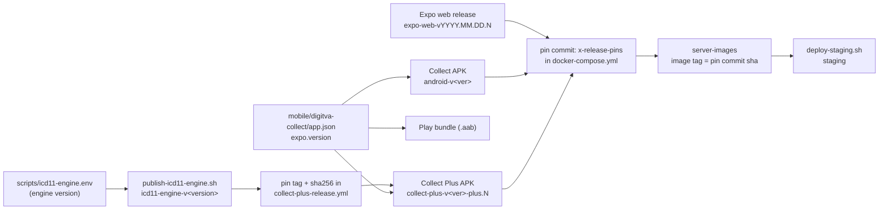

# Release Process

How DigitVA releases each deliverable. This page is a map. It links to the
runbooks that hold the detail and does not copy them. Every statement here
comes from the workflow, script, Dockerfile or compose file named beside it.
Where the files and the owner's instructions disagree, the files win and the
conflict is listed under [Conflicts between sources](#conflicts-between-sources).

Read first:

- [Split Production Deploy Runbook](split-production-deploy.md): the web
  release, pin, image and staging sequence, post-checks and rollback.
- [Android Release Builds](android-release-builds.md): signing, versionCode,
  Play bundle, source maps, published APK table.
- [Runtime And Operations](runtime-and-operations.md): image sources, web
  export hosting, APK download.
- [ICD-11 Android Engine Interface](icd11-android-engine-interface.md): the
  "Building the engine" and "Release" sections.
- [Expo Client Hosting And Bootstrap](expo-client.md): matched WHO and app
  builds, Collect Plus build notes.
- Policy: [No Builds on Servers](../policy/server-builds.md).
- `AGENTS.md` ("Staging and production", "Toolchain"). `CLAUDE.md` is a link to it.

## Rules that apply to every release

- Release builds run only on GitHub Actions. Do not build a release APK or a
  release web export on a developer machine. Local debug builds are for the
  emulator only.
- Servers never build. They pull a CI-built image
  ([No Builds on Servers](../policy/server-builds.md), bead `digitva-k7g8`).
- `publish=false` builds artifacts only (a workflow artifact, 14 days).
  `publish=true` with a tag also creates a GitHub release. Publishing is the
  owner's decision.
- Every workflow with an `environment:` key waits for approval before its
  build job starts (see [Approval gates](#approval-gates)).
- Staging is deployed only with `scripts/deploy-staging.sh <full-sha>`, only on
  the owner's go.

## Deliverables

| Deliverable | Workflow or script | Trigger | Inputs | Gate | Output | Pinned by, and where |
| --- | --- | --- | --- | --- | --- | --- |
| Server image (app, Celery worker, Celery beat, public DORIS: one image) | `.github/workflows/server-images.yml` | `workflow_dispatch`, or a pushed tag `server-v*` | `ref`: branch, tag or FULL commit SHA (default `main`) | environment `server-images` | `ghcr.io/drguptavivek/digitva-app:<full git sha>`, `linux/arm64` only. A `server-v*` tag push without `ref` adds the tag name as a second image tag | `DIGITVA_IMAGE_TAG` in the server `.env`, written by `scripts/deploy-server.sh`. Build args come from `x-release-pins` in `docker-compose.yml` at the built ref |
| Expo web export | `.github/workflows/expo-web-release.yml` | `workflow_dispatch`, `main` only | `publish` (required), `tag` | none declared in the file | Release `expo-web-vYYYY.MM.DD[.N]` with `<tag>.tar.gz`, `.sha256`, `<tag>-who-package.tgz`, `.sha256`, `who-build.json`. Created with `--latest=false`. Unpublished: run artifacts `expo-web-<sha>` and `who-package-<sha>`, 14 days | `EXPO_WEB_TAG` and `EXPO_WEB_SHA256` in `x-release-pins`, `docker-compose.yml`; read by the `expo_web` stage of `Dockerfile` |
| Collect APK (sideload) | `.github/workflows/android-release.yml` | `workflow_dispatch`, `main` only | `publish` (required), `tag` | environment `android-release` | Release `android-v<version>` with `digitva-collect-<version>-armeabi-v7a.apk` and `-arm64-v8a.apk`, each with `.sha256`. Run artifact `digitva-collect-android-<sha>`, 14 days; Hermes source map artifact, 90 days | `ANDROID_APK_TAG`, `ANDROID_APK_ASSET`, `ANDROID_APK_SHA256` in `x-release-pins`; only the `arm64-v8a` asset can be pinned (`android_apk` stage of `Dockerfile`) |
| Collect Plus APK | `.github/workflows/collect-plus-release.yml` | `workflow_dispatch`, `main` only | `publish` (required), `tag` | environment `android-release` | Prerelease `collect-plus-v<version>-plus.N` with `digitva-collect-plus-<version>-arm64-v8a.apk` and `.sha256`. Run artifact `collect-plus-android-<sha>`, 14 days; source map artifact, 90 days | `PLUS_ANDROID_APK_TAG`, `PLUS_ANDROID_APK_ASSET`, `PLUS_ANDROID_APK_SHA256` in `x-release-pins`. The engine it bundles is pinned inside the workflow (next row) |
| Google Play bundle | `.github/workflows/android-play-bundle.yml` | `workflow_dispatch`, `main` only | none | environment `android-release` | Run artifact `digitva-collect-android-play-<sha>` with `digitva-collect-<version>-play.aab` and `.sha256`, 14 days. No release, no Play upload; the owner uploads it | Not pinned anywhere |
| ICD-11 engine (build check) | `.github/workflows/icd11-engine-build.yml` | `workflow_dispatch`; pull requests and pushes to `main` that touch the engine paths listed in the file | none | none declared in the file | Run artifact `icd11-engine-<sha>`, 7 days. Never publishes | Not pinned. It reports whether its build equals the pinned release |
| ICD-11 engine (release) | `scripts/package-icd11-engine.sh`, then `scripts/publish-icd11-engine.sh`, run by hand by the owner | Manual | `OUT_DIR` | The owner runs it; CI never does | Release `icd11-engine-v<ICD11_ENGINE_VERSION>` with `icd11-engine-<version>.tar.gz` and `.sha256` | Version in `scripts/icd11-engine.env`. `ICD11_ENGINE_TAG` and `ICD11_ENGINE_SHA256` in the `env:` block of `.github/workflows/collect-plus-release.yml` (edited by hand) |
| Staging deployment | `scripts/deploy-staging.sh <full-sha>` on the Mac, which runs `scripts/deploy-server.sh` on the host over SSM | Manual, owner's go | full 40-character lowercase sha of a `server-images` build | The owner's go. The script has no prompt | The host runs that image | `DIGITVA_IMAGE_TAG` in the host `.env` |

The Mac-built engine release stays the pinned one for now: the CI build is not
byte-identical to it (bead `digitva-9cll.11`; the build ID, `.comment` and about
1.6 KB of `.rodata` differ, per the engine interface page).

## Dependency order



The reason for each edge:

- Engine release to Collect Plus. The Plus workflow downloads
  `icd11-engine-<version>.tar.gz` from the release and checks it against
  `ICD11_ENGINE_SHA256`. It stops at once if the pin is not a sha256, if
  `ICD11_ENGINE_TAG` does not match `scripts/icd11-engine.env`, or if the
  staged library lacks `digitva_icd11_init`, `_call` or `_free`. The release
  must exist before the pin commit, or the Plus build fails.
- `app.json` version to the APKs. All three Android workflows read
  `expo.version` from `mobile/digitva-collect/app.json`. The release tag, the
  asset names and the versionCode come from it.
- Web release to pin to server image. The image does not build the web client.
  The `expo_web` stage downloads `https://github.com/drguptavivek/DigitVA/releases/download/<tag>/<tag>.tar.gz`
  and fails unless its sha256 equals `EXPO_WEB_SHA256`. The release therefore
  has to be published before the pin, and the pin has to be pushed before the
  image is built.
- APK releases to pin to server image. The `android_apk` stage downloads and
  checks the pinned arm64 assets into `/opt/digitva/android`, which the server
  serves at `/download/android`. Only a new image run picks up a new APK pin.
- Server image to staging. `deploy-server.sh` refuses a sha whose image is not
  in GHCR (`docker manifest inspect`).

The Play bundle, the engine build check and the Hermes source maps feed nothing
else.

## Approval gates

The build job of `server-images.yml` declares `environment: server-images`.
`android-release.yml`, `collect-plus-release.yml` and `android-play-bundle.yml`
declare `environment: android-release` on their build job. Per the owner, every
run waits there for approval. The required-reviewer rule is a GitHub
environment setting, so the files cannot prove it; `split-production-deploy.md`
says "The owner approves the `server-images` GitHub environment when
requested."

The gate sits on the build job. The `publish` jobs have no `environment:` key,
so a run that was approved to build also publishes when `publish=true`. Decide
`publish` before you dispatch.

`expo-web-release.yml` and `icd11-engine-build.yml` declare no environment. The
files give them no gate.

## Server image

Files: `.github/workflows/server-images.yml`, `Dockerfile`,
`docker-compose.yml` (`x-release-pins`), `docker-compose.images.yml`,
`scripts/deploy-server.sh`, `Makefile` (`prod-pull`, `prod-rollback`).

```bash
# SERVER_SHA is the full 40-character commit, for example from: git rev-parse HEAD
gh workflow run server-images.yml --ref main -f ref="$SERVER_SHA"
```

- Use a branch, a tag or a FULL commit SHA for `ref`. A short SHA fails at
  checkout: `actions/checkout` treats it as a branch or tag name and fetches
  `refs/heads/<ref>*` and `refs/tags/<ref>*`, which match nothing (run
  41055136060, 2026-10-30). The deploy scripts also demand a full, lowercase
  40-character sha.
- The image tag is the full commit sha. The build args are read from
  `docker-compose.yml` at that commit (`docker compose config` in the
  checkout), so the pins must already be committed and pushed on `ref`.
- It builds `linux/arm64` only. The SmartVA submodule `vendor/smartva-analyze`
  is fetched; `vendor/who-icd11-api` is not (it is in `.dockerignore`).
- Verify: the run summary prints the digest and the tag. `docker manifest inspect
  ghcr.io/drguptavivek/digitva-app:<sha>` is what the deploy scripts run.
- Rollback: see [Staging deployment](#staging-deployment).

## Expo web release

Files: `.github/workflows/expo-web-release.yml`, `scripts/build-who-package.mjs`,
`scripts/build-expo-web-cache.mjs`, `scripts/profile-expo-web.mjs`.

```bash
# Build only, nothing published (artifact kept 14 days). A tag is optional here.
gh workflow run expo-web-release.yml --ref main -f publish=false

# Publish. The tag must match expo-web-vYYYY.MM.DD or expo-web-vYYYY.MM.DD.N and be new.
gh workflow run expo-web-release.yml --ref main -f publish=true -f tag=expo-web-v2026.10.30.1
```

- Tag convention: `expo-web-vYYYY.MM.DD[.N]`. The workflow checks it with a
  regex when `publish=true`, or when any tag is given. An unpublished run names
  the archive `expo-web-dev-<7-char sha>`.
- Jobs: `build-who`, then `build`, then `publish`. The build runs the WHO
  package checks, `npm test`, the typecheck, `npm run export:web`, the cache
  builder and the bundle profiler (`--require-who`). The archive has fixed
  order, owner and mtime, and the job refuses AppleDouble (`._`) entries.
- A web client change is anything under `mobile/digitva-collect` that the web
  uses, or `vendor/who-va-2022`.
- Pin: take the sha256 from the release's own `<tag>.tar.gz.sha256` asset. Do
  not use the WHO package's hash. Edit only `EXPO_WEB_TAG` and
  `EXPO_WEB_SHA256` in `x-release-pins`. Example: commit `66c50c638`
  ("Pin web release expo-web-v2026.10.29.2 with the consent reload fix").
- Verify (from `split-production-deploy.md`): download the release into a new
  empty directory and check both archives.

  ```bash
  gh release download "$WEB_TAG" --dir "$RELEASE_DIR" \
    --pattern "$WEB_TAG.tar.gz*" --pattern "$WEB_TAG-who-package.tgz*" \
    --pattern who-build.json
  (cd "$RELEASE_DIR" && shasum -a 256 -c "$WEB_TAG.tar.gz.sha256")
  (cd "$RELEASE_DIR" && shasum -a 256 -c "$WEB_TAG-who-package.tgz.sha256")
  ```

- Rollback: no script. The pins live in the server commit, so rolling the
  server back to an older commit restores the older web release
  (`split-production-deploy.md`). Old releases stay published.

## Collect and Collect Plus APKs

Files: `.github/workflows/android-release.yml`,
`.github/workflows/collect-plus-release.yml`, `scripts/verify-android-release.sh`,
`mobile/digitva-collect/app.json`, `mobile/digitva-collect/app.config.js`,
`mobile/digitva-collect/plugins/with-android-abi-splits.js`.

```bash
# Collect: tag must equal android-v<app.json expo.version>
gh workflow run android-release.yml --ref main -f publish=true -f tag=android-v0.3.16

# Collect Plus: tag must be collect-plus-v<app.json expo.version>-plus.N, N a positive integer
gh workflow run collect-plus-release.yml --ref main -f publish=true -f tag=collect-plus-v0.3.16-plus.1

# Build only
gh workflow run android-release.yml --ref main -f publish=false
gh workflow run collect-plus-release.yml --ref main -f publish=false
```

Version and versionCode:

- The app version lives in `mobile/digitva-collect/app.json` (`expo.version`,
  now `0.3.15`). `mobile/digitva-collect/package.json` also says `0.3.15`, but
  no workflow reads it. The workflows read only `app.json` and require plain
  `major.minor.patch`.
- `app.json` holds `android.versionCode: 1`. That is only the default for
  non-release builds. A release build (`DIGITVA_ANDROID_RELEASE_BUILD=1`)
  requires `DIGITVA_ANDROID_VERSION_CODE`, which the workflow sets to
  `major*10000 + minor*100 + patch` (minor and patch must be below 100).
  `0.3.15` gives `315`.
- Final versionCode: `base*10 + 1` for the `armeabi-v7a` APK, `base*10 + 2` for
  the `arm64-v8a` APK (Collect and Collect Plus), `base*10 + 3` for the Play
  bundle. `0.3.15` gives `3152` for arm64.
- The same version gives the same versionCodes. Bump `app.json` before every
  published release (`android-release-builds.md`). The `N` in a Plus tag does
  not change the versionCode.
- Collect Plus shows version `<version>-plus` inside the app (`app.config.js`),
  but its release tag uses the plain `app.json` version.
- Both workflows bake in `EXPO_PUBLIC_API_BASE_URL`
  (`https://digitvav3.causeofdeathindia.com`) and a screenshot allowance
  (`EXPO_PUBLIC_ALLOW_SCREENSHOTS_UNTIL`), set in each workflow's `env:`.

Verify:

- The workflows run `scripts/verify-android-release.sh` themselves and fail the
  build on a mismatch. It needs `apksigner` and `aapt`.
  Usage: `scripts/verify-android-release.sh APK EXPECTED_CERT_SHA256 EXPECTED_API_BASE_URL EXPECTED_VERSION_CODE [EXPECTED_PACKAGE]`.
  It rejects debug signing, checks the certificate, the package id, the label,
  the versionCode, and that the embedded JavaScript has the HTTPS API origin and
  no development origin. Collect Plus passes package
  `com.causeofdeathindia.digitvacollect.plus`.
- To check a downloaded APK by hand, run the script with the certificate
  fingerprint from `android-release-builds.md` and, for arm64 `0.3.15`,
  versionCode `3152`.
- Checksums: `shasum -a 256 -c <asset>.sha256` in the download directory.
- Rollback: no script. Pin an earlier tag and sha256 in `x-release-pins` and
  build a new image. Published releases are not deleted by any workflow.

After a published APK, pin it:

- Edit `ANDROID_APK_*` and `PLUS_ANDROID_APK_*` in `x-release-pins` (example:
  commit `709064303`, "Pin Collect 0.3.15 and Collect Plus 0.3.15"). A partial
  pin fails the image build.
- Staging serves hosted APKs from `private/android-hosted`
  (`DIGITVA_ANDROID_APK_DIR`). A new image does not replace those files;
  see `android-release-builds.md` for the copy steps.

## Google Play bundle

```bash
gh workflow run android-play-bundle.yml --ref main
```

It builds with `DIGITVA_DISTRIBUTION=play`, which turns off the in-app APK
update check and the ABI splits. It checks the signature, the certificate and
the embedded config, and uploads `digitva-collect-<version>-play.aab` with a
`.sha256`. There is no publish input. The owner uploads the bundle to Play.
Which key becomes the Play upload key is still an owner decision (comment in
the workflow). Details: `android-release-builds.md`, "Google Play bundle".

## ICD-11 engine

Files: `.github/workflows/icd11-engine-build.yml`,
`scripts/icd11-engine.env`, `scripts/package-icd11-engine.sh`,
`scripts/publish-icd11-engine.sh`.

Build check (CI):

```bash
gh workflow run icd11-engine-build.yml --ref <branch>
```

It also runs on its own for pull requests and pushes to `main` that touch the
engine source, `stage-engine.js`, the packaging script, `icd11-engine.env` or
the workflow. It fails if `rd_gen.xml` is stale, the exports are not exactly
`digitva_icd11_init`, `_call` and `_free`, a LOAD segment is not 16 KB aligned,
or a download does not match its sha256. It never publishes. It reports, without
failing, whether it equals the pinned release.

Release (owner, by hand):

1. Set `ICD11_ENGINE_VERSION` in `scripts/icd11-engine.env`
   (format `YYYY.MM.DD.N`, now `2026.10.29.1`). Bump it whenever the engine or
   its WHO data changes.
2. Package: `scripts/package-icd11-engine.sh OUT_DIR`. It reads the spike
   folder (`DIGITVA_ICD11_SPIKE_DIR`, else `private/`).
3. Publish: `scripts/publish-icd11-engine.sh OUT_DIR`. It checks the local
   sha256, creates release `icd11-engine-v<version>`, downloads the release
   copy, and compares it byte for byte with the local archive. It prints
   `published <tag>; sha256 <hex>`.
4. Edit `ICD11_ENGINE_TAG` and `ICD11_ENGINE_SHA256` in
   `.github/workflows/collect-plus-release.yml` by hand, using the printed
   sha256. Commit and push this together with the publish
   (`icd11-android-engine-interface.md`, "Release"): the Plus build fails until
   the release exists and the pin matches.
5. Run the phone parity kit and JNI smoke by hand; CI has no device
   (`icd11-android-engine-interface.md`).

Rollback: none in the script. Old engine releases stay published; pin the older
tag and sha256 again. The `2026.10.25.1` release cannot be used by the current
tree (`icd11-android-engine-interface.md`).

## Staging deployment

Files: `scripts/deploy-staging.sh`, `scripts/deploy-server.sh`, `scripts/ssm.sh`,
`Makefile` (`prod-pull`, `prod-rollback`).

Before the owner's go, audit the diff since the deployed commit for old-APK
compatibility (error codes, response shapes, session refusal) and for anything
that could drop unsent work (`AGENTS.md`, "Staging and production"). Staging
has real user accounts and phones on older APKs.

```bash
scripts/deploy-staging.sh "$SERVER_SHA"     # full 40-character lowercase sha, from the Mac
```

What it does, from the scripts:

- Checks that the host checkout is clean, `DIGITVA_IMAGE_TAG` is in `.env`,
  at least 6 GB is free, and the hosted APK override and files exist.
- Checks that the commit and the image `ghcr.io/drguptavivek/digitva-app:<sha>`
  are available.
- Takes a database dump and requires a successful backup entry.
- Runs `scripts/deploy-server.sh` with `SKIP_BACKUP=1` (the backup is already
  taken). That script switches the maintenance page on, checks out the sha,
  pins `DIGITVA_IMAGE_TAG`, removes the stale `minerva_venv` volume, runs
  `make prod-pull`, waits for a healthy app, requires `flask db current` to
  equal `flask db heads`, then lifts the maintenance page and prunes old
  images.
- Checks the running image, the health status, that `.env` changed only in
  `DIGITVA_IMAGE_TAG`, and that the hosted APK checksums are unchanged. It
  prints `DEPLOY_STAGING_OK` with the previous commit, the previous tag and the
  rollback command.

Rollback, on the host as the checkout owner:
`sudo -Hu ubuntu env SKIP_BACKUP=1 bash scripts/deploy-server.sh <previous full sha>`,
or `make prod-rollback TAG=<previous full sha>`. Do not run `flask db downgrade`
unless the release notes say so (`split-production-deploy.md`, section 6).

Production uses `scripts/deploy-server.sh` by the steps in
[Split Production Deploy Runbook](split-production-deploy.md). There is no
production wrapper script.

## Release recipes

Each recipe assumes `publish` was approved by the owner.

### Server-only change

1. Commit and push to `main`. Run the tests.
2. `gh workflow run server-images.yml --ref main -f ref="$SERVER_SHA"` with the
   full sha. Wait for the `server-images` approval and a green run.
3. Audit the diff since the deployed commit for old-APK compatibility.
4. On the owner's go: `scripts/deploy-staging.sh "$SERVER_SHA"`. Require
   `DEPLOY_STAGING_OK`.

### Web client change

1. Push the change to `main`.
2. `gh workflow run expo-web-release.yml --ref main -f publish=true -f tag=expo-web-vYYYY.MM.DD.N`.
   Confirm the run's `headSha` is the intended source.
3. Download the release, check both `.sha256` files, take the app tarball's
   sha256.
4. Edit `EXPO_WEB_TAG` and `EXPO_WEB_SHA256` in `docker-compose.yml`. Commit
   and push the pin.
5. Run `server-images` on the pin commit (full sha).
6. Audit the diff, then deploy to staging as above.

Skipping steps 1 to 4 leaves the server on the old web client, whatever the
repository now contains.

### App change (Collect and/or Collect Plus)

1. Bump `expo.version` in `mobile/digitva-collect/app.json` (and keep
   `package.json` in step; no workflow reads it).
2. Push to `main`.
3. Collect: `gh workflow run android-release.yml --ref main -f publish=true -f tag=android-v<version>`.
   Plus: `gh workflow run collect-plus-release.yml --ref main -f publish=true -f tag=collect-plus-v<version>-plus.N`.
   Approve the `android-release` gate for each.
4. Verify the checksums and, if needed, `scripts/verify-android-release.sh`.
5. To serve the APKs from the server and the help page: edit the pins in
   `x-release-pins`, push, run `server-images`, deploy, then handle the staging
   hosted APK override.
6. If the app change also changes web code, do the web client recipe too.
   The APK workflows do not use the web release.
7. For Google Play: `gh workflow run android-play-bundle.yml --ref main`, and
   the owner uploads the bundle.

### Engine change

1. Change the engine; run `build.sh` locally and commit a fresh `rd_gen.xml`.
2. Let `icd11-engine-build` run on the pull request or push. It must be green.
3. Run the phone parity kit and JNI smoke by hand.
4. Owner: bump `scripts/icd11-engine.env`, run `package-icd11-engine.sh` and
   `publish-icd11-engine.sh`.
5. Pin the printed sha256 and the new tag in `collect-plus-release.yml`, commit
   and push.
6. Then the Collect Plus step of the app recipe, with the next `plus.N` or a
   new app version.

### Full release of everything

In this order:

1. Engine (only if it changed): the engine recipe up to the pin commit.
2. Bump `expo.version` in `app.json`. Push to `main`.
3. Publish the web release (`expo-web-release.yml`).
4. Publish Collect (`android-release.yml`) and Collect Plus
   (`collect-plus-release.yml`). Dispatch the Play bundle if wanted. Each waits
   for its own approval.
5. Take the three sha256 values from the `.sha256` files. Edit
   `EXPO_WEB_*`, `ANDROID_APK_*` and `PLUS_ANDROID_APK_*` in one pin commit.
   Push.
6. Run `server-images` on that commit.
7. Audit the diff since the deployed commit. On the owner's go,
   `scripts/deploy-staging.sh <that sha>`. Then copy the new APKs into the
   hosted override as `android-release-builds.md` describes.

## Pitfalls

- Short SHA. `server-images` `ref` takes a branch, a tag or a FULL commit SHA.
  A short SHA fails at checkout. Use `git rev-parse HEAD`.
- An unpublished web build does not reach the server. `publish=false` leaves a
  14-day run artifact only. The image downloads a published release by tag, so
  an unpublished tag fails the image build, and an old pin keeps serving the
  old web client.
- Pin before image. The image takes its pins from `docker-compose.yml` at the
  built ref. Run `server-images` on a commit that has the pin, not on the commit
  that was released.
- Wrong checksum. Use the sha256 of `<tag>.tar.gz`, not of the WHO package, and
  not a local hash of a rebuilt archive.
- Gate waits. Every build waits for approval at its environment. A dispatched
  run sits idle until the owner approves. The publish job is not gated again.
- Branch dispatch does nothing. The web, Collect, Collect Plus and Play
  workflows run their jobs only when `github.ref` is `refs/heads/main`.
- Tag mismatches. The Collect tag must be exactly `android-v<app.json version>`.
  The Plus tag must be `collect-plus-v<version>-plus.N`. A bad tag fails in the
  publish job, after the build.
- Plus and the engine pin. Plus fails at once if `ICD11_ENGINE_SHA256` is not a
  sha256, if the tag differs from `scripts/icd11-engine.env`, or if the engine
  lacks the three exports.
- Same version, same versionCode. A rebuild without a version bump reproduces
  the same versionCodes (`android-release-builds.md`), so bump `app.json`
  before every published release.
- Screenshot allowance. Each APK workflow sets
  `EXPO_PUBLIC_ALLOW_SCREENSHOTS_UNTIL` to a fixed instant (currently
  `2026-11-25T08:12:11Z`). Screenshots block again after it.
- Hosted APKs on staging are not part of the image. Check them after a deploy.
- Mac-built versus CI-built engine. Do not swap the pinned engine for the CI
  build until bead `digitva-9cll.11` is closed.
- Never run `make prod-build` on a server.
- A release does not authorize a deployment, and a deployment instruction does
  not authorize a publish (`expo-client.md`, `split-production-deploy.md`).

## Who decides what

| Decision | Owner | Developer |
| --- | --- | --- |
| Set `publish=true` and the release tag | Decides | Proposes, dispatches once told |
| Approve the `server-images` and `android-release` gates | Approves | Waits |
| Build-only runs (`publish=false`) | | Runs them to test |
| Publish the engine release and pin it in `collect-plus-release.yml` | Runs `publish-icd11-engine.sh` | Prepares the version bump, the package and the pin edit |
| Edit and push the `x-release-pins` commit | | Does it from the release's `.sha256` assets |
| Staging deployment | Gives the go | Audits the diff for old-APK compatibility first; runs `deploy-staging.sh` |
| Rollback | Decides | Runs the printed command |
| Play upload, and which key signs for Play | Decides | Provides the bundle |
| Signing keystore and secrets | Holds | Does not handle them |
| New work not on the handoff's ranked list | Decides | Asks first (`AGENTS.md`) |

## Conflicts between sources

- `scripts/publish-icd11-engine.sh` creates the release only. It does not
  change `collect-plus-release.yml`; the pin is a hand edit.
- `android-release-builds.md` still has a "Local release build" section and
  says local release builds were authorized in an earlier session. The same
  page says release builds stay on CI, and `docs/policy/server-builds.md` says
  the APK is "built in CI or locally". This page follows the current rule:
  releases are CI only.
- `expo-web-release.yml` and `icd11-engine-build.yml` have no `environment:`
  gate. `android-play-bundle.yml` shares the `android-release` gate with the two
  APK workflows.
- `doc_type` for this page is `current-state`, the value `cli-reference.md` and
  most pages here use. `reference` is used by only a few pages here.

## Not verified

- That the `server-images` and `android-release` environments require reviewers.
  That is repository settings. The files only name the environments.
- Whether the engine release, created by `gh release create` without
  `--latest`, takes the "Latest" label on the releases page. The Collect
  workflow's release has no `--latest=false`; the web release does.
