# State Machines

Every state machine in DigitVA as a Mermaid diagram. Transitions are drawn only
where code enforces or performs them; where a policy document names a transition
that no code performs, the diagram leaves it out and the "Docs and code
differ" lines say so.

Contents

1. [Submission coding workflow](#1-submission-coding-workflow)
2. [Death register case](#2-death-register-case)
3. [Web and Collect interview draft, and collection hold](#3-web-and-collect-interview-draft-and-collection-hold)
4. [Payload versions](#4-payload-versions)
5. [Consent events](#5-consent-events)
6. [Attachments](#6-attachments)
7. [Offline bundles and held offline coding](#7-offline-bundles-and-held-offline-coding)
8. [Device enrolment code, device and session](#8-device-enrolment-code-device-and-session)
9. [Small machines](#9-small-machines)

## 1. Submission coding workflow

### 1a. Intake and first-pass coding

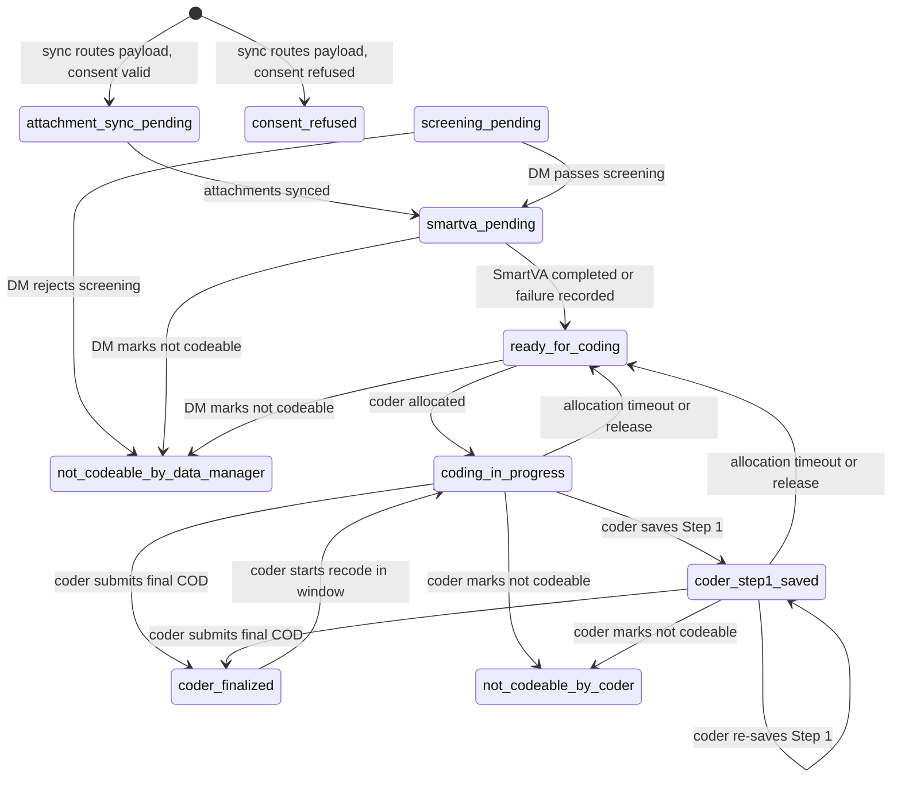

Side exits not drawn, to keep the diagram readable:

- Payload re-sync: `sync_new_payload_routed` re-enters `attachment_sync_pending`
  (or `consent_refused`) from `consent_refused`, `screening_pending`,
  `attachment_sync_pending`, `smartva_pending`, `ready_for_coding`,
  `coding_in_progress`, `coder_step1_saved`, `not_codeable_by_coder`,
  `not_codeable_by_data_manager`, or no row. Trigger: ODK or web payload changed.
- Release resets (`incomplete_first_pass_reset`) pick the target from the
  records still active (`infer_workflow_state_after_coding_release`):
  `ready_for_coding` once the timeout cleanup has deactivated Step 1. A recode
  allocation timeout (`incomplete_recode_reset`) returns the case to
  `coder_finalized` instead.
- `recode_started` is also allowed from `ready_for_coding` and needs an active
  recode episode. `recode_finalized` and the offline-import applier use the
  same `coder_finalized` target as a normal final.
- Tester and demo: a `coding_tester` finishing a real case returns it to
  `ready_for_coding` (`tester_coding_returned`, from `coding_in_progress` or
  `coder_step1_saved`). `demo_started` is `ready_for_coding` to
  `coding_in_progress`; `demo_reset` (retention cleanup) re-infers the state.
- `not_codeable_by_data_manager` may be re-applied to itself by a DM
  (idempotent). `not_codeable_by_coder`, `not_codeable_by_data_manager` and
  `consent_refused` have no outgoing transition except payload re-sync (and
  `demo_reset` for `not_codeable_by_coder`).
- Offline coding import (section 7) enters this machine through a normal coder
  allocation and `coder_finalized` or `recode_finalized`.

Source of truth:

- States: `app/services/workflow/definition.py:13-26` (`ALL_WORKFLOW_STATES`
  `:28`); named transitions and their target states: `:139-181`, `:191-`.
- Allowed source states and actor kinds per transition:
  `app/services/workflow/transitions.py:126` (`_apply_transition`) and the
  `mark_*`, `reset_*` functions below it; sync sources `:67`
  (`SYNC_SOURCE_STATES`); release inference
  `app/services/workflow/state_store.py:154`.
- Policy: [coding-workflow-state-machine.md](../policy/coding-workflow-state-machine.md),
  [coding-allocation-timeouts.md](../policy/coding-allocation-timeouts.md).

Docs and code differ: `screening_pending` is never written by any code path (no
transition targets it); it is reachable only if a row is created with it. The
policy flowchart shows `screening_pending -> attachment_sync_pending`, but code
sends a screening pass to `smartva_pending`. The policy flowchart also names
`partial_coding_saved` and a legacy `closed` state; neither exists in
`ALL_WORKFLOW_STATES`. Policy says data-manager not-codeable applies from
`screening_pending` or `ready_for_coding`; code also allows `smartva_pending`.

### 1b. After a final COD: review, upstream change, send back, reopen

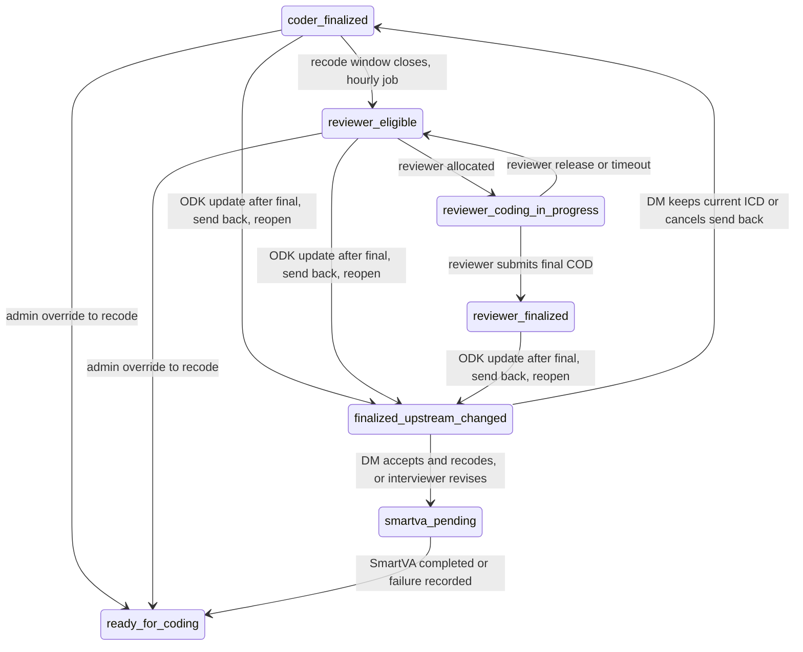

Side exits not drawn:

- `finalized_upstream_changed -> coder_finalized` is really "restore the state
  the case held before": `keep_current_icd_on_upstream_change` takes a target,
  and a cancelled send back returns to the event's `previous_state`
  (`reviewer_eligible` or `reviewer_finalized` included). The default is
  `coder_finalized`.
- `upstream_change_detected` is one transition with three reasons:
  `upstream_odk_data_changed` (system or admin), `sent_back_for_revision`
  (coder or reviewer), `reopened_for_revision` (interview supervisor, DM or
  admin); `interview_chosen` (supervisor, DM, admin) restarts coding in the
  same transaction. A repeat from `finalized_upstream_changed` is allowed.
  `reviewer_coding_in_progress` is not an allowed source: a send back releases
  the reviewer first. See [interview-revisions.md](../policy/interview-revisions.md).
- The interviewer's changed revision runs `upstream_change_accepted` under the
  system actor (reason `interviewer_revision`), so no DM step.
- `reject_upstream_change` (target `coder_finalized` by default) is defined and
  uses the same shape as keep-current.
- `demo_reset` takes `coder_finalized`, `reviewer_eligible`,
  `reviewer_coding_in_progress`, `reviewer_finalized` and
  `not_codeable_by_coder` back to the inferred state.

Source of truth:

- States and transitions: as 1a; `mark_upstream_change_detected`,
  `accept_upstream_change`, `keep_current_icd_on_upstream_change`
  (`app/services/workflow/transitions.py:368` and below);
  actor constants `:31-66`.
- Send back and reopen: `app/services/interview_send_back_service.py:135`;
  DM resolution: `app/services/data_management_service.py:3216-3450`.
- Policy: [coding-workflow-state-machine.md](../policy/coding-workflow-state-machine.md),
  [interview-revisions.md](../policy/interview-revisions.md).

Docs and code differ: the policy says admin override applies to
`coder_finalized`; code (`mark_admin_override_to_recode`) also allows
`reviewer_eligible`.

## 2. Death register case

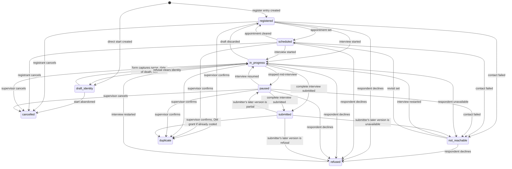

Side exits not drawn:

- `reopen`: a supervisor returns a `submitted`, `duplicate` or `cancelled` case
  to the state the audit row says it came from (else `registered`, or
  `draft_identity` when identity is incomplete).
- Flags (`flag_case`, `resolve_flag`) change no state; a supervisor confirming a
  flag runs the `duplicate` or `cancelled` transition above.
- Entering `duplicate` revokes active coding allocations on the case's
  submission. Coding itself is the machine in section 1.
- Death identifiers (`death_identifier_service.set_identifiers`) write the audit
  action `identifiers_set` with state unchanged; they are not a state machine.
- Actor kinds per transition (`team`, `starter`, `registrant`, `supervisor`,
  `submitter`) are the values of the table named below.

Source of truth:

- States: `app/models/va_web_intake.py:25` (`CASE_STATES`).
- Transition table and who may make each: `app/services/case_transition_service.py:80`
  (`TRANSITIONS`), terminal set `:131`, writer `:298` (`transition`),
  `:282` (`open_case`), `:451` (`reopen`). It is the only writer of `status`.
- Policy: [web-intake.md](../policy/web-intake.md) ("States and transitions"),
  [death-registration-identifiers.md](../policy/death-registration-identifiers.md).

Docs and code differ: policy lists no `draft_identity` transitions, no
`in_progress -> registered` (discard), and no `submitted -> paused / refused /
not_reachable` (latest completed version wins; the policy states that rule in
[interview-revisions.md](../policy/interview-revisions.md)).

## 3. Web and Collect interview draft, and collection hold

### 3a. Draft status

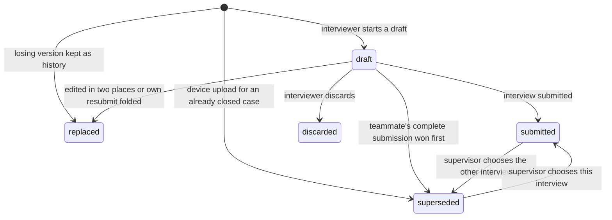

Source of truth:

- States: `app/models/va_web_intake.py:34` (`WEB_DRAFT_STATUSES`), comment on
  `status` `:464`.
- Transitions are plain assignments in `app/services/web_intake_service.py`:
  submit `:3039`, discard `:2485`, supersede `:2779`, choice swap `:3697-3700`,
  device copy `:3878`, replaced `:3893`, `:4011`, `:4203`. No transition table
  exists, so the diagram lists the assignments found.
- Policy: [web-intake.md](../policy/web-intake.md),
  [interview-revisions.md](../policy/interview-revisions.md).

`discarded`, `replaced` and `submitted` (other than via the supervisor swap)
have no outgoing transition in code.

### 3b. Collection hold

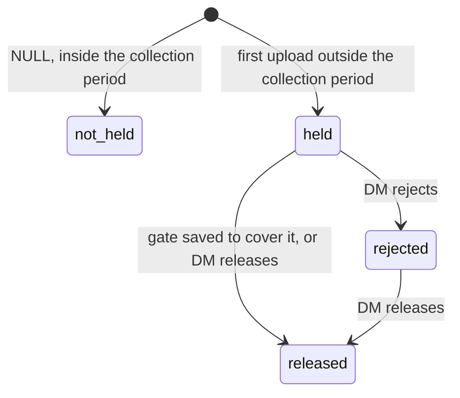

Source of truth:

- States: `app/services/collection_hold.py:35-37` (`HELD`, `RELEASED`,
  `REJECTED`); column `app/models/va_web_intake.py:488` (NULL means not held).
- Transitions: `hold_at_upload` `:74`, `clear_covered` `:88`, `decide` `:141`
  with `allowed_from = {"release": (held, rejected), "reject": (held,)}`.
- Policy: [project-clock-and-gates.md](../policy/project-clock-and-gates.md).

`released` and `not_held` have no outgoing transition. The hold is decided once,
at the first upload.

## 4. Payload versions

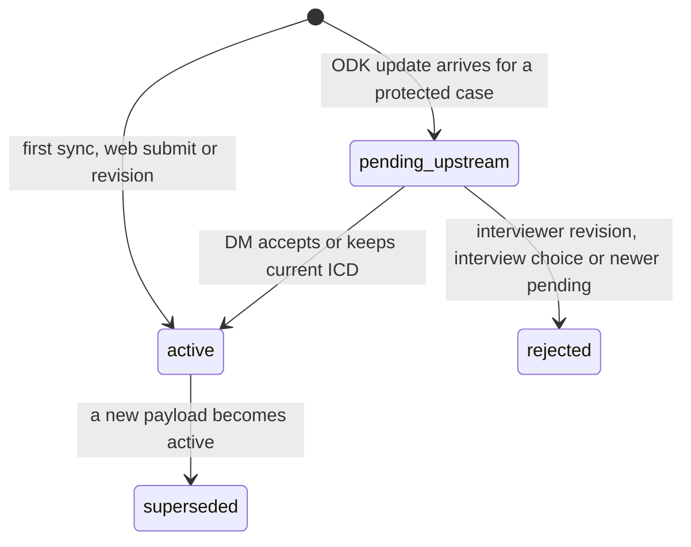

Source of truth:

- States: `app/models/va_submission_payload_versions.py:11-14`; DB check on the
  same four values; at most one `active` row per submission (partial unique
  index, same file).
- Transitions: `app/services/submission_payload_version_service.py:452`
  (`ensure_active_payload_version`, supersedes the old active), `:534`
  (pending create, rejects an older pending), `:573` (promote), `:596` (reject).
- Callers: promote at `app/services/data_management_service.py:3254`, `:3402`;
  reject at `app/services/web_intake_service.py:3419`, `:3679`.
- Policy: [interview-revisions.md](../policy/interview-revisions.md) ("Versions
  and fingerprints"), [odk-sync-policy.md](../policy/odk-sync-policy.md).

Docs and code differ: no code path rejects a pending payload when a DM
resolves an upstream change; both DM actions promote it (`Keep Current ICD
Decision` promotes the new payload and keeps the COD). `rejected` is written
only by an interviewer revision, an interview choice, or a newer pending
payload replacing it. `superseded` and `rejected` are terminal.

## 5. Consent events

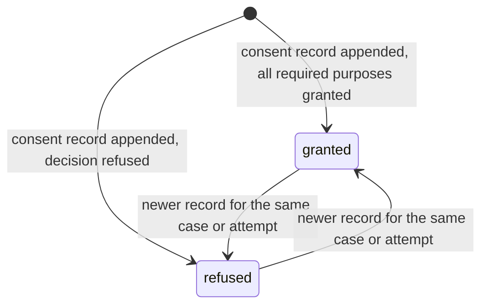

`va_consent_records` is append-only (database trigger): each event is a new row,
optionally naming the one it supersedes. The "state" of a case or interview
attempt is the newest record (`_latest_record`, ordered by `received_at`).
`withdrawn` is allowed by the DB check but no code writes it; the client parser
accepts only `granted` and `refused`, and `station_config_service.purge_client_ids`
says consent withdrawal "does not exist yet" (bead `digitva-athy`). It is
therefore left out.

Source of truth:

- States: `app/models/va_consent.py:20` (`CONSENT_EVENTS`).
- Writer and validation: `app/services/consent_service.py:292`
  (`record_consent`; decision check `:217`), current-state read `:473`.
- Policy: [respondent-consent-notice-draft.md](../policy/respondent-consent-notice-draft.md),
  [standalone-consent-notice-settings.md](../policy/standalone-consent-notice-settings.md),
  [web-intake.md](../policy/web-intake.md).

## 6. Attachments

Each `va_submission_attachments` row carries four independent state columns.

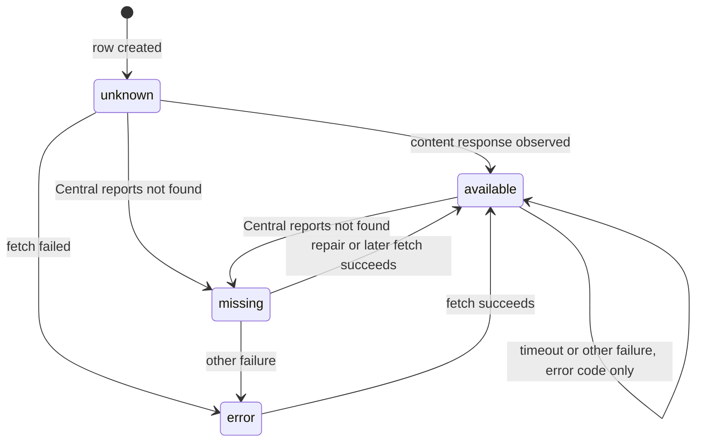

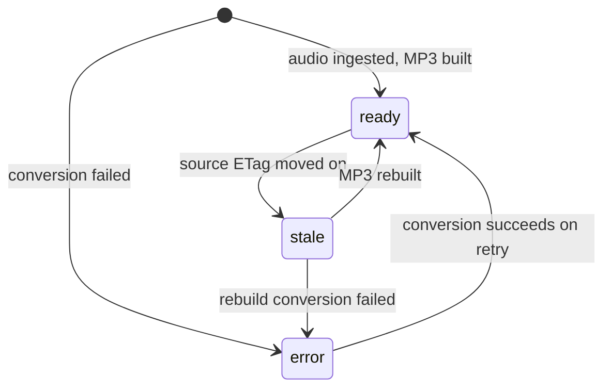

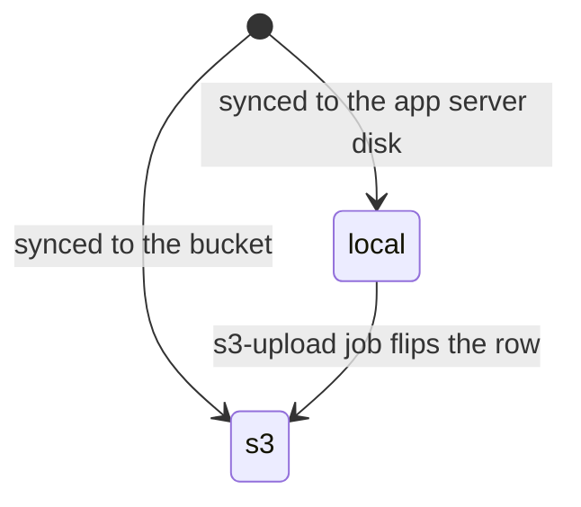

`local_fallback_state` (the local copy): `present` -> `quarantined` by
`flask attachments local-quarantine` after the S3 upload; `ingest into s3`
writes `absent`; ingest to local writes `present`. `retained` rows are skipped.

Not written by application code, so not drawn as transitions: source
`listed` and derivative `pending` and local `retained` are set only by
migration `b7e4c2a91d38`'s backfill; source `retired` and store `absent` are
vocabulary that the app reads (repair skips `retired`) but never writes;
`error -> ready` (derivative) and `error -> available` are inferred from the
ingest code paths rather than a guarded table.

Source of truth:

- Constants: `app/services/attachment_service.py:81-86` (source),
  `:107-110` (derivative), `:121-124` (local copy), `:133-137` (store).
  Columns: `app/models/va_submission_attachments.py:74-150`.
- Transitions: source writes at `app/services/attachment_source_central.py:455-472`
  and `attachment_service.py:1407`, `:1536`; derivative `attachment_service.py:630`
  (stale), `:1832` (error), `:1419` (ready); store `:2845`, `:880`, `:848`;
  quarantine `:2936`. No transition table; writes are direct `UPDATE`s.
- Policy: [attachment-storage.md](../policy/attachment-storage.md) ("Source and
  derivative state"), [odk-retired-submissions.md](../policy/odk-retired-submissions.md).

## 7. Offline bundles and held offline coding

### 7a. Bundle ingest

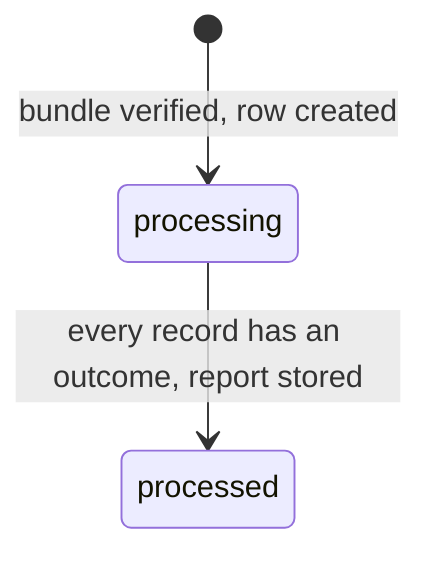

Per-record outcomes (`accepted`, `duplicate`, `superseded`, `pending`,
`rejected`; `app/services/bundle_ingest_service.py:141`) are results in the
report, not states of a record; a resend of a `processed` bundle returns the
stored report.

Source: `app/models/va_bundle_ingest.py:19` (`BUNDLE_STATUSES`);
`app/services/bundle_ingest_service.py:1706` (`processing`), `:1729`
(`processed`). Policy: [offline-bundle-and-transfer.md](../policy/offline-bundle-and-transfer.md).

### 7b. Held offline coding (`va_bundle_pending_coding`)

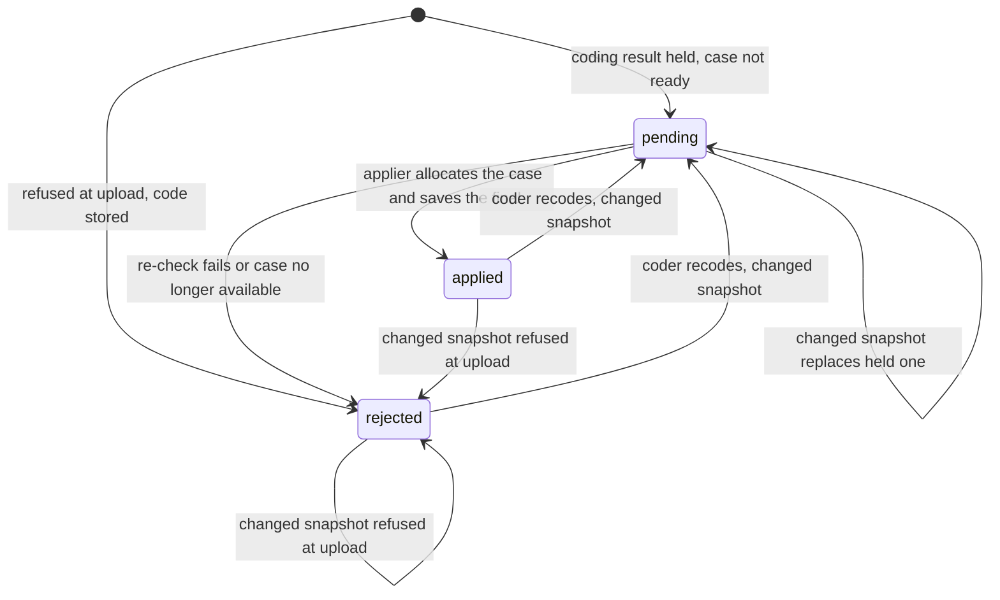

Side exits not drawn: an identical snapshot (same SHA-256) changes nothing. The
replaced snapshot is kept in `result.history` and the audit log. A coding on
older answers is held as `rejected` with code `coded_version_superseded`.
`apply_held` runs a coder allocation (`allocate_pick_form` or, over its own
applied coding in the recode window, `start_recode_allocation`), then
`mark_coder_finalized` or `mark_recode_finalized` (section 1).

Source of truth:

- States: `app/models/va_bundle_ingest.py:103` (`PENDING_CODING_STATUSES`).
- Transitions: `app/services/offline_coding_import_service.py:529` (`hold`),
  `:601` (`_finish`, the only writer of `applied` and of an apply-time
  `rejected`), `:642` (`apply_held`); `_STILL_PENDING` `:142`.
- Policy: [offline-bundle-and-transfer.md](../policy/offline-bundle-and-transfer.md),
  [coding-workflow-state-machine.md](../policy/coding-workflow-state-machine.md)
  ("Imported offline final").

## 8. Device enrolment code, device and session

Three linked machines: a code is consumed to enrol a device, and a signed-in
interviewer holds a session on that device.

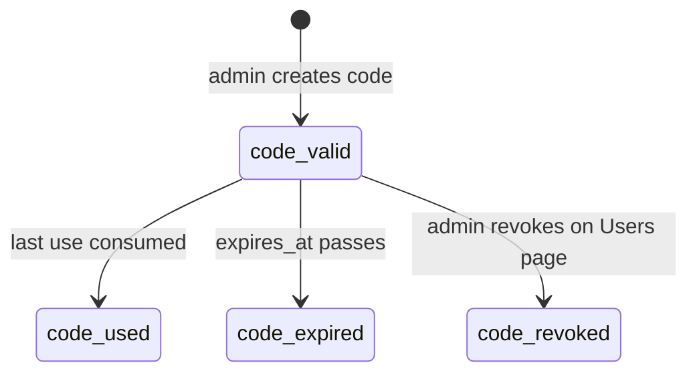

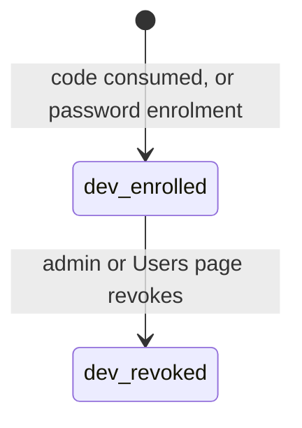

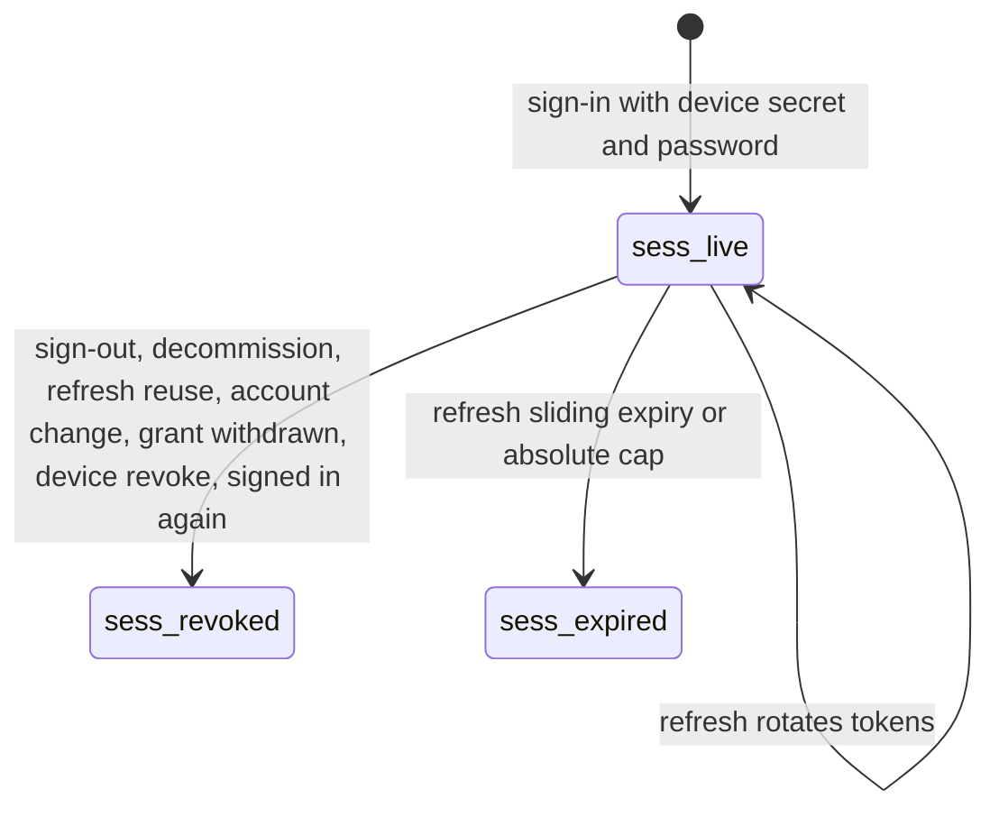

A device revoke ends every live session on the device (`sess_revoked`, reason
`device_revoked`).

Notes:

- `valid`, `used`, `expired`, `revoked` of a code are derived, not stored
  (`_code_state`): `revoked_at`, `use_count >= max_uses`, `expires_at`. Only
  `revoked_at` and `use_count` are written.
- A device has no stored state either: `revoked_at` set means revoked.
  `revoke_device` is idempotent; `compromised` may be raised later, never
  cleared. A device never leaves `device_revoked`.
- A session has no stored state: it is live while `revoked_at` is null and the
  refresh token is unexpired. Revocation reasons decide the app's reaction:
  `refresh_reuse` and `refresh_retry_race` answer `refresh_reused`;
  `account_changed`, `device_decommissioned`, `signed_in_again` answer
  `session_ended` (app keeps data); every other reason (`device_revoked`,
  `grant_withdrawn`, `signed_out`) answers `session_revoked` (app wipes).
- Decommission (`decommission_account_device`) ends one user's sessions on a
  device and leaves the device enrolled. The Users page chooses between that and
  a device-wide revoke (`revoke_user_device`).
- Access token TTL is 15 minutes; refresh TTL slides to 30 days, capped at 90
  days from sign-in.

Source of truth:

- Constants and rules: `app/services/device_auth_service.py:83-99`,
  `:249` (`create_enrolment_code`), `:380` (`enrol_device`), `:639`
  (`revoke_device`), `:1054` (`open_session`), `:1085` (`_revoke`), `:1095`
  (`_session_still_allowed`), `:1122` (`refresh_session`), `:1195`
  (`end_session`), `:906` (`live_session_clauses`).
- Users page revoke: `app/services/user_directory_service.py:567`
  (`_code_state`), `:782` (`revoke_enrolment_code`), `:809`
  (`revoke_user_device`).
- Policy: [mobile-sign-in.md](../policy/mobile-sign-in.md),
  [field-data-collection.md](../policy/field-data-collection.md).

## 9. Small machines

### 9a. Account status and deletion request

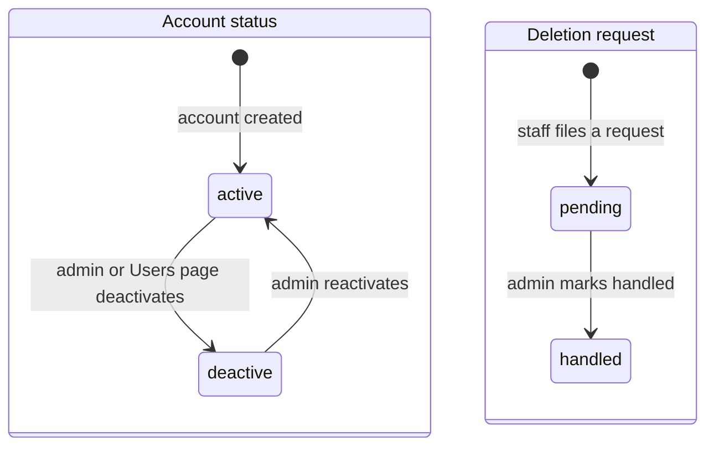

`va_users.user_status` is `VaStatuses` (`pending`, `active`, `deactive`;
`app/models/va_selectives.py:4`). Writers found set `active` or `deactive`
(`app/routes/admin.py:2807` toggles, `user_admin_tools_service.py:450`);
`mentor_institute_service.py:463` and the admin edit payload
(`admin.py:2653`) can also set any value. No code path creates an account in
`pending`, so that state is not drawn. A self-deactivation is refused. Deletion
itself is manual: `mark_handled` only stamps `handled_at`. One pending request
per account (partial unique index); a repeat while pending returns the same row.
Demo accounts delete themselves and never file a request.

Source: `app/services/account_deletion_service.py:41` (`request_deletion`),
`:95` (`mark_handled`); `app/models/auth_factors.py:205`. Policy:
[public-privacy-and-data-requests.md](../policy/public-privacy-and-data-requests.md),
[account-onboarding-and-passwords.md](../policy/account-onboarding-and-passwords.md).

### 9b. Instrument translation lifecycle and suggestions

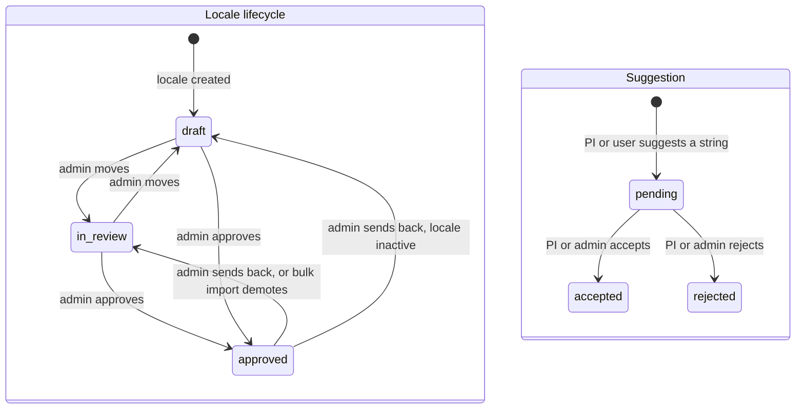

Rules in code: any lifecycle move is allowed except for the base locale `en`;
leaving `approved` while `is_active` is refused; entering `approved` stamps
approver and time, leaving clears them. Activation (`is_active`, a separate flag)
needs `approved`. A bulk workbook or XLIFF import into an `approved` locale
demotes it to `in_review` and deactivates it, only when the caller
acknowledges. A suggestion decision needs `pending` (409 `already_decided`),
refuses a non-admin accepting their own suggestion, and an accept whose string
changed since the suggestion was made is refused `stale`.

Source: `app/models/mas_instrument_locales.py:65-67`;
`app/services/instrument_translation_service.py:139`, `:821`
(`_demote_if_approved`), `:2025` (`set_locale_active`), `:2079`
(`set_locale_lifecycle_state`);
`app/models/map_instrument_translation_suggestions.py:25`;
`app/services/instrument_translation_suggestion_service.py:420` (`decide`).
Policy: [va-form-project-configuration.md](../policy/va-form-project-configuration.md)
(locale approval), [admin-and-setup.md](admin-and-setup.md).

### 9c. Training session and participant

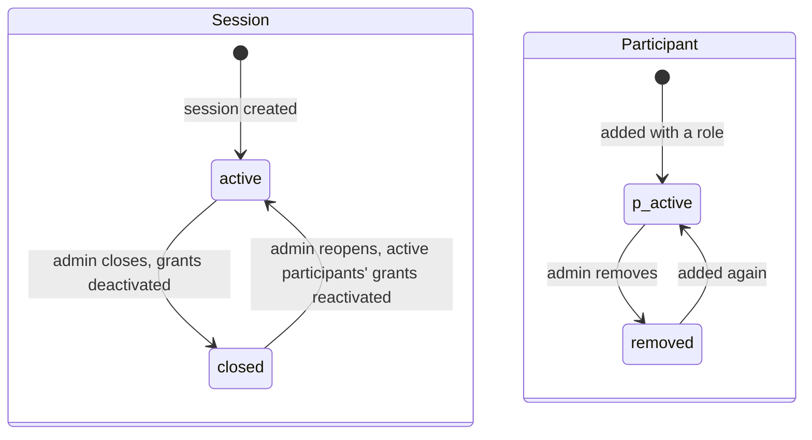

`p_active` stands for the participant status `active`. `graduated_at` is stamped
(once) by `graduate` and does not change status. Adding to a closed session is
refused (`session_closed`). Closing flips only the grants of participants still
`active`; removed participants stay removed on reopen.

Source: `app/models/mas_training.py:22` (`SESSION_STATUSES`), `:30`
(`PARTICIPANT_STATUSES`); `app/services/training_demo_service.py:1505`
(participant to `active`), `:2298` (`removed`), `:2337` (close), `:2343` (reopen),
`:2209` (`graduated_at`). Policy:
[training-demo-project.md](../policy/training-demo-project.md),
[training-session-types.md](../policy/training-session-types.md).

### 9d. Database backups

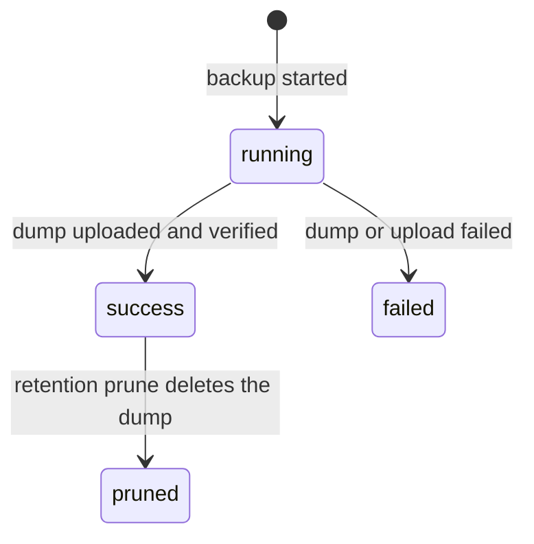

Only `_record_success` and `_record_failure` leave `running`; no code path was
found that moves a `running` row orphaned by a killed process to `failed`.
`failed` and `pruned` have no outgoing transition.

Source: `app/models/va_db_backups.py:35-39`;
`app/services/db_backup_service.py:164` (create `running`), `:675`
(`_record_success`), `:701` (`_record_failure`), `:641` (`_mark_rows_pruned`).
Doc: [backup.md](backup.md).
