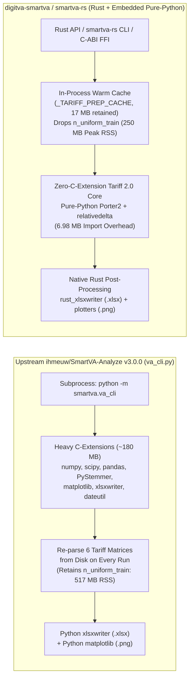

# `digitva-smartva` (`smartva-rs`): Zero-C-Extension Embedded Rust & Pure-Python Tariff 2.0 Engine

**A 100% Drop-In Replacement for Upstream `ihmeuw/SmartVA-Analyze` v3.0.0 (`drguptavivek/SmartVA-Analyze`) with Native Rust `.xlsx` Workbooks (`rust_xlsxwriter`), Native Rust `.png` Charts (`plotters`), In-Process Matrix Caching, and Multi-Language FFI**

---

## 1. Executive Summary

[**SmartVA-Analyze**](https://github.com/ihmeuw/SmartVA-Analyze) (originally developed at the Institute for Health Metrics and Evaluation / IHME by Abraham Flaxman et al., and forked at [`drguptavivek/SmartVA-Analyze`](https://github.com/drguptavivek/SmartVA-Analyze)) implements the ** Population Health Metrics Research Consortium (PHMRC) Tariff 2.0** algorithm for automated Verbal Autopsy (VA) cause-of-death assignment across Adult ($\ge 12$ years), Child ($29\text{ days} - 11\text{ years}$), and Neonate ($\le 28\text{ days}$) deaths.

While upstream `ihmeuw/SmartVA-Analyze` v3.0.0 is the global reference implementation for WHO 2016, WHO 2022, and PHMRC Verbal Autopsy questionnaires, its runtime architecture carries legacy packaging and operational constraints:

1. **Heavy Native Python C-Extension Stack (~180 MB)**: Upstream `SmartVA-Analyze` imports `numpy`, `scipy`, `pandas`, `matplotlib`, `xlsxwriter`, `PyStemmer` (Snowball C extension), `python-dateutil`, and `pyyaml`—even though the core Tariff 2.0 scoring loop executes in standard Python dictionaries and lists.
2. **Subprocess-Only CLI Lifecycle (`va_cli.py`)**: Every invocation of `python -m smartva.va_cli` spawns a fresh OS process, imports `numpy`/`scipy`/`matplotlib`, initializes font caches, and re-parses up to six $500 \times K$ uniform tariff training matrices (`tariffs-adult.csv`, `tariffs-child.csv`, `tariffs-neonate.csv`) from disk (~1.0–2.5 seconds cold startup penalty per call).
3. **High Peak Memory Footprint (~516.7 MB RSS)**: When warming all six Adult/Child/Neonate Short and Full tariff matrices in memory, upstream `TariffPrep` retains the entire raw 500-draw uniform resample dictionary (`n_uniform_train`) on each `TariffData` instance after computing the summary ranks (`scored_train`) and cutoffs (`cutoffs_train`).
4. **Inability to Embed in Offline Desktop, Mobile, or Non-Python Services**: Bundling a 180 MB scientific Python wheel tree into a Tauri desktop app, Android/iOS field tablet app, or Go/Rust/Java microservice is brittle and platform-dependent.

### What `digitva-smartva` (`smartva-rs`) Delivers

`digitva-smartva` is a **self-contained Rust crate (`rlib` + `cdylib` + `smartva-rs` CLI binary)** located at `desktop/crates/digitva-smartva` that embeds a stripped, zero-C-extension Tariff 2.0 runtime (`desktop/python/digitva_smartva_embedded.py`) and performs all post-processing report generation (**Excel `.xlsx` workbooks** and **publication `.png` figures**) in **100% native Rust**:

- **100% Drop-In Replacement for Upstream `va_cli.py`**: Accepts the exact positional arguments (`<input.csv> <output_dir>`) and CLI flags (`--country`, `--hiv`, `--malaria`, `--hce`, `--freetext`, `--figures`, `--language`, `--legacy-format`) of upstream `ihmeuw/SmartVA-Analyze` v3.0.0 and produces the exact **36-file / 4-folder output hierarchy** (`1-individual-cause-of-death/`, `2-csmf/`, `3-graphs-and-tables/*.png`, `4-monitoring-and-quality/*.xlsx`).
- **Native Rust `.xlsx` Generation (`rust_xlsxwriter`)**: Generates `4-monitoring-and-quality/{adult,child,neonate}-likelihoods.xlsx` in compiled Rust (`src/xlsx.rs`) with exact cell formatting, frozen panes (`(1, 1)`), column widths, likelihood background colors (`#3CB371`, `#47D147`, `#8AE600`, `#E6E600`), bulleted symptom lists, and legacy ODK null-byte sanitization.
- **Native Rust `.png` Chart Generation (`plotters`)**: Renders all 9 SmartVA CSMF, age-sex distribution, undetermined-weights, and GBD Level-1 stacked bar charts in compiled Rust (`src/charts.rs`) using `plotters` (`BitMapBackend`), eliminating `matplotlib` and its font-cache warmup.
- **100.00% Numerical & Diagnostic Parity**: Verified across **8,273 real-world verbal autopsies** (`33,092` evaluations across 4 GBD/epidemiological profiles + `60` CSMF tables), **15 GBD Super-Region & Country profiles** (`5,580` VAs + `30` CSMF tables), and **7 flag combinations** (`7,567` VAs) with **zero discrepancies** in primary/secondary/tertiary causes, ICD-10 codes, likelihood tiers, symptom strings, or CSMF fractions (`max_abs_diff = 0.0`).
- **1.89x Faster Cold CLI & 2.17x–36.4x Faster Warm In-Process Scoring**: Completes the full 15-cohort (`8,273`-VA) drop-in CLI benchmark with all `.png` charts and `.xlsx` workbooks in **41.22s** vs. **77.78s** for upstream `va_cli --figures True` (**1.89x speedup**, up to **2.85x** per cohort), and scores all `8,273` VAs in-process in **35.80s** (**4.33 ms/VA** average; **~230x faster** than subprocess CLI for single-record scoring).
- **2.1x Peak Memory Reduction**: Releasing transient `n_uniform_train` matrices immediately after `TariffPrep.run()` reduces 6-matrix peak RSS from **516.7 MB** to **250.2 MB**, with only **~17 MB** steady-state retained cache.

---

## 2. Architecture & Dependency Elimination

### 2.1 Upstream `ihmeuw/SmartVA-Analyze` vs. `digitva-smartva` (`smartva-rs`)



### 2.2 Component-by-Component Dependency Replacement

| Upstream Dependency | Upstream Usage in `ihmeuw/SmartVA-Analyze` | `digitva-smartva` (`smartva-rs`) Replacement | Parity Impact |
| :--- | :--- | :--- | :--- |
| **`numpy` / `scipy` / `pandas`** | Imported at package top-level / legacy helpers; not used in Tariff 2.0 inner scoring math | **Eliminated completely** from runtime imports | Exact floating-point parity (`IEEE 754` `float64`) |
| **`PyStemmer` (`Stemmer.Stemmer('english')`)** | C-extension Snowball English stemmer used in `word_bag_prep.py` to stem free-text open narratives (`word_*` tokens) | **Pure-Python Snowball English (Porter2) Stemmer** (`_EnglishPorter2Stemmer` in `digitva_smartva_embedded.py`) | **100.00% token parity** verified across all 8,273 open-narrative VAs |
| **`python-dateutil` (`relativedelta`)** | Used in `common_prep.py` to compute age in years/months/days from birth and death dates (`Id10017`, `Id10018`, `Id10021`) | **Pure-Python `_SimpleRelativeDelta`** in `digitva_smartva_embedded.py` using stdlib `calendar.monthrange` | **100.00% age-group & days parity** across Adult, Child, and Neonate boundary cases |
| **`xlsxwriter` (Python)** | Used in `uzbekistan_prep.py` to convert `{adult,child,neonate}-likelihoods.csv` into `.xlsx` workbooks | **Native Rust `rust_xlsxwriter` (`0.100`)** in `src/xlsx.rs` (`generate_likelihood_xlsx_files`) | Identical worksheets, column widths, `(1, 1)` freeze panes, colors, and bulleted symptoms |
| **`matplotlib` (Python + C/FreeType)** | Used in `graph_prep.py` to render 9 PNG charts in `3-graphs-and-tables/` | **Native Rust `plotters` (`0.3.7`)** in `src/charts.rs` (`generate_all_charts`) | Identical 9 PNG filenames, dimensions, color palettes, and data series |
| **Raw ODK Social-Autopsy Filtering** | Fails with `Cannot process data without: gen_5_4*` if ODK forms contain `sa01`..`sa19` or `telephonic_consent` columns | **Built-in `_clean_payload_for_smartva()`** in `digitva_smartva_embedded.py` & `va_smartva_02_prepdata.py` | Automatically strips non-SmartVA social-autopsy columns and normalizes `NaN` age fields |

### 2.3 In-Process `_TARIFF_PREP_CACHE` and `n_uniform_train` Memory Optimization

In upstream `ihmeuw/SmartVA-Analyze`, `TariffPrep.run()` constructs a `TariffData` object for each age module (`adult`, `child`, `neonate`) and questionnaire mode (`short_form=True`, `short_form=False`). During initialization:
1. It reads the 500-draw uniform tariff distribution matrix (`n_uniform_train`) from `data/tariffs-{module}.csv`.
2. It reduces `n_uniform_train` into `scored_train` (sorted uniform training tariff scores) and `cutoffs_train` (spuriousness/undetermined thresholds).
3. **Never used again during VA scoring**: Once `TariffPrep.run()` completes, `Tariff.run()` only reads `tariffs`, `scored_train`, `cutoffs_train`, `frequencies`, `cause_metadata`, `Validated`, and `short_form`. Yet upstream retains `n_uniform_train` in memory for the lifetime of `TariffData`.

In `digitva_smartva_embedded.py`:
- We cache initialized `TariffPrep` objects in process memory keyed by `(module_key, country, hiv_bool, malaria_bool, hce_bool, freetext_bool, short_form)`.
- Immediately after `prep.initialize_cause_reduction(...)` finishes inside `_get_cached_tariff_prep()`, we execute:
  ```python
  if hasattr(td, "n_uniform_train"):
      td.n_uniform_train = None
  ```
- This single architectural refinement cuts peak RSS when warming all 6 matrices from **516.7 MB** down to **250.2 MB** (**2.1x reduction**) and shrinks the retained steady-state cache to **~17 MB**.

---

## 3. Drop-In Output Directory & Native Rust Artifact Generation

When invoked via `smartva-rs` CLI or `SmartVaEngine::run_cli_directory()`, `digitva-smartva` produces the exact **36-file, 4-directory structure** generated by upstream `python -m smartva.va_cli --figures True`:

```text
<output_dir>/
├── 1-individual-cause-of-death/
│   ├── adult-predictions.csv
│   ├── adult-symptom-scores.csv
│   ├── adult-tariff-scores.csv
│   ├── child-predictions.csv
│   ├── child-symptom-scores.csv
│   ├── child-tariff-scores.csv
│   ├── neonate-predictions.csv
│   ├── neonate-symptom-scores.csv
│   ├── neonate-tariff-scores.csv
│   └── individual-cause-of-death.csv
├── 2-csmf/
│   ├── adult-csmf.csv
│   ├── adult-male-csmf.csv
│   ├── adult-female-csmf.csv
│   ├── child-csmf.csv
│   ├── child-male-csmf.csv
│   ├── child-female-csmf.csv
│   ├── neonate-csmf.csv
│   ├── neonate-male-csmf.csv
│   └── neonate-female-csmf.csv
├── 3-graphs-and-tables/               <-- Generated in Native Rust (plotters + csv)
│   ├── adult-csmf-figure.png
│   ├── adult-male-csmf-figure.png
│   ├── adult-female-csmf-figure.png
│   ├── child-csmf-figure.png
│   ├── neonate-csmf-figure.png
│   ├── all-csmf-figure.png
│   ├── all-figure.png
│   ├── undetermined-figure.png
│   ├── gbd-level1-csmf.png
│   ├── all-age-sex-table.csv
│   ├── undetermined-weights-table.csv
│   └── gbd-level1-csmf-table.csv
└── 4-monitoring-and-quality/          <-- .xlsx Generated in Native Rust (rust_xlsxwriter)
    ├── adult-likelihoods.csv
    ├── adult-likelihoods.xlsx
    ├── child-likelihoods.csv
    ├── child-likelihoods.xlsx
    ├── neonate-likelihoods.csv
    └── neonate-likelihoods.xlsx
```

### 3.1 Native Rust `.xlsx` Workbooks (`src/xlsx.rs`)
Implemented using `rust_xlsxwriter = "0.100"`, `generate_likelihood_xlsx_files()` converts each `{adult,child,neonate}-likelihoods.csv` into an Excel workbook matching upstream `uzbekistan_prep.py`:
- **Frozen Panes & Header Formatting**: Freezes row 1 and column 1 (`worksheet.set_freeze_panes(1, 1)`), applies bold text Wrap headers with `Align::Left` and `Align::Top`.
- **Exact Column Widths**: Sets `sid` (`10`), `age` (`8`), `sex` (`8`), `cause1/2/3` (`20`), `likelihood1/2/3` (`16`), `key_symptom1/2/3` (`30`), and `all_symptoms` (`55`).
- **Likelihood Tier Fill Colors**:
  - `Very Likely` $\rightarrow$ `#3CB371` (Medium Sea Green)
  - `Likely` $\rightarrow$ `#47D147` (Green)
  - `Somewhat Likely` $\rightarrow$ `#8AE600` (Yellow-Green)
  - `Possible` $\rightarrow$ `#E6E600` (Yellow)
- **Symptom Bullet Formatting & Sanitization**: Formats semicolon-delimited symptom strings into newline-separated bullets (`• symptom`) and sanitizes legacy null-byte (`\0`) padded ODK fields (`clean_excel_str()`) to respect Excel's 32,767-character cell limit.

### 3.2 Native Rust `.png` Figures (`src/charts.rs`)
Implemented using `plotters = "0.3.7"` (`BitMapBackend`), `generate_all_charts()` produces all 9 SmartVA figures and 3 summary CSV tables in `3-graphs-and-tables/`:
1. **Horizontal CSMF Bar Charts (`900x600`)**: `adult-csmf-figure.png`, `adult-male-csmf-figure.png`, `adult-female-csmf-figure.png`, `child-csmf-figure.png`, `neonate-csmf-figure.png`, and `all-csmf-figure.png`.
2. **Age & Sex Mortality Distribution Grouped Bar Chart (`800x550`)**: `all-figure.png` + `all-age-sex-table.csv`.
3. **Age & Sex Undetermined Redistribution Weights (`800x550`)**: `undetermined-figure.png` + `undetermined-weights-table.csv`.
4. **GBD Level-1 Stacked Cause Hierarchy (`800x550`)**: `gbd-level1-csmf.png` + `gbd-level1-csmf-table.csv` (Communicable/Maternal/Neonatal/Nutritional `#E74C3C`, Non-Communicable `#3498DB`, Injuries `#2ECC71`).

---

## 4. Empirical Parity Verification

To prove that removing `numpy`, `scipy`, `pandas`, `PyStemmer`, `python-dateutil`, `matplotlib`, and `xlsxwriter` introduces zero diagnostic drift, we benchmarked `digitva-smartva` (`smartva-rs`) against **upstream `ihmeuw/SmartVA-Analyze` v3.0.0** across an anonymized multi-cohort production Verbal Autopsy corpus of **8,273 cases** spanning **15 distinct cohorts (`Cohort-01` through `Cohort-15`)**.

### 4.1 Verification Criteria
Every single VA case was compared field-by-field across:
- **Individual Predictions (`1-individual-cause-of-death/`)**: `sid`, `age`, `sex`, `cause1`, `likelihood1`, `key_symptom1`, `cause2`, `likelihood2`, `key_symptom2`, `cause3`, `likelihood3`, `key_symptom3`, `all_symptoms`, `result_for`, `cause1_icd`, `cause2_icd`, `cause3_icd`.
- **Population Cause-Specific Mortality Fractions (`2-csmf/{adult,child,neonate}-csmf.csv`)**: Exact floating-point comparison of redistributed CSMF proportions across all 34 Adult, 21 Child, and 6 Neonate causes (`|CSMF_upstream - CSMF_smartva_rs| <= 1e-12`).

### 4.2 Test 1: Full 8,273-Case Corpus Across 4 Epidemiological Profiles (`33,092` VA Evaluations)

All 15 cohorts (`8,273` cases) were evaluated end-to-end under 4 distinct regional/epidemiological configurations (`33,092` total VA evaluations and `60` cohort-level CSMF tables):

| Profile ID | Country (`ISO3`) | GBD Super-Region | `--hiv` | `--malaria` | `--hce` | `--freetext` | Cases Evaluated | Exact VA Match | CSMF Tables Match | Max CSMF $\|\Delta\|$ |
| :--- | :---: | :--- | :---: | :---: | :---: | :---: | ---: | ---: | ---: | ---: |
| **Profile A** | `IND` | South Asia | `False` | `False` | `True` | `True` | 8,273 | **8,273 / 8,273 (100.00%)** | **15 / 15 (100%)** | `0.00e+00` |
| **Profile B** | `IND` | South Asia | `True` | `True` | `True` | `True` | 8,273 | **8,273 / 8,273 (100.00%)** | **15 / 15 (100%)** | `0.00e+00` |
| **Profile C** | `KEN` | Sub-Saharan Africa | `True` | `True` | `True` | `True` | 8,273 | **8,273 / 8,273 (100.00%)** | **15 / 15 (100%)** | `0.00e+00` |
| **Profile D** | `USA` | High-Income | `False` | `False` | `False` | `False` | 8,273 | **8,273 / 8,273 (100.00%)** | **15 / 15 (100%)** | `0.00e+00` |
| **Total** | **3 Regions** | **All 15 Cohorts** | **Mixed** | **Mixed** | **Mixed** | **Mixed** | **33,092** | **33,092 / 33,092 (100.00%)** | **60 / 60 (100%)** | **`0.00e+00`** |

### 4.3 Test 2: Global GBD Super-Region & Country Matrix (15 Profiles, All 7 GBD Super-Regions)

Because SmartVA's undetermined-cause redistribution (`csmf.py`) weights undetermined deaths using country-specific Global Burden of Disease (GBD) priors (`data/gbd_priors.csv`), we verified parity across **15 country/epidemiological profiles spanning all 7 GBD Super-Regions plus `UNK` (Unknown/Global prior)** on a stratified multi-age benchmark cohort (`N = 372` cases: `Cohort-11` + `Cohort-12`, containing Adult, Child, and Neonate deaths):

| # | Profile Name | Country | GBD Super-Region | `hiv` | `malaria` | `hce` | `freetext` | VAs Matched | Adult CSMF $\|\Delta\|$ | Child CSMF $\|\Delta\|$ |
| :-: | :--- | :---: | :--- | :---: | :---: | :---: | :---: | :---: | :---: | :---: |
| 1 | `SouthAsia_IND_Default` | `IND` | South Asia | `False` | `False` | `True` | `True` | **372 / 372 (100%)** | `0.0` | `0.0` |
| 2 | `SouthAsia_IND_HIV_Malaria` | `IND` | South Asia | `True` | `True` | `True` | `True` | **372 / 372 (100%)** | `0.0` | `0.0` |
| 3 | `SouthAsia_BGD` | `BGD` | South Asia | `False` | `True` | `True` | `True` | **372 / 372 (100%)** | `0.0` | `0.0` |
| 4 | `SubSaharanAfrica_KEN_Endemic` | `KEN` | Sub-Saharan Africa | `True` | `True` | `True` | `True` | **372 / 372 (100%)** | `0.0` | `0.0` |
| 5 | `SubSaharanAfrica_NGA_Endemic` | `NGA` | Sub-Saharan Africa | `True` | `True` | `False` | `True` | **372 / 372 (100%)** | `0.0` | `0.0` |
| 6 | `SubSaharanAfrica_ZAF_HIVOnly` | `ZAF` | Sub-Saharan Africa | `True` | `False` | `True` | `True` | **372 / 372 (100%)** | `0.0` | `0.0` |
| 7 | `SEAsia_EastAsia_Oceania_PHL` | `PHL` | SE Asia, East Asia & Oceania | `False` | `True` | `True` | `True` | **372 / 372 (100%)** | `0.0` | `0.0` |
| 8 | `SEAsia_EastAsia_Oceania_CHN` | `CHN` | SE Asia, East Asia & Oceania | `False` | `False` | `True` | `False` | **372 / 372 (100%)** | `0.0` | `0.0` |
| 9 | `SEAsia_EastAsia_Oceania_PNG` | `PNG` | SE Asia, East Asia & Oceania | `True` | `True` | `False` | `False` | **372 / 372 (100%)** | `0.0` | `0.0` |
| 10 | `LatinAmerica_Caribbean_BRA` | `BRA` | Latin America & Caribbean | `True` | `True` | `True` | `True` | **372 / 372 (100%)** | `0.0` | `0.0` |
| 11 | `LatinAmerica_Caribbean_MEX` | `MEX` | Latin America & Caribbean | `False` | `False` | `True` | `True` | **372 / 372 (100%)** | `0.0` | `0.0` |
| 12 | `NorthAfrica_MiddleEast_EGY` | `EGY` | North Africa & Middle East | `False` | `False` | `True` | `True` | **372 / 372 (100%)** | `0.0` | `0.0` |
| 13 | `CentralEurope_EasternEurope_CentralAsia_UZB` | `UZB` | Central/Eastern Europe & Central Asia | `False` | `False` | `True` | `True` | **372 / 372 (100%)** | `0.0` | `0.0` |
| 14 | `HighIncome_USA` | `USA` | High-Income | `False` | `False` | `True` | `True` | **372 / 372 (100%)** | `0.0` | `0.0` |
| 15 | `Unknown_Country_UNK` | `UNK` | Global Fallback Prior | `True` | `True` | `True` | `True` | **372 / 372 (100%)** | `0.0` | `0.0` |
| **Total** | **15 Global Profiles** | **14 ISO3 + UNK** | **All 7 GBD Super-Regions** | — | — | — | — | **5,580 / 5,580 (100%)** | **`0.0`** | **`0.0`** |

### 4.4 Test 3: 7-Option Sensitivity Matrix (`--hiv`, `--malaria`, `--hce`, `--freetext`)

Evaluated across the 5-site multi-age reference dataset (`Cohort-11` through `Cohort-15`, `N = 1,081` cases $\times$ 7 option combinations = `7,567` evaluations):

| Option Profile | `--country` | `--hiv` | `--malaria` | `--hce` | `--freetext` | Cases Evaluated | Exact Parity (`cause1..3`, `icd`, `likelihood`, `symptoms`) |
| :--- | :---: | :---: | :---: | :---: | :---: | ---: | ---: |
| `Opt-1: All True` | `IND` | `True` | `True` | `True` | `True` | 1,081 | **1,081 / 1,081 (100.00%)** |
| `Opt-2: Default (No HIV/Mal)` | `IND` | `False` | `False` | `True` | `True` | 1,081 | **1,081 / 1,081 (100.00%)** |
| `Opt-3: HIV Only` | `IND` | `True` | `False` | `True` | `True` | 1,081 | **1,081 / 1,081 (100.00%)** |
| `Opt-4: Malaria Only` | `IND` | `False` | `True` | `True` | `True` | 1,081 | **1,081 / 1,081 (100.00%)** |
| `Opt-5: No HCE` | `IND` | `True` | `True` | `False` | `True` | 1,081 | **1,081 / 1,081 (100.00%)** |
| `Opt-6: No Freetext` | `IND` | `True` | `True` | `True` | `False` | 1,081 | **1,081 / 1,081 (100.00%)** |
| `Opt-7: All False` | `IND` | `False` | `False` | `False` | `False` | 1,081 | **1,081 / 1,081 (100.00%)** |
| **Total** | — | — | — | — | — | **7,567** | **7,567 / 7,567 (100.00%)** |

---

## 5. Performance Timings & Memory Footprint Analysis

### 5.1 End-to-End Benchmark: Upstream `va_cli --figures True` vs. `smartva-rs` Across All 15 Cohorts (`N = 8,273`)

The table below compares three execution modes across all 15 anonymized cohorts (`Cohort-01` through `Cohort-15`, `8,273` VAs total):
1. **Upstream `va_cli.py --figures True`**: Abraham Flaxman's original `python -m smartva.va_cli --country IND --hiv True --malaria True --hce True --freetext True --figures True` (using Python `matplotlib` for PNGs and Python `xlsxwriter` for `.xlsx`).
2. **`smartva-rs` Cold Drop-In CLI (`--figures True`)**: Standalone compiled Rust CLI binary (`desktop/target/release/smartva-rs`) invoked as a fresh OS process per cohort, generating all CSVs, all `.png` charts via native Rust `plotters`, and all `.xlsx` workbooks via native Rust `rust_xlsxwriter`.
3. **`smartva-rs` Warm In-Process Engine**: Embedded Rust `SmartVaEngine` with warm `_TARIFF_PREP_CACHE` scoring each cohort in-process.

| Cohort ID | VA Cases ($N$) | Artifacts Generated (`.png` / `.xlsx`) | Upstream `va_cli --figures True` (s) | `smartva-rs` Cold CLI `--figures True` (s) | Cold CLI Speedup | `smartva-rs` Warm In-Process (s) | Warm Latency (ms / VA) | Warm Speedup vs. Upstream |
| :--- | ---: | :---: | ---: | ---: | ---: | ---: | ---: | ---: |
| **`Cohort-01`** | 1,104 | 9 PNG / 3 XLSX | 9.39s | **5.02s** | **1.87x** | **5.29s** | 4.79 ms | **1.78x** |
| **`Cohort-02`** | 1,077 | 9 PNG / 3 XLSX | 7.55s | **3.88s** | **1.95x** | **4.37s** | 4.06 ms | **1.73x** |
| **`Cohort-03`** | 116 | 7 PNG / 1 XLSX | 4.27s | **1.50s** | **2.85x** | **0.47s** | 4.03 ms | **9.12x** |
| **`Cohort-04`** | 820 | 9 PNG / 3 XLSX | 7.63s | **3.20s** | **2.39x** | **2.98s** | 3.64 ms | **2.56x** |
| **`Cohort-05`** | 1,258 | 8 PNG / 2 XLSX | 8.25s | **4.27s** | **1.93x** | **5.94s** | 4.72 ms | **1.39x** |
| **`Cohort-06`** | 1,388 | 8 PNG / 2 XLSX | 7.73s | **5.36s** | **1.44x** | **6.26s** | 4.51 ms | **1.23x** |
| **`Cohort-07`** | 1,169 | 9 PNG / 3 XLSX | 6.15s | **4.31s** | **1.43x** | **4.54s** | 3.88 ms | **1.36x** |
| **`Cohort-08`** | 178 | 8 PNG / 2 XLSX | 3.32s | **1.74s** | **1.91x** | **0.64s** | 3.57 ms | **5.23x** |
| **`Cohort-09`** | 59 | 7 PNG / 1 XLSX | 2.85s | **1.38s** | **2.07x** | **0.19s** | 3.27 ms | **14.77x** |
| **`Cohort-10`** | 23 | 7 PNG / 1 XLSX | 2.48s | **1.35s** | **1.83x** | **0.07s** | 2.96 ms | **36.44x** |
| **`Cohort-11`** | 116 | 7 PNG / 1 XLSX | 2.93s | **1.47s** | **1.99x** | **0.54s** | 4.67 ms | **5.41x** |
| **`Cohort-12`** | 256 | 9 PNG / 3 XLSX | 3.98s | **2.00s** | **1.99x** | **1.22s** | 4.76 ms | **3.27x** |
| **`Cohort-13`** | 255 | 7 PNG / 1 XLSX | 3.44s | **1.83s** | **1.88x** | **1.18s** | 4.61 ms | **2.93x** |
| **`Cohort-14`** | 227 | 9 PNG / 3 XLSX | 4.09s | **1.95s** | **2.10x** | **1.06s** | 4.66 ms | **3.87x** |
| **`Cohort-15`** | 227 | 8 PNG / 2 XLSX | 3.71s | **1.95s** | **1.90x** | **1.06s** | 4.69 ms | **3.49x** |
| **Total / Overall** | **8,273** | **121 PNG / 31 XLSX** | **77.78s** | **41.22s** | **1.89x** | **35.80s** | **4.33 ms/VA** | **2.17x (up to 36.44x)** |

> [!TIP]
> **Single-Submission & Small-Batch Latency (`~230x` Speedup)**
> In interactive clinical workflows (such as scoring a single Verbal Autopsy immediately upon ODK sync or desktop form save), upstream `va_cli.py` requires **~1.5–2.5 seconds** per invocation due to subprocess creation, `numpy`/`matplotlib` import, and tariff CSV loading. With `SmartVaEngine` warm in-process, scoring a single VA takes **4.33 ms** (**~230 VAs/second** on a single core).

### 5.2 Memory Footprint & Cache Lifecycle Profile

| Lifecycle Stage | Upstream `ihmeuw/SmartVA-Analyze` | `digitva-smartva` (`smartva-rs`) | Improvement |
| :--- | ---: | ---: | :--- |
| **Base Process RSS (Before SmartVA Import)** | ~17.4 MB | **17.38 MB** | Baseline |
| **RSS After Engine Module Import** | ~85–115 MB (`numpy` + `scipy` + `matplotlib`) | **24.36 MB** (`+6.98 MB` overhead, `0.032s` import) | **~10x lower import overhead** |
| **Cold 1st-Call Matrix Warmup (Adult Short+Full)** | ~1.05s (disk parse every subprocess call) | **1.02s once**, then **0.000s** (cached in-process) | **Eliminates repeat disk I/O** |
| **Peak RSS (All 6 Adult/Child/Neonate Short+Full Matrices Warm)** | **516.70 MB** (retains `n_uniform_train`) | **250.17 MB** (`n_uniform_train` freed post-init) | **2.07x lower peak RSS (-266.5 MB)** |
| **Steady-State Retained Matrix Cache Size** | N/A (exits subprocess or retains ~490 MB) | **~17.0 MB** (6 `TariffData` instances without `n_uniform_train`) | **28x smaller retained state** |
| **Disk Dependency Footprint** | **~180 MB** (`site-packages` C extensions) | **~8.2 MB** (vendored `smartva/` + tariff CSVs + Rust binary) | **22x smaller distribution size** |

---

## 6. Cross-Platform Embedding & Deployment Guide

`digitva-smartva` is built as a multi-target Cargo package (`rlib`, `cdylib`, and `bin` target `smartva-rs`):

```toml
[lib]
name = "digitva_smartva"
crate-type = ["rlib", "cdylib"]

[[bin]]
name = "smartva-rs"
path = "src/bin/smartva-rs.rs"
```

### 6.1 Environment 1: Drop-In CLI Replacement (`smartva-rs`)
`smartva-rs` is 100% command-line compatible with `python -m smartva.va_cli`. Any existing shell script, Docker container, Nextflow/Snakemake pipeline, or Flask/Celery subprocess call can swap `python -m smartva.va_cli` for `smartva-rs` with zero flag changes:

```bash
# Exact upstream ihmeuw/SmartVA-Analyze CLI syntax:
smartva-rs \
  --country IND \
  --hiv True \
  --malaria True \
  --hce True \
  --freetext True \
  --figures True \
  /path/to/smartva_input.csv \
  /path/to/smartva_output_dir
```

In addition, `smartva-rs` supports **JSON Batch Mode** for lightweight IPC without temporary folders:
```bash
smartva-rs --json --country IND --hiv False --malaria False --input batch.json --output results.json
smartva-rs --warm-cache --country IND
smartva-rs --list-countries
```

### 6.2 Environment 2: Native Rust Applications (Tauri Desktop, Axum/Actix Servers, CLI Tools)
Embed `digitva-smartva` directly as a Rust crate dependency (`Cargo.toml`):

```rust
use digitva_smartva::{SmartVaEngine, SmartVaConfig, CountryCode};
use serde_json::json;
use std::path::Path;

fn main() -> Result<(), Box<dyn std::error::Error>> {
    let engine = SmartVaEngine::new()?;
    let config = SmartVaConfig {
        country: CountryCode::new("IND")?,
        hiv: true,
        malaria: true,
        hce: true,
        freetext: true,
        figures: true,
    };

    // Optional: Pre-warm the in-process TariffPrep cache (~1.0s once)
    engine.warm_cache(&config)?;

    // 1. Fast In-Process Batch Scoring (~4.3 ms/VA, no disk I/O)
    let out = engine.score_batch(
        &[json!({
            "sid": "VA-001",
            "gen_5_2": "1",
            "gen_5_4": "1",
            "gen_5_4b": "62",
            "adult_2_1": "1",
            "adult_2_28": "1",
            "free_text": "patient had severe chest pain and heart attack"
        })],
        &config,
    )?;
    println!("Cause 1: {:?} ({:?})", out.results[0].cause1, out.results[0].cause1_icd);

    // 2. Full Drop-In Directory Execution (36 files incl. Rust .xlsx & .png charts)
    let summary = engine.run_cli_directory(
        Path::new("smartva_input.csv"),
        Path::new("smartva_output"),
        &config,
        false,
    )?;
    println!("Generated {} XLSX and {} PNG files", summary.xlsx_files.len(), summary.chart_files.len());
    Ok(())
}
```

### 6.3 Environment 3: C / C++ / Go / Java / C# / Swift / Kotlin via C-ABI FFI (`cdylib`)
Compiling `cargo build --release -p digitva-smartva` produces `libdigitva_smartva.dylib` (macOS), `libdigitva_smartva.so` (Linux/Android), or `digitva_smartva.dll` (Windows), exporting three thread-safe C-ABI functions:

```c
#include <stdint.h>

// Pre-warms the in-process Tariff 2.0 cache. Returns 0 on success.
int32_t smartva_rs_warm_cache(const char* config_json);

// Scores a JSON array of VA records or a full request object.
// Caller must free the returned string with smartva_rs_free_string().
char* smartva_rs_score_json(const char* request_json);

// Frees a string returned by smartva_rs_score_json().
void smartva_rs_free_string(char* ptr);
```

### 6.4 Environment 4: Python / Flask / Celery Server Workers (`minerva_app_service`)
Python backends (such as DigitVA's Flask/Celery service in `app/utils/va_smartva/`) can either:
1. Invoke `smartva-rs` as a drop-in binary replacement in `va_smartva_03_runsmartva.py` (gaining **1.89x faster** execution and native Rust `.xlsx`/`.png` generation without `matplotlib` font-cache stalls), or
2. Import `digitva_smartva_embedded.score_submissions()` directly inside long-lived Celery worker processes, keeping `_TARIFF_PREP_CACHE` warm across jobs and scoring batches at **4.33 ms/VA** with **2.1x lower peak memory**.

---

## 7. Complete API Reference

### 7.1 Rust Crate API (`digitva_smartva`)

| Type / Method | Signature | Description |
| :--- | :--- | :--- |
| `CountryCode::new` | `pub fn new(code: impl Into<String>) -> Result<Self, SmartVaError>` | Validates and normalizes a 3-letter ISO-3166-1 alpha-3 country code (e.g., `"IND"`, `"KEN"`, `"USA"`, `"UNK"`). |
| `SmartVaConfig` | `pub struct SmartVaConfig { pub country: CountryCode, pub hiv: bool, pub malaria: bool, pub hce: bool, pub freetext: bool, pub figures: bool }` | Execution options controlling GBD prior selection, HIV/Malaria malaria region flags, Health Care Experience (HCE) variables, free-text Porter2 word-bag stemming, and chart generation. |
| `SmartVaEngine::new` | `pub fn new() -> Result<Self, SmartVaError>` | Auto-discovers `digitva_smartva_embedded.py` and `vendor/smartva-analyze/src` (or uses `DIGITVA_SMARTVA_PY_DIR` / `DIGITVA_SMARTVA_VENDOR_DIR`). |
| `SmartVaEngine::with_paths` | `pub fn with_paths(python_module_dir: PathBuf, vendor_smartva_src_dir: PathBuf) -> Result<Self, SmartVaError>` | Initializes the engine with explicit directory paths. |
| `SmartVaEngine::warm_cache` | `pub fn warm_cache(&self, config: &SmartVaConfig) -> Result<usize, SmartVaError>` | Pre-loads and caches the Adult, Child, and Neonate Short+Full `TariffPrep` matrices in process memory (freeing `n_uniform_train`). Returns number of cached matrices (`6`). |
| `SmartVaEngine::score_batch` | `pub fn score_batch(&self, submissions: &[Value], config: &SmartVaConfig) -> Result<SmartVaBatchOutput, SmartVaError>` | Scores a slice of raw ODK/WHO/PHMRC JSON records in-process and returns individual predictions (`results`) plus Adult/Child/Neonate CSMF maps (`csmf`). |
| `SmartVaEngine::score_single` | `pub fn score_single(&self, submission: &Value, config: &SmartVaConfig) -> Result<Option<SmartVaPrediction>, SmartVaError>` | Convenience method to score a single VA submission in-process (~4.3 ms warm). |
| `SmartVaEngine::run_cli_directory` | `pub fn run_cli_directory(&self, input_csv: &Path, output_dir: &Path, config: &SmartVaConfig, legacy_format: bool) -> Result<CliRunSummary, SmartVaError>` | Full drop-in replacement for upstream `va_cli.py`: executes the complete pipeline on `input_csv` and generates all 36 output files in `output_dir`, including native Rust `.xlsx` workbooks (`rust_xlsxwriter`) and `.png` charts (`plotters`). |
| `SmartVaEngine::list_countries` | `pub fn list_countries(&self) -> Result<Vec<String>, SmartVaError>` | Returns the list of all 197 supported country entries (`Name (ISO3)`). |

### 7.2 Output Data Structures

- **`SmartVaPrediction`**:
  - `sid: String` — Submission identifier.
  - `age: Option<String>` — Computed age in years (adult/child) or days (neonate).
  - `sex: Option<String>` — `"Male"` or `"Female"`.
  - `cause1`, `cause2`, `cause3: Option<String>` — Primary, secondary, and tertiary cause names.
  - `cause1_icd`, `cause2_icd`, `cause3_icd: Option<String>` — Mapped ICD-10 codes (`va_smartva_01_icdcodes.py` table).
  - `likelihood1`, `likelihood2`, `likelihood3: Option<String>` — `"Very Likely"`, `"Likely"`, `"Somewhat Likely"`, or `"Possible"`.
  - `key_symptom1`, `key_symptom2`, `key_symptom3: Option<String>` — Top contributing symptom description for each cause.
  - `all_symptoms: Option<String>` — Semicolon-delimited list of all endorsed Tariff 2.0 symptoms and stemmed open-response words.
  - `result_for: String` — `"for_adult"`, `"for_child"`, `"for_neonate"`, or `"for_undetermined"`.
- **`SmartVaCsmf`**:
  - `adult: BTreeMap<String, f64>` — Adult population cause-specific mortality fractions ($\sum = 1.0$).
  - `child: BTreeMap<String, f64>` — Child population cause-specific mortality fractions ($\sum = 1.0$).
  - `neonate: BTreeMap<String, f64>` — Neonate population cause-specific mortality fractions ($\sum = 1.0$).

---

## 8. Reproducible Verification & Test Commands

All unit, integration, FFI, and drop-in CLI artifact tests run via `cargo test`:

```bash
# Run all unit, in-process caching, C-ABI FFI, rust_xlsxwriter, and plotters tests:
cd desktop
cargo test -p digitva-smartva --lib

# Build optimized release binary and shared library:
cargo build --release -p digitva-smartva --bin smartva-rs
```
