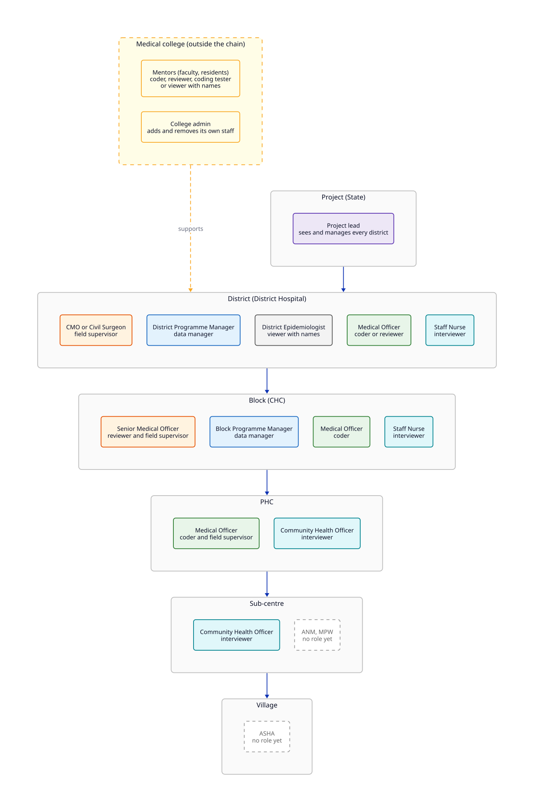

# Who can do what in DigitVA

This page explains, in plain language, what each person can and cannot do in
DigitVA. It is written for principal investigators, district Chief Medical
Officers and Civil Surgeons, and medical college faculty who mentor a
district.

DigitVA runs two kinds of project. A **site project** is a research study
with a few field sites. A **district project** follows the public health
system: district, block (CHC), PHC and sub-centre.

## The 5-Stage Process in DigitVA

Work in DigitVA flows through 5 clear stages, matching real-world health system operations:

1. **1. Death Register** — Recording a death in the area (by an ANM, MPW, ASHA, or Interviewer). Depending on project configuration, registering a death can be mandatory before an interview or optional. Field workers capture key identity details, place of death, and informant contacts.
2. **2. Interview** — Visiting the family and completing the WHO Verbal Autopsy questionnaire on mobile or web (by a Community Health Officer / CHO, Staff Nurse, or trained Interviewer). Interviewers record the illness timeline, symptoms, and medical history.
3. **3. Coding** — A Medical Officer or Medical College Mentor reads the narrative and questionnaire answers and assigns the ICD cause of death. Depending on project settings, this happens either immediately after the interview in self-coding projects, by picking a case from their area worklist, or by automatic random assignment.
4. **4. Review** — A Senior Medical Officer or Medical College Faculty Reviewer independently reviews a sample of coded deaths for quality assurance once the coder's 24-hour correction window closes.
5. **5. Summary Reports** — Facility In-charges, District Programme Managers, Epidemiologists, and Project Leads view progress counts and cause-of-death summaries for their area without needing technical expertise.

## "Within Area" vs "All" Scope

Every role in DigitVA is assigned at a specific **Scope**:

- **Within Area (e.g., `Within Area: Ballabgarh CHC` or `Within Area: PHC01, PHC02`)**: Your role covers that specific health facility/area and every sub-centre or village under it (or the specific cross-area facilities assigned to you). You only see deaths and take actions within your assigned health area.
- **All**: Your role covers the entire project across all facilities and sites. This is typically used by State Nodal Officers, Project Principal Investigators, and Central Data Managers.

## Three rules for everyone

Nobody gets access because of their job title. Each person is given a role,
and each role is given for a place. A role covers everything inside that
place, and nothing outside it or above it.

A person can hold more than one role. A doctor who both codes and reviews is
given both. One role never includes another, so a senior officer cannot code
unless they are also given the coder role. The one exception is a self-coding project, below.

Names of the deceased and the family, ID numbers, and who collected, coded
or reviewed a death are personal details. Every role sees them except the
plain viewer.

## Roles in a site project

In a site project, a role is given either for the whole project or for one
site.

**Project PI**
- Can set up the project and its sites.
- Can give people their roles in the project.
- Can see the progress of every site.
- Cannot code or review deaths unless also given that role.

**Site PI**
- Can see their site's progress: deaths received, deaths with an agreed
  cause, deaths that could not be coded, and each coder's work.
- Cannot change any data.
- Cannot code, review or give anyone a role.

**Data manager**
- Can see every death and every progress figure for their site or project.
- Can check incoming cases and mark a case as not fit for coding.
- Can bring in the latest interviews.
- Can add coders, coding testers and other data managers at their own site
  or project.
- Cannot code or review deaths.
- Cannot give anyone a PI or reviewer role.

**Coder**
- Can read an interview and assign the cause of death, for deaths at their
  site or project and in their language.
- Can correct their own coding within 24 hours.
- Cannot review deaths, change the interview, or give anyone a role.

**Reviewer**
- Can code a sample of deaths a second time, independently, once the
  coder's 24 hours have passed.
- Cannot do the first coding of a death unless also given the coder role.
- Cannot change the interview or give anyone a role.

**Coding tester**
- Can code deaths to check that coding works, even while coding is switched
  off for everyone else.
- Their work does not count toward results.
- Cannot review deaths or give anyone a role.

**Interviewer**
- Can register a death and interview the family, on the web or the mobile
  app.
- Can see and follow up their own cases.
- Cannot code or review deaths.

**Viewer**
- Can see lists of deaths and progress figures, and open a death to read it.
- Names and other personal details are hidden.
- Cannot change anything.

**Viewer with names**
- Same as a viewer, but sees names and other personal details.
- Cannot change anything.

## Roles in a district project

In a district project, a role is given for a place in the health system: the
whole project, a district, a block, or a PHC. A role for the district covers
every CHC, PHC and sub-centre in it. A role for one PHC covers that PHC and
its sub-centres, but not the neighbouring PHC and not the district above.
Each level has an in-charge: the CMO or Civil Surgeon for the district, the
Senior Medical Officer for a block, the Medical Officer for a PHC.

A role given at a level covers that level and everything below it, never the
level above. Taluka or sub-district is an optional level between district and
block, used only where a state has it.

**Project lead** (State nodal officer or principal investigator)
- Can see every screen, for every district in the project.
- Can set up the project, its districts and its facilities.
- Can give people their roles, including data manager at any level.
- Can do everything a District Programme Manager and an in-charge can do,
  in every district.
- Cannot code or review deaths unless also given that role.

**In-charge** (District in-charge: CMO or Civil Surgeon; Block in-charge:
Senior Medical Officer of the CHC; PHC in-charge: Medical Officer of the PHC)
- Can see every screen for their own area, with names and other personal
  details.
- Can oversee field work in their area: see every death registered and every
  interview, sort out problems an interviewer has flagged, cancel or reopen a
  case, and mark duplicates.
- Can do everything a data manager can do in their area: check incoming
  cases, mark a case as not fit for coding, bring in the latest interviews,
  place a death at the right facility, and give people roles.
- Can make someone a data manager at their own level or below, in their own
  area: the District in-charge can add the District Programme Manager.
- Cannot code or review deaths unless also given that role.
- Cannot interview unless also given that role.
- Cannot see or act outside their own area.

**Data manager** (District Programme Manager for the district, Block
Programme Manager for a block)
- Can see every death and every progress figure in their area.
- Can check incoming cases and mark a case as not fit for coding.
- Can correct which facility a death belongs to.
- Can see deaths that arrived without a facility, from anywhere in the
  project, and place them at the right facility in their own area.
- Can bring in the latest version of a single interview.
- Can give staff in their area the role of interviewer, coder, reviewer,
  coding tester or viewer, at their own level or below.
- Can make someone a data manager only below their own level: a District
  Programme Manager can add a Block Programme Manager, but not another
  district data manager.
- Cannot code or review deaths.
- Cannot make anyone an in-charge, project lead or administrator, or give a
  role outside their own area.

**Coder** (Medical Officer)
- Can assign the cause of death for deaths at their own facility and below
  it, in their language.
- Can correct their own coding within 24 hours.
- Cannot review deaths, change the interview, or give anyone a role.

**Reviewer** (usually a Senior Medical Officer)
- Can code a sample of deaths in their area a second time, independently.
- Cannot do the first coding of a death unless also given the coder role.

**Interviewer** (CHO or Staff Nurse)
- Can register a death and interview the family.
- Can see and follow up their own cases.
- Cannot code or review deaths.

**Viewer with names** (for example the District Epidemiologist)
- Can see every death and every figure in their area, with names, and open a
  death to read it.
- Cannot change anything.

**Viewer**
- Same as a viewer with names, but names and other personal details are
  hidden.

**Death reporter (ANM, MPW and ASHA)**
- Can register deaths in their village or sub-centre on the mobile app or web.
- Can view their own registered deaths list to follow up on cases.
- Can update and correct death details until an interviewer completes the family interview.
- Cannot conduct or submit the full verbal autopsy interview, code, or review.

### Medical college mentors

A medical college is not part of the district's chain of facilities. It is
linked to the districts it supports. Medical college staff have a dedicated
**Mentoring Institution** screen (`/app/mentoring`) where faculty and
residents can see their college's supported districts, their assigned
"Within Area" roles, and jump straight into coding or review queues.

**Mentor** (faculty or resident)
- Can be given one of four roles, only in districts their college supports:
  coder, reviewer, coding tester, or viewer with names.
- Their coding and review count toward the district's results, like any
  doctor's.
- Are listed separately from district staff and not counted in the
  district's staff numbers, allowing institutions to provide expert academic
  oversight alongside district health teams.
- Cannot manage data, be an in-charge or interview.
- Need a separate account for any work they also do for the district.

**College / Institute Admin**
- Can add and remove the college's own faculty and resident accounts in the
  Mentoring Institution screen (`/app/mentoring`).
- Cannot give anyone a role directly. Mentors get their "Within Area" roles
  assigned by the project lead or by a District Programme Manager of a
  district the college supports.

## Self-coding projects

Some projects let a medical officer interview a death and then code it. The
project is set up this way by an administrator, and it is off unless asked
for. In such a project the coder role includes the interviewer role, for the
same place: a coder can register a death, interview the family, and then
choose to code that case straight away. Nobody has to give the interviewer
role as well, and ending the coder role, or switching the setting off, ends
the interviewing too.

This means a data manager who may give the coder role in a self-coding project
is also, in effect, giving the right to interview, even in a site project,
where a data manager cannot otherwise give the interviewer role.

Medical college mentors are not covered: their coder role never includes
interviewing.

## What nobody can do

- See a site, district, block or PHC they were not given a role for.
- See upwards from their own place.
- Code or review without a coder or reviewer role, however senior they are.
